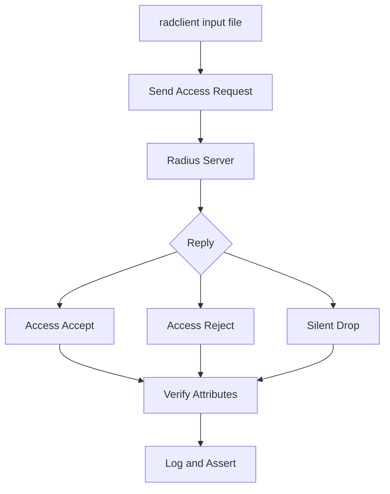

# The Challenge of Testing Authorization: radclient Scripts and Negative Cases

## English

Most RADIUS testing focuses on the happy path: does a known-good user get an Access-Accept? That is necessary but far from sufficient. The interesting failures live in the negative and edge cases — the user whose password is correct but whose account is disabled, the device presenting a valid certificate but landing in the wrong VLAN, the session that should be rejected because the simultaneous-use limit is already reached, the request missing a Message-Authenticator that should be silently dropped. A serious test suite exercises these deliberately, and the tool that makes it practical is radclient, shipped with FreeRADIUS.

radclient reads a file of attribute lines, sends them to a RADIUS server, and prints the reply. A minimal invocation looks like `radclient -x 192.0.2.10:1812 auth testing123`, where `-x` prints the full request and reply in debug form, the address is the server, `auth` selects the Access-Request code, and the last argument is the shared secret. The input file might contain `User-Name = alice`, `User-Password = correct-horse`, and crucially `Message-Authenticator = 0x00` to signal that the client should compute it. Because you control every attribute, you can construct requests that a real NAS would never send — and that is the point.

What should a negative test suite cover? First, authentication failures: wrong password, unknown user, expired account, disabled account — each should produce Access-Reject, and the log should distinguish them for the operator without leaking which one to the client. Second, authorization edge cases: a user who authenticates but whose group maps to a VLAN that does not exist on the switch; a Filter-Id that references an ACL the NAS does not have; a Tunnel-Type the NAS does not support. Third, protocol hygiene: a request with no Message-Authenticator, a request with a malformed attribute length, a request from an unknown client IP, a request with a User-Name containing unusual characters. Fourth, session logic: send two Access-Requests for the same user with the same Calling-Station-Id and confirm the simultaneous-use policy behaves as designed.

A useful pattern is to keep the test files in version control alongside the server configuration, and to run them in CI or in a pre-change checklist. Each file is a scenario with a comment explaining what it is proving. When someone edits the policy — say, changes the order of a `if` block in unlang — the test suite catches the regression. This is the RADIUS equivalent of unit tests, and it is far more valuable than a single `radtest` smoke check because it encodes intent, not just connectivity.

One caveat: radclient is a client, not a NAS, so it cannot reproduce every behaviour of real hardware. Some switches add attributes radclient will not, some enforce their own timeout and retransmission policies, and some behave differently under load. For those, a lab switch or a virtualized NAS is worth the investment. But for the vast majority of policy, attribute, and authentication logic, radclient is fast, scriptable, and precise — and it lets you prove that your server rejects what it should reject, which is the half of the specification that documentation rarely covers.

## 中文

大多數 RADIUS 測試都集中在順利路徑：一個已知正常的使用者會不會拿到 Access-Accept？這是必要條件，但遠遠不夠。真正有趣的失敗藏在負面與邊緣案例裡——密碼正確但帳戶被停用的使用者、出示有效憑證卻被分到錯誤 VLAN 的裝置、因為同時上線數已達上限而應被拒絕的 session、缺少 Message-Authenticator 而應被靜默丟棄的請求。認真的測試套件會刻意演練這些情況，而讓這件事可行的工具，是 FreeRADIUS 附帶的 radclient。

radclient 會讀取一個屬性行的檔案，把它們送到 RADIUS 伺服器，並印出回應。最小的呼叫長這樣：`radclient -x 192.0.2.10:1812 auth testing123`，其中 `-x` 以 debug 形式印出完整的請求與回應，位址是伺服器，`auth` 選擇 Access-Request 這個 code，最後一個引數是 shared secret。輸入檔可能包含 `User-Name = alice`、`User-Password = correct-horse`，以及關鍵的 `Message-Authenticator = 0x00`，用來示意 client 應自行計算它。因為你控制每一個屬性，你可以構造出真實 NAS 永遠不會送出的請求——而這正是重點。

一個負面測試套件應該涵蓋什麼？第一，認證失敗：錯誤密碼、未知使用者、過期帳戶、停用帳戶——每一個都應產生 Access-Reject，而 log 應為營運者區分它們，卻不向 client 洩漏是哪一種。第二，授權邊緣案例：認證成功但所屬群組對應到交換機上不存在的 VLAN 的使用者；引用 NAS 沒有的 ACL 的 Filter-Id；NAS 不支援的 Tunnel-Type。第三，協定衛生：沒有 Message-Authenticator 的請求、屬性長度格式錯誤的請求、來自未知 client IP 的請求、User-Name 含不尋常字元的請求。第四，session 邏輯：對同一使用者、同一 Calling-Station-Id 送出兩個 Access-Request，確認 simultaneous-use 政策的行為符合設計。

一個有用的模式，是把測試檔與伺服器設定一起放進版本控制，並在 CI 或變更前檢查清單中執行。每個檔案是一個情境，附有註解說明它在證明什麼。當有人改動政策——比如改了 unlang 裡某個 `if` 區塊的次序——測試套件就會抓到回歸。這是 RADIUS 版的單元測試，比單純一個 `radtest` 煙霧測試有價值得多，因為它編碼的是意圖，而不只是連通性。

一個注意事項：radclient 是 client，不是 NAS，所以它無法重現真實硬體的所有行為。有些交換機會加入 radclient 不會加的屬性，有些會執行自己的逾時與重傳政策，有些在高負載下行為不同。對於這些，實驗室交換機或虛擬化 NAS 值得投資。但對絕大多數政策、屬性與認證邏輯而言，radclient 快速、可指令碼化而且精確——它能讓你證明伺服器會拒絕它應該拒絕的東西，而這正是規格檔案中很少涵蓋的那一半。

## Key Takeaway

Serious RADIUS testing means scripting negative and edge cases with radclient and keeping them in version control, because the failures that matter live in what the server should reject, not what it should accept.

## Related Concepts
- radclient
- Negative testing

## Diagram

