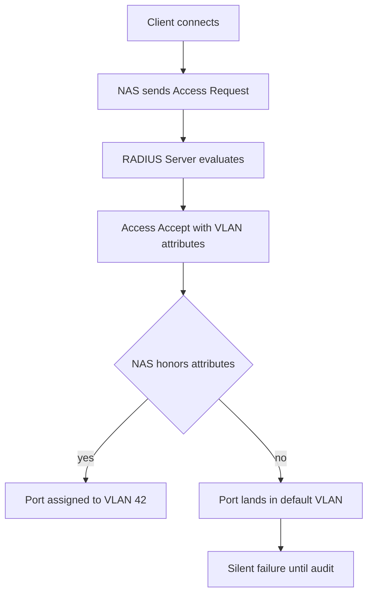

# The NAS Is the Judge, RADIUS Only Advises: Understanding the Enforcement Gap

## English

People often talk about RADIUS as if it decides who gets on the network. Strictly speaking it does not. RADIUS is a decision-support protocol: the network access server (NAS) — a switch, wireless controller, VPN concentrator, or broadband remote access server — sends an Access-Request, and the RADIUS server replies with Access-Accept, Access-Reject, or Access-Challenge. What the NAS actually does with that answer is entirely up to the NAS's own configuration and firmware. The server can say "accept" and attach a Tunnel-Type, Tunnel-Medium-Type, and Tunnel-Private-Group-Id triple that is supposed to place the user in VLAN 42 — but if the switch port is not configured to honour those attributes, or the vendor spells the values differently, the user lands in the default VLAN and nobody notices until an audit.

This gap is the single most common source of "RADIUS is broken" tickets that are not actually RADIUS problems. A useful mental model: the RADIUS server writes a prescription, but the NAS is the pharmacist who decides whether to fill it. The prescription is only as good as the formulary the pharmacist recognises. Vendor dictionaries exist precisely because different NAS vendors encode the same intent differently — one might expect Tunnel-Private-Group-Id as a decimal string, another as a hex blob, another might use a proprietary VLAN attribute entirely. The RADIUS dictionary translates between names and wire numbers, but it cannot force a device to implement a feature it never supported.

There is also a timing dimension. The NAS must apply the attributes before the port transitions to authorised state, and many NAS platforms apply only a subset of attributes at that moment — some attributes are honoured only on re-authentication, some only on session establishment. If the server sends a Filter-Id (an access control list name) and the NAS has no ACL by that name, behaviour ranges from silently ignoring it to dropping the session, depending on the vendor. The lesson: every attribute you rely on is a contract with a specific NAS model and firmware version, and that contract must be tested, not assumed.

Practically, this means your test plan must include the NAS, not just the server. Tools like radclient can prove the server returns the right attributes, but only an actual client connecting to an actual port proves the NAS enforces them. A good habit is to build a small matrix: for each NAS model in your estate, list which authorisation attributes it honours and how it behaves when an attribute is missing or malformed. When a new switch model arrives, that matrix tells you exactly what to re-test before deploying it to production.

## 中文

大家講起 RADIUS，好多時會當佢係「決定邊個可以上網」嘅角色。嚴格嚟講，佢唔係。RADIUS 係一個輔助決策嘅協定：網路存取伺服器（NAS）——即係交換機、無線控制器、VPN 集中器或者寬頻遠端存取伺服器——會送出 Access-Request，而 RADIUS 伺服器就回覆 Access-Accept、Access-Reject 或者 Access-Challenge。至於 NAS 收到答案之後實際做乜，完全取決於 NAS 自己嘅設定同韌體。伺服器可以話「批准」，同時附上 Tunnel-Type、Tunnel-Medium-Type 同 Tunnel-Private-Group-Id 三個屬性，理論上應該將使用者放入 VLAN 42——但若果交換機埠根本冇設定去理會呢啲屬性，或者廠商對數值嘅寫法唔同，使用者就會跌落預設 VLAN，而無人會發現，直到審計為止。

呢個落差，就係最常見嘅「RADIUS 壞咗」工單來源，但其實根本唔關 RADIUS 事。一個好用嘅比喻：RADIUS 伺服器負責開藥方，但 NAS 係藥劑師，決定要唔要配藥。藥方有冇效，視乎藥劑師識唔識得睇嗰隻藥。廠商字典（dictionary）存在嘅原因正正係咁——唔同 NAS 廠商對同一個意圖有唔同編碼方式：有啲預期 Tunnel-Private-Group-Id 係十進位字串，有啲預期係十六進位位元組，有啲索性用自己嘅專有 VLAN 屬性。RADIUS 字典負責將名稱同線路編號互相翻譯，但佢冇辦法逼一部從未支援某功能嘅裝置去實現嗰個功能。

仲有時序上嘅問題。NAS 必須喺埠轉為已授權狀態之前套用屬性，而好多 NAS 平臺喺嗰一刻只會套用一部分屬性——有啲屬性只會喺重新認證時生效，有啲只喺建立工作階段時生效。若果伺服器送出 Filter-Id（一個 ACL 名稱），而 NAS 根本冇嗰個名嘅 ACL，行為可以由靜靜雞忽略，到直接斷開工作階段，視乎廠商而定。教訓係：你依賴嘅每一個屬性，都係同某個特定 NAS 型號同韌體版本嘅一份合約，而呢份合約必須經過測試，唔可以假設。

實務上，即係你嘅測試計劃必須包括 NAS，唔止係伺服器。radclient 呢類工具可以證明伺服器回傳正確屬性，但只有真正嘅客戶端連上真正嘅埠，先可以證明 NAS 會執行呢啲屬性。一個好習慣係建立一個小型對照表：對你環境入面每個 NAS 型號，列出佢支援邊啲授權屬性，以及屬性缺失或者格式錯誤時佢會點做。當有新交換機型號加入，呢個表就話你知，喺推上生產環境之前，邊啲嘢必須重新測試。

## Key Takeaway

RADIUS only recommends; the NAS enforces, so every authorisation attribute is a contract with a specific device model that must be tested end to end.

## Related Concepts
- VLAN Assignment and the Authorization Decision
- RADIUS Client Configuration on the NAS: What the Switch Must Know

## Diagram

