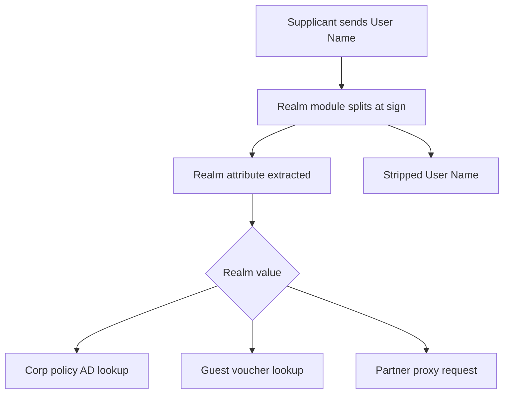

# Realm Routing: How One RADIUS Server Serves Many Organisations at Once

## English

A single RADIUS deployment often serves wildly different populations: staff on corporate laptops, students on personal devices, contractors from a partner company, guests with a one-day voucher, and IoT sensors that authenticate with a certificate. The mechanism that keeps these from colliding is the realm — the part of the User-Name after the '@' sign, borrowed from the email convention. When a supplicant sends 'alice@corp.example', the server can split the string at the '@' and use the suffix to choose which policy, which identity store, and which reply attributes apply. This is called realm routing, and it is the reason a single IP address and port can front an entire federation of user communities.

In FreeRADIUS 3.x the machinery lives in the 'realm' module and in virtual servers. The realm module rewrites the User-Name attribute — typically stripping the realm into a separate attribute (often called Realm or Stripped-User-Name) and possibly rewriting the name entirely — before the authorisation section runs. Then unlang policy can branch: if the realm equals 'corp.example', query the Active Directory pool; if it equals 'guest', look up the voucher database; if it equals 'partner.example', proxy the request to the partner's own RADIUS server over a home-server pool defined in proxy.conf. The decision is made on data, not on code, which is what makes multi-tenant operation tractable.

A subtlety that bites people: the realm is not always where you think it is. In EAP methods like PEAP and TTLS, the outer identity is often an anonymous placeholder such as 'anonymous@corp.example' while the real identity is inside the TLS tunnel. If your realm routing only looks at the outer name, every user in that organisation lands in the same policy branch — which is fine for choosing the right certificate, but useless for per-user decisions. The correct pattern is to route on the outer realm for the first phase (selecting the TLS policy and certificate), then re-evaluate the inner identity after the tunnel is established. This is why FreeRADIUS configurations often have a separate 'inner-tunnel' virtual server.

Multi-tenancy also raises the question of isolation. If two tenants share a server, a bug in one tenant's policy must not be able to read another tenant's attributes or leak accounting records. Common defences include separate virtual servers per tenant with their own dictionaries and policy files, distinct shared secrets per NAS so a compromised device cannot impersonate another tenant's switch, and careful scoping of which attributes a tenant is allowed to set in its replies. Attribute filtering on the reply path is not just hygiene — in a multi-tenant deployment it is a security boundary.

Finally, realm routing is where RADIUS meets identity federation. A realm can be a hint to proxy to an eduroam-style federation, to a cloud identity provider's RADIUS front end, or to an internal business unit's own AAA stack. The protocol does not know or care; it just carries the name and the reply. What matters operationally is that the routing table is documented, version-controlled, and tested with negative cases — an unknown realm should land in a defined default policy, not silently fall through to whatever section happens to be last.

## 中文

一個 RADIUS 部署，好多時要同時服務截然不同嘅人群：用公司手提電腦嘅員工、用私人裝置嘅學生、合作夥伴公司嘅承辦商、持一日通行證嘅訪客，以及用憑證認證嘅物聯網感測器。防止佢哋互相碰撞嘅機制就係 realm——即係 User-Name 裡面 '@' 之後嗰部分，借用咗電郵嘅慣例。當 supplicant 送出 'alice@corp.example'，伺服器可以喺 '@' 度切開個字串，用字尾去揀邊套政策、邊個身份儲存庫、邊啲回覆屬性。呢個就叫 realm routing（領域路由），亦正因為咁，一個 IP 位址同埠就可以同時面對一整個使用者社群聯盟。

喺 FreeRADIUS 3.x 裡面，呢套機制住喺 'realm' 模組同 virtual server 度。realm 模組會改寫 User-Name 屬性——通常會將 realm 拆去一個獨立屬性（好多時叫 Realm 或 Stripped-User-Name），亦可能要成個名改寫——然後先至行 authorisation 區段。之後 unlang 政策就可以分支：如果 realm 等於 'corp.example'，就查 Active Directory 連線池；如果等於 'guest'，就查通行證資料庫；如果等於 'partner.example'，就透過 proxy.conf 入面定義嘅 home-server 池，將請求代理去夥伴自己嘅 RADIUS 伺服器。決策係基於資料，唔係基於程式碼，呢點正正令多租戶運作成 feasible。

有個好易中招嘅細節：realm 唔一定喺你以為嘅位置。喺 PEAP、TTLS 呢類 EAP 方法入面，外層身份往往係一個匿名佔位符，例如 'anonymous@corp.example'，而真正身份收喺 TLS 隧道裡面。若果你嘅 realm routing 只睇外層名，該組織所有使用者都會跌落同一個政策分支——用嚟揀正確憑證係冇問題，但用嚟做逐個使用者嘅決策就冇用。正確做法係第一階段用外層 realm 去路由（揀 TLS 政策同憑證），隧道建立之後再按內層身份重新評估。呢個就係點解 FreeRADIUS 設定裡面通常有個獨立嘅 'inner-tunnel' virtual server。

多租戶亦帶出隔離問題。若果兩個租戶共用一個伺服器，其中一個租戶政策嘅漏洞，唔應該可以讀到另一個租戶嘅屬性，或者洩漏佢嘅計費記錄。常見防禦包括：每個租戶一個獨立 virtual server，各自有字典同政策檔；每個 NAS 用唔同嘅 shared secret，令一部被攻陷嘅裝置冇辦法冒充另一個租戶嘅交換機；以及小心界定每個租戶喺回覆入面可以設定邊啲屬性。回覆路徑上嘅屬性過濾唔止係衛生問題——喺多租戶部署入面，佢係一條安全邊界。

最後，realm routing 就係 RADIUS 同身份聯盟交匯嘅地方。一個 realm 可以係提示，指向 eduroam 式聯盟、雲端身份供應商嘅 RADIUS 前端，或者某個業務單位自己嘅 AAA 堆疊。協定本身唔知亦唔理；佢只係負責帶住個名同回覆。運作上最重要嘅係：路由表要有檔案、要納入版本控制、要用反面案例測試——未知嘅 realm 應該跌落一個明確定義嘅預設政策，而唔係靜靜雞滑落到碰巧排最後嘅區段。

## Key Takeaway

Realm routing turns one RADIUS server into a multi-tenant switchboard, but it only works safely when outer and inner identities are handled separately and unknown realms have an explicit default.

## Related Concepts
- Tunneling EAP: PEAP and TTLS Hide the Inner Identity Inside TLS
- RADIUS in a Multi-Tenant or Guest World: Realms, Tenants, and Delegated Administration

## Diagram

