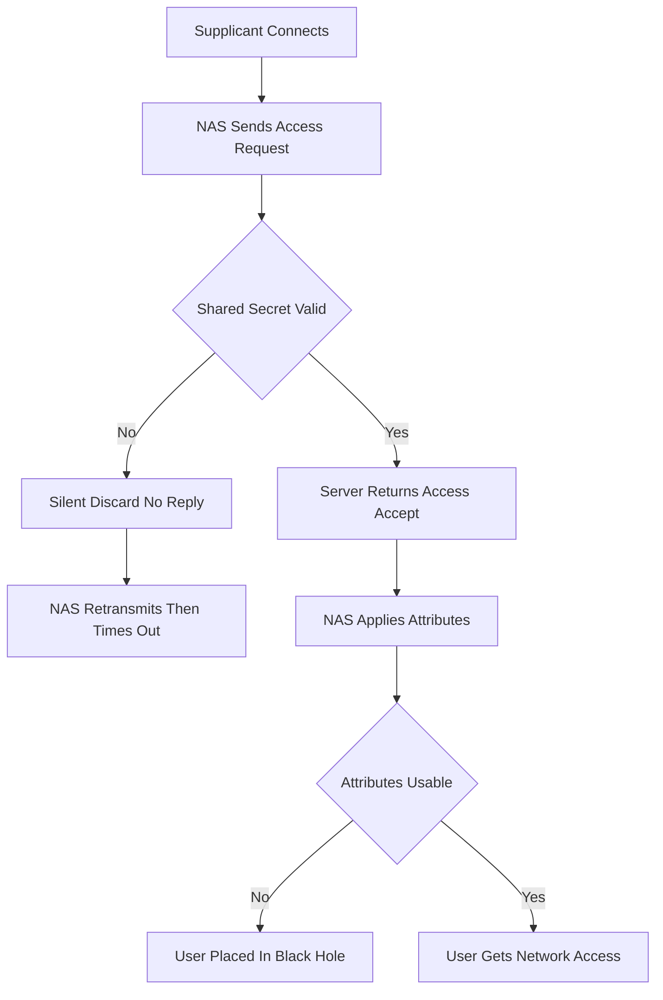

# The Silent Failure Modes: When RADIUS Says Yes but Nobody Gets In

## English

The nastiest RADIUS incidents are not the ones where the server crashes or rejects everyone — those are loud and get fixed in minutes. The nasty ones are silent: the server returns Access-Accept, the logs look healthy, and yet the user cannot reach anything. Understanding why requires knowing that RADIUS is only one hop in a chain that includes the supplicant, the NAS, the switching fabric, DHCP, DNS, and whatever policy enforcement point sits downstream. A failure anywhere in that chain looks identical from the user's seat: "the Wi-Fi is broken."

One classic silent failure is the mismatched shared secret. RADIUS validates requests using the shared secret and the Request Authenticator, and it silently discards packets whose authenticator does not verify — there is no error reply, because replying would itself be a security risk and could be used for oracle attacks. From the NAS's perspective the server simply never answers, so it retransmits, times out, and eventually marks the server dead or falls back. The symptom is a timeout, not an authentication failure, and the server log may show nothing at all because the packet never passed validation. This is why "no log entry" is itself a diagnostic clue: check the shared secret before you check anything else.

Another silent failure is the attribute that the NAS accepts but cannot use. Suppose the server returns Tunnel-Private-Group-Id with a VLAN number that does not exist on the switch, or a Filter-Id naming an ACL that was deleted last quarter. The NAS may accept the session and place the user in a black hole: associated, authenticated, but with no working path. The user sees a connection that says "connected, no internet", which is arguably worse than a clean rejection because it generates support tickets rather than a clear error. The fix is to make the server's reply self-consistent with the network's actual state — validate VLAN IDs against a known list, reference ACLs that exist, and alert when a policy references a resource that has disappeared.

A third family of silent failures lives in the certificate and time domain. If a server certificate expires at 3 a.m., EAP-TLS and PEAP handshakes fail, but depending on the supplicant the user may see a generic "cannot connect" rather than a certificate error. Similarly, clock skew between the NAS and the server can invalidate Event-Timestamp checks or cause certificate validation to fail in ways that look like bad credentials. Monitoring certificate expiry and NTP synchronisation is not glamorous, but it prevents the most embarrassing outages.

The general lesson is that RADIUS observability must extend beyond "did the server answer". Good deployments track, at minimum: request counts by result code, the rate of Access-Challenge versus Access-Accept, retransmission rates seen on the NAS, the age of the oldest unacknowledged request, and post-authentication signals such as DHCP success or first-packet-seen for the session. When those signals diverge — accepts are high but DHCP successes are low — you have found a silent failure before the help desk did. Treat the RADIUS server as one instrument in an orchestra, not the whole performance.

## 中文

最難搞嘅 RADIUS 事故，唔係伺服器宕機或者全部拒絕——嗰啲好響，幾分鐘就搞掂。最難搞嘅係靜默失敗：伺服器回 Access-Accept，日誌睇落健康，但使用者乜都去唔到。要理解點解，就要知道 RADIUS 只係一條鏈入面嘅其中一環，條鏈包括 supplicant、NAS、交換網路、DHCP、DNS，以及下游嘅政策執行點。鏈中任何一處出事，喺使用者角度睇都一模一樣：「Wi-Fi 壞咗」。

一個經典嘅靜默失敗係 shared secret 唔匹配。RADIUS 用 shared secret 同 Request Authenticator 去驗證請求，驗證唔過嘅封包會被靜靜丟棄——唔會有錯誤回覆，因為回覆本身就有安全風險，可能被用嚟做 oracle 攻擊。喺 NAS 角度，伺服器只係一直唔覆，於是佢重傳、逾時，最後將伺服器標記為 dead 或者切換去備援。症狀係逾時，唔係認證失敗，而伺服器日誌可能乜都冇，因為個封包根本未過驗證。所以「日誌冇記錄」本身就係一條診斷線索：檢查 shared secret 先，再查其他嘢。

另一種靜默失敗，係 NAS 收咗個屬性但用唔到。假設伺服器回傳 Tunnel-Private-Group-Id，但個 VLAN 號喺交換機上根本唔存在；或者 Filter-Id 指向一個上一季已經刪咗嘅 ACL。NAS 可能照樣接受工作階段，將使用者放入黑洞：已關聯、已認證，但冇任何可用路徑。使用者見到「已連線，但沒有網際網路」，老實講比乾淨嘅拒絕更差，因為佢會產生工單，而唔係清晰嘅錯誤。解決方法係令伺服器嘅回覆同網路實際狀態保持一致——用已知清單驗證 VLAN ID、只引用存在嘅 ACL、當政策引用咗已消失嘅資源時發出告警。

第三類靜默失敗住喺憑證同時間領域。若果伺服器憑證喺凌晨三點過期，EAP-TLS 同 PEAP 握手會失敗，但視乎 supplicant，使用者可能只見到籠統嘅「無法連線」，而唔係憑證錯誤。同樣，NAS 同伺服器之間嘅時鐘偏差，可以令 Event-Timestamp 檢查失效，或者令憑證驗證以好似「密碼錯」嘅方式失敗。監控憑證到期同 NTP 同步唔算好型，但佢可以避免最尷尬嘅故障。

整體教訓係：RADIUS 嘅可觀測性必須超出「伺服器有冇回應」。好嘅部署至少會追蹤：按結果碼分類嘅請求數量、Access-Challenge 對 Access-Accept 嘅比率、NAS 見到嘅重傳率、最舊未確認請求嘅年齡，以及認證後嘅訊號，例如 DHCP 成功或者工作階段首個封包出現。當呢啲訊號出現分歧——接受率高但 DHCP 成功率低——你就喺客服發現之前捉到一個靜默失敗。要將 RADIUS 伺服器當成樂團入面一件樂器，而唔係整場表演。

## Key Takeaway

Most RADIUS outages are silent mismatches between what the server says and what the rest of the network can actually deliver, so monitor the whole chain, not just the reply code.

## Related Concepts
- When RADIUS Is Down: Fail-Open, Fail-Closed, and the Critical Unreachable Policy
- Reading a RADIUS Log: Turning Debug Output into a Diagnosis

## Diagram

