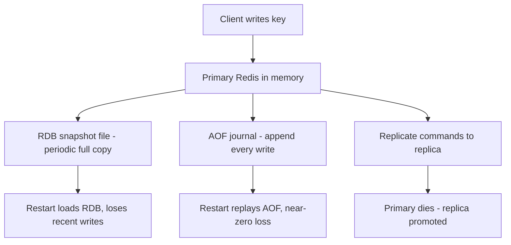

# Persistence: RDB Snapshots vs AOF, and Replication

### English

Redis keeps everything in memory, which is what makes it fast — but memory disappears when the process stops. **Persistence** is the mechanism that writes data to disk so a restart does not lose it. There are two main approaches, and they trade durability against speed.

**RDB** is a point-in-time snapshot. Redis periodically serialises the entire dataset into a single compact binary file, then atomically replaces the previous one. Because it is one sequential write, an RDB file is fast to create and to load, and it produces compact files. The cost is the gap: any write that happened since the last snapshot is lost on a crash. Redis therefore also writes the snapshot when it receives a shutdown command, and you can configure how often it happens (for example every 60 seconds and after N key changes).

**AOF** (Append-Only File) works like a journal. Every write command is appended to a file, and on restart Redis replays the log to rebuild the dataset. The write is typically done every second (`appendfsync everysec`), which is a reasonable middle ground between losing a second of writes and paying for a synchronous disk flush on every command. If you need zero data loss, `appendfsync always` gives that at a significant throughput cost.

**Replication** is a different axis of protection: it is about surviving a *machine* failure rather than a process crash. A replica is a second Redis instance that keeps a copy of the primary's data. Replicas connect to the primary and receive a stream of the same commands (or a full resync followed by that stream). If the primary dies, one replica can be promoted to primary with `REPLICAOF NO ONE`. Note that replication is normally **asynchronous**: the primary acknowledges a write before the replica has it, so a failover can lose the last few milliseconds of writes unless you enable `min-replicas-to-write` with `min-replicas-max-lag`.

The practical design is usually to combine them: RDB for fast bulk recovery and backups, AOF for tighter durability, and at least one replica for machine-level resilience.

### 中文

Redis 把所有資料放在記憶體內，這是它快的關鍵 —— 但記憶體在行程結束就會消失。**持久化**（persistence）就是將資料寫到磁碟的機制，令重啟時不會遺失。主流做法有兩種，取捨在持久性與速度之間。

**RDB** 是某一時間點的快照（snapshot）。Redis 定期把整個資料集序列化為單一精簡的二元檔案，再原子性地（atomic）替換舊檔。因為是一次連續寫入，RDB 檔案建立快、載入快，而且檔案體積細小。代價是那個空隙期：自上次快照之後的寫入，一遇上崩潰就會遺失。因此 Redis 在收到關機指令時亦會寫入快照，亦可設定快照頻率（例如每 60 秒，或累積 N 次變更後）。

**AOF**（Append-Only File，附加檔案）則像一本流水帳。每一次寫入指令都會被追加到檔案，重啟時 Redis 重播整份記錄以重建資料集。寫入通常每秒一次（`appendfsync everysec`），是「遺失一秒寫入」與「每條指令都同步落盤拖慢吞吐」之間的折衷。若要零資料遺失，`appendfsync always` 可以做到，但代價顯著。

**複製**（replication）是另一個保護維度：它應付的是「機器」故障，而非「行程」崩潰。Replica 是另一個 Redis 實例，保存著 primary 的資料副本。Replica 連上 primary 後，接收相同的指令串流（或先做一次完整同步，之後再接收指令串流）。若 primary 掛掉，可以用 `REPLICAOF NO ONE` 把其中一個 replica 提升為 primary。要留意複製通常是**非同步**的：primary 在 replica 收到之前就已確認寫入，因此故障切換可能遺失最後幾毫秒的寫入，除非你設定 `min-replicas-to-write` 配合 `min-replicas-max-lag`。

實務上的設計通常會組合三者：RDB 負責快速大量復原與備份，AOF 負責較嚴密的持久性，而至少一個 replica 應付機器層級的韌性。

## Key Takeaway
RDB snapshots are fast and compact but lossy between snapshots, AOF journals every write for tighter durability, and replication protects against machine failure rather than process crashes.

## Related Concepts
- RDB Snapshot
- Append-Only File
- Replication and Failover

## Diagram

