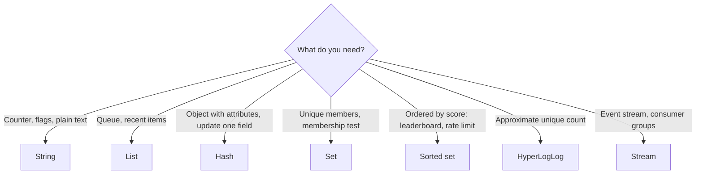

# Redis Data Structures and What Each One Is For

### English

Redis is more than a key-value store: each key can hold a different *data structure*, and choosing the right one removes a lot of hand-written code. The core structures each solve a specific problem.

**Strings** hold text or binary values up to about 512 MB. Beyond plain storage, Redis lets you use them as counters (`INCRBY`), as bitmaps, and as simple caches.

**Lists** are ordered, doubly linked collections where you can push and pop from both ends. They are the natural fit for queues (push at the tail, pop at the head) and recent-activity feeds, because `LPUSH` + `LPOP` is O(1). The classic use is a job queue: workers `BRPOP` (blocking pop) so they sleep until work arrives instead of polling.

**Hashes** map field names to values inside a single key. Use one when objects have a handful of attributes and you often need to read or update a single field — `HSET user:42 name "..."` updates just that attribute, whereas storing the whole object as a JSON string means reading and rewriting the entire document. Hashes also have a field-expiry feature in recent versions.

**Sets** are unordered collections of unique members, with fast membership tests (`SISMEMBER`) and set algebra (intersection, union, difference). Perfect for tags, unique visitors, and follow relationships.

**Sorted sets** (ZSET) are sets where every member carries a numeric score, and the set is kept ordered by score. That single feature powers leaderboards (`ZREVRANGE`), rate limiters (score = expiry timestamp), and priority queues.

Two newer structures round it out: **Hashes with field expiry** and **streams**. Also worth knowing are **HyperLogLog** for approximate cardinality counting (counting unique users in a million-event stream using a few kilobytes) and **Bitmaps** for tracking booleans per day or per user. The practical rule: pick the structure whose operations match your access pattern, because every structure has different time complexities and memory overheads.

### 中文

Redis 不只是簡單的 key-value store：每個 key 都可以存放不同的「資料結構」，選對結構可以省下大量自己動手寫的程式碼。以下是幾種核心結構與它們各自解決的問題。

**String**（字串）可存放文字或二進位值，上限約 512 MB。除了純粹儲存，Redis 還可把它們當計數器（`INCRBY`）、點陣圖（bitmap），或者簡單的快取使用。

**List**（列表）是具序的雙向連結集合，可在頭尾兩端推入與彈出。它天然適合佇列（隊尾推入、隊頭彈出）與近期動態摘要，因為 `LPUSH` + `LPOP` 是 O(1)。經典用途是工作佇列：worker 用 `BRPOP`（阻塞式彈出）在工作到達前休眠，不用反覆輪詢。

**Hash**（雜湊）在一個 key 內把欄位名對應到值。當物件只有少量屬性、而你又經常需要讀取或更新單一欄位時，就用它 —— `HSET user:42 name "..."` 只更新該欄位；若把整個物件存成 JSON 字串，則要讀出再整份寫回。新版本的 Redis 亦為 Hash 加入欄位過期功能。

**Set**（集合）是無序、不重複成員的集合，Membership 測試（`SISMEMBER`）極快，也支援交集、聯集、差集等集合運算。非常適合標籤、獨立訪客數、追蹤關係。

**Sorted set**（有序集合）則是每個成員帶一個數值分數，並按分數保持排序。單憑這個特性就能實現排行榜（`ZREVRANGE`）、速率限制器（分數 = 到期時間）與優先隊列。

較新的結構補上了其餘需求：**支援欄位過期的 Hash** 與 **Stream**（資料流）。另外也值得認識 **HyperLogLog**（以幾 KB 記憶體近似估算基數，例如計算百萬事件串流中的獨立用戶數）以及 **Bitmap**（用來按日或按用戶追蹤布林狀態）。實用準則是：選擇操作模式與存取方式相符的結構，因為每種結構的時間複雜度與記憶體開銷都不同。

## Key Takeaway
Each Redis structure encodes a different access pattern — pick lists for queues, hashes for partial updates, sets for membership, and sorted sets for anything ordered by score.

## Related Concepts
- Redis Data Structures
- Sorted Sets
- HyperLogLog and Bitmaps

## Diagram

