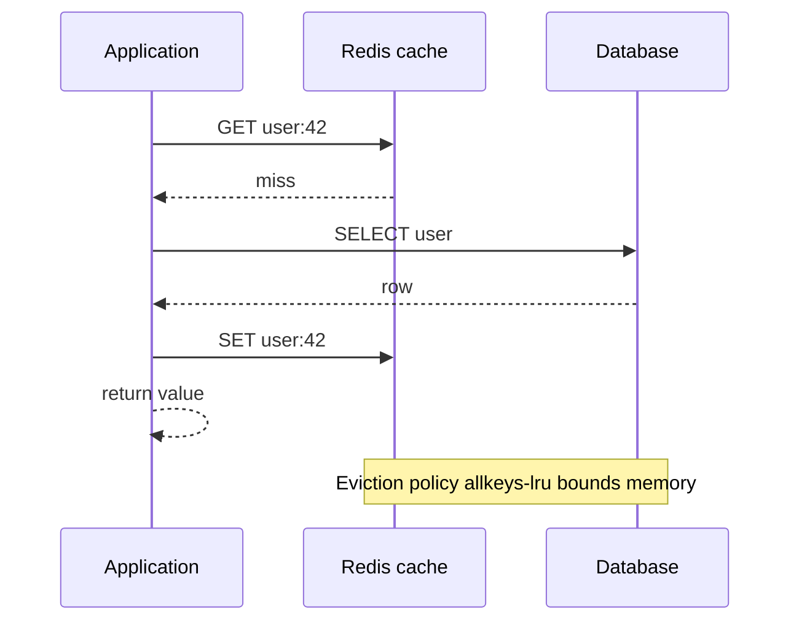

# Cache Patterns, Eviction Policies, Pub/Sub and Rate Limiting

### English

**Caching** means keeping a copy of data somewhere faster than the original. The two classic patterns differ in who updates the cache. In **cache-aside**, the application reads from cache first; on a miss it loads from the database, writes into the cache, and returns the value. The cache is only ever touched by the application, and the database is never told the cache exists. This is the most common pattern because it is simple and resilient: if the cache dies, the application just falls back to the database. In **write-through**, the application writes to the cache and the cache is responsible for writing through to the database, so the two never diverge — but every write now goes through the cache and the cache must be reliable.

Whatever the pattern, the cache only works if it is bounded. When memory fills up, Redis **evicts** keys according to a policy. `maxmemory-policy allkeys-lru` evicts the least recently used key across all keys; `volatile-lru` only evicts keys that have a TTL set; `allkeys-lfu` evicts the least frequently used, and `volatile-ttl` evicts whichever key expires soonest. In practice `allkeys-lru` is a safe default for a pure cache, while a mixed workload usually wants `volatile-lru` so that persistent keys are never evicted.

**Pub/Sub** is Redis's messaging primitive: publishers send messages to a channel and subscribers receive them. It is fire-and-forget — if a subscriber is offline, the message is gone, and there is no history. **Streams** are the durable alternative: messages are appended to a stream with an incrementing ID, consumers read by ID, and consumer groups track delivery so another consumer can pick up unacknowledged messages. Streams give you replay and at-least-once delivery; pub/sub gives you simplicity.

**Rate limiting** with Redis uses a sorted set: each request adds an entry whose score is the expiry timestamp, and a Lua script atomically removes expired entries, counts what remains, and rejects the request if the count exceeds the limit. Sorted sets are a good fit because they score-ordered and can be trimmed from the tail. A token-bucket variant using a hash of counters plus expiry is also common.

### 中文

**快取**（caching）就是把資料複製一份放在比原來更快的地方。兩種經典模式的分別在於「由誰更新快取」。在 **cache-aside** 模式中，應用程式先讀快取；未命中就從資料庫載入、寫回快取，再把值返回。快取只由應用程式接觸，資料庫完全不知道快取的存在。這是最常用的模式，因為簡單而且有韌性 —— 快取掛掉時，應用程式只是退回資料庫而已。在 **write-through** 模式中，應用程式只寫快取，由快取負責同步寫入資料庫，兩邊永不分歧 —— 但每次寫入都要經過快取，快取本身必須可靠。

無論採用哪種模式，快取要運作就必須有上限。當記憶體用盡，Redis 會依政策**淘汰**（evict）key。`maxmemory-policy allkeys-lru` 會在所有 key 中淘汰最久未使用的那個；`volatile-lru` 只淘汰設有 TTL 的 key；`allkeys-lfu` 淘汰使用頻率最低者；`volatile-ttl` 則淘汰最快到期的 key。實務上，純快取用途以 `allkeys-lru` 作為安全預設；混合用途則通常選 `volatile-lru`，確保持久性 key 不會被淘汰。

**Pub/Sub** 是 Redis 的訊息機制：發布者把訊息送到頻道（channel），訂閱者接收。它是「射後不理」—— 訂閱者離線，訊息就沒了，也沒有歷史記錄。**Stream**（資料流）是持久化的另一個選擇：訊息附加到帶遞增 ID 的 stream，消費者按 ID 讀取，而 consumer group 會追蹤投遞狀態，讓其他消費者接手未被確認的訊息。Stream 提供重播與至少一次投遞；pub/sub 則提供簡潔。

用 Redis 做**速率限制**（rate limiting）通常使用有序集合：每次請求加入一筆以到期時間為分數的項目，再由一段 Lua 腳本原子地移除過期項目、統計剩餘數量，若超過上限就拒絕。有序集合很適合，因為它按分數排序，可以從尾部裁剪。另一種常見做法是使用計數器加上到期時間的雜湊，實作 token bucket（令牌桶）。

## Key Takeaway
Cache-aside plus an LRU eviction policy gives a fast and bounded cache, while sorted sets, streams, and atomic Lua scripts cover rate limiting and durable messaging.

## Related Concepts
- Cache-Aside Pattern
- Eviction Policies
- Pub/Sub vs Streams
- Rate Limiting with Sorted Sets

## Diagram

