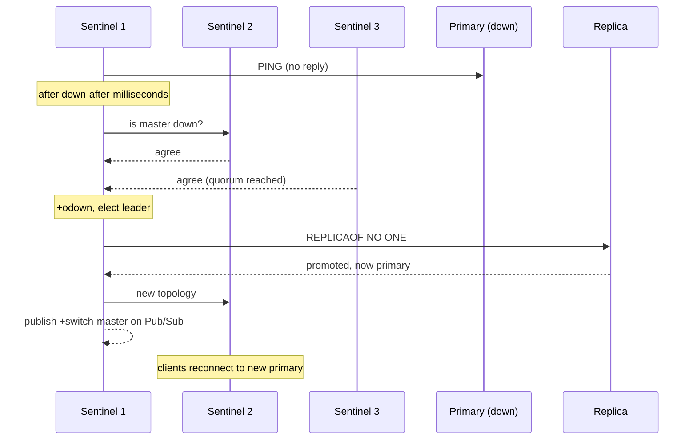

# Redis Sentinel: Automatic Failover for a Single Primary

### English

Replication (a primary plus replicas) gives you a **copy**, but not **availability**: if the primary machine dies, replicas keep replicating from a dead master and stop accepting writes. **Redis Sentinel** is the process that closes this gap. Sentinel is a separate lightweight daemon that watches a master and its replicas, and when the master disappears for long enough, it promotes one of the replicas to be the new primary and rewrites the topology so every other replica follows it.

A Sentinel deployment has three roles: the **primary** (which accepts writes), one or more **replicas** (read replicas and failover candidates), and **three or more Sentinel processes** (the monitors). Three is the practical minimum, because Sentinel needs a majority to make decisions. With two Sentinels, losing one leaves a single Sentinel that cannot reach a majority, so failover cannot happen — the failure mode is exactly when you need it most.

The detection logic has two stages. Each Sentinel pings the primary every second. If it gets no reply for `down-after-milliseconds` (default 30000 ms), it marks the primary **subjectively down** (`+sdown`). It then asks the other Sentinels whether they agree. When a **quorum** of them says yes, the primary is marked **objectively down** (`+odown`) and the failover procedure begins. The quorum is the number written in the `sentinel monitor` line; with three Sentinels and quorum 2, one failing Sentinel is tolerated.

Failover itself has a fixed sequence: the Sentinels elect a **leader** among themselves (one Sentinel performs the work so there is no split brain), the leader picks the healthiest replica (lowest `replica-priority`, then the largest replication offset, then run ID as a tiebreaker), sends it `REPLICAOF NO ONE` to promote it, and then points the remaining replicas at the new primary. Finally each Sentinel persists the new topology and publishes a `+switch-master` event on Pub/Sub so that clients can learn the new primary address.

A minimal configuration looks like this:

```
port 26379
sentinel monitor mymaster 10.0.0.11 6379 2
sentinel down-after-milliseconds mymaster 5000
sentinel failover-timeout mymaster 60000
sentinel parallel-syncs mymaster 1
sentinel auth-pass mymaster "strong-password"
```

Two tunables dominate the behaviour. `down-after-milliseconds` sets the detection latency but also the false-positive risk: too low and a momentary network hiccup triggers a failover, which is disruptive because clients reconnect and the old primary is demoted. `failover-timeout` caps the whole procedure. A useful rule of thumb for a stable data-centre network is 5000 ms for detection and 60000 ms for the timeout, giving a sub-10-second recovery in the common case.

The critical client-side detail: a Sentinel-aware client subscribes to `+switch-master` (or polls `SENTINEL get-master-addr-by-name mymaster`) and reconnects to the new primary. If your application hard-codes `localhost:6379` and does not use a Sentinel-aware client library, Sentinel buys you nothing — the failover happens, but your application keeps talking to a demoted replica and will see `READONLY You can't write against a read only replica`. Also remember that Sentinel protects against node failure, not against data loss: asynchronous replication can lose the last few milliseconds of writes, and Sentinel does not shard your data. For sharding you need Cluster, and for both at once you need a managed deployment.

### 中文

複製（primary 加 replica）提供嘅係一份**副本**，但唔係**可用性**：如果 primary 所在機器死咗，replica 會繼續嘗試从一个已經死咗嘅 master 同步，並且唔會再接受寫入。**Redis Sentinel** 正係填補呢個缺口。Sentinel 係一個獨立、輕量嘅常駐程序，負責監察 master 同 replica；一旦 master 消失夠耐，佢就會將其中一個 replica 提升做新 master，並且重寫拓撲，令其餘 replica 轉而跟隨新 master。

一套 Sentinel 部署有三重角色：**primary**（接受寫入）、一個或多個 **replica**（讀副本兼故障轉移候選），以及**三個或以上 Sentinel 程序**（監察者）。三個係實務上嘅最低要求，因為 Sentinel 需要大多數（majority）才能做決定。得兩個 Sentinel 嘅話，掛咗一個就剩低一個獨木橋，無法達到大半，failover 根本唔會發生 —— 即係最需要 failover 嘅時刻偏偏失效。

偵測過程分兩階段。每個 Sentinel 每秒向 primary 發 ping。如果連續 `down-after-milliseconds`（預設 30000 毫秒）都收唔到回覆，就會將 primary 標記為**主觀下線**（`+sdown`），然後問其他 Sentinel 意見。當達到 **quorum**（法定人數）數量嘅 Sentinel 一致同意，primary 就被標記為**客觀下線**（`+odown`），failover 開始。quorum 就係 `sentinel monitor` 那一行最後個數字；三個 Sentinel 配 quorum 2 意味住可以承受一個 Sentinel 故障。

Failover 本身有固定次序：Sentinel 之間先**選出一個 leader**（由一個 Sentinel 執行，避免 split brain 腦裂），leader 再揀最健康嘅 replica（`replica-priority` 最低、其次複製位點 offset 最大、再以 run ID 打破平手），向佢發送 `REPLICAOF NO ONE` 完成升級，然後將其餘 replica 指向新 master。最後每個 Sentinel 都會把新拓撲寫入磁碟，並且在 Pub/Sub 發佈 `+switch-master` 事件畀客戶端。

最簡設定如下：

```
port 26379
sentinel monitor mymaster 10.0.0.11 6379 2
sentinel down-after-milliseconds mymaster 5000
sentinel failover-timeout mymaster 60000
sentinel parallel-syncs mymaster 1
sentinel auth-pass mymaster "strong-password"
```

當中有兩個參數主導表現。`down-after-milliseconds` 決定偵測延遲，同時亦決定誤判風險 —— 調得太低，網絡抖一抖就觸發 failover，後果係客戶端要重連、舊 master 被降級，非常扰民。`failover-timeout` 則限制整個流程上限。數據中心內網絡穩定嘅話，常見做法係偵測 5000 毫秒、超時 60000 毫秒，通常情況下十秒內可以復原。

客戶端方面最關鍵嘅一點：支援 Sentinel 嘅 client 會訂閱 `+switch-master`（或者輪詢 `SENTINEL get-master-addr-by-name mymaster`）並連去新 master。如果應用寫死 `localhost:6379` 又唔用 Sentinel-aware client library，Sentinel 等於白設 —— failover 發生咗，但應用仲係連住一個已降級嘅 replica，會收到 `READONLY You can't write against a read only replica` 嘅錯誤。另外要記住 Sentinel 解決嘅係節點故障，唔係資料遺失：異步複製可能會損失最後幾毫秒嘅寫入；而 Sentinel 亦唔會幫你分片，要分片就得用 Cluster，兩者兼備就要靠託管方案。

## Key Takeaway
Sentinel adds automatic failover on top of replication by having a quorum of monitor processes elect one replica as the new primary — but the client must be Sentinel-aware for that to be useful.

## Related Concepts
- Quorum and Majority Voting
- Subjective vs Objective Down
- Primary-Replica Promotion
- Sentinel-Aware Clients

## Diagram

