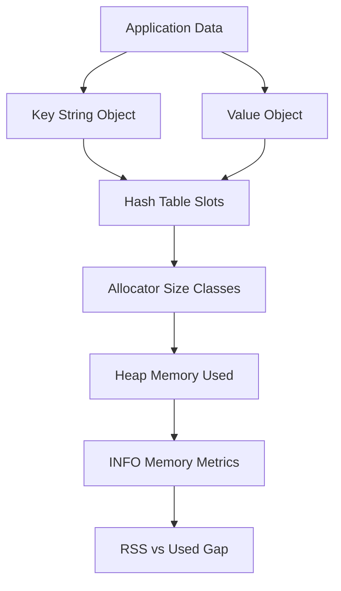

# Memory Overhead: Why a 100 MB Dataset Can Eat 200 MB of RAM

## English

When people say Redis stores data in RAM, it is tempting to imagine a raw byte blob of exactly the size of your values. In practice every key Redis stores is wrapped in a heap-allocated object with bookkeeping fields, and the overhead is substantial. Each key is a dynamically allocated string with its own header, each value is an object tagged with a type and an encoding, and the dictionary that maps keys to values is a hash table whose buckets must stay sparse enough to keep lookups fast. The result is that a tiny key like "user:1" with a short string value can consume well over a hundred bytes once you count the object headers, allocator rounding, and hash-table slot.

The classic demonstration is that storing millions of very small keys is far more expensive than storing the same total bytes in a handful of larger structures. A million keys each holding a few bytes might occupy on the order of a hundred megabytes, whereas the same payload packed into hashes or lists could take a fraction of that. This is why the Redis documentation recommends structuring small related items inside a hash or a sorted set instead of creating one key per tiny item — the per-key overhead dominates the payload.

Allocator behaviour matters too. Redis typically uses jemalloc, which rounds allocations up to size classes, so a request for 40 bytes may actually reserve 48 or 56. Over millions of objects those rounded-up fragments add up. Fragmentation can also occur when keys are deleted: the allocator may hold onto freed pages rather than returning them to the operating system, so the reported memory usage stays high even though the logical data has shrunk. The INFO memory command exposes metrics like used_memory and used_memory_rss that let you see the gap between what Redis thinks it is using and what the operating system has actually handed out.

Encodings are the main lever for reducing overhead. Redis stores small hashes, lists, sets, and sorted sets in compact, contiguous encodings (historically called ziplist or listpack) rather than full hash tables, as long as they stay under configurable thresholds. A hash with a few dozen short fields is stored as one small packed block instead of a hash table with per-field overhead. Exceeding the threshold silently converts the object to the general-purpose encoding, and memory use can jump sharply — a common surprise when a collection grows past a limit.

So capacity planning for Redis should not be based on the size of your values alone. Budget for per-key overhead, allocator rounding, fragmentation, and the cost of internal data structures such as the expiry dictionary and replication backlog. Measure with real data shapes rather than estimating from raw byte counts, and prefer fewer, well-structured keys over millions of tiny ones.

## 中文

當人們說 Redis 把數據存在記憶體（RAM）裡，很容易想像成一個與你數值大小完全相同的原始位元組區塊。但實際上，Redis 儲存的每一個鍵都被包在一個堆上分配的物件裡，附帶各種記錄用的欄位，這些額外開銷相當可觀。每個鍵都是一條獨立分配的動態字串，有自己的標頭；每個值都是一個帶有類型與編碼標記的物件；而把鍵對應到值的字典本身是一個雜湊表，其桶（bucket）必須保持足夠稀疏，才能讓查詢維持快速。結果是，像「user:1」這種小小的鍵配上一個短字串值，一旦把物件標頭、分配器取整和雜湊表槽位都算進去，可能就佔用超過一百個位元組。

最經典的示範是：儲存幾百萬個極小的鍵，遠比把同樣的總位元組數放進少數幾個較大的結構裡昂貴得多。一百萬個各只裝幾個位元組的鍵，可能佔用上百 MB；而同樣的內容打包進雜湊或列表，可能只佔其中一小部分。這正是為何 Redis 官方文件建議把相關的小項目放進同一個雜湊或有序集合，而不是每個小項目都開一個鍵——因為每個鍵的固定開銷會壓過實際內容本身。

分配器的行為也很重要。Redis 通常使用 jemalloc，它會把分配請求向上取整到某個大小等級，所以請求 40 位元組實際上可能保留 48 或 56 位元組。在幾百萬個物件上，這些向上取整的碎片就會累積起來。當鍵被刪除時也可能產生碎片：分配器可能保留已釋放的頁面而不還給作業系統，於是即使邏輯上的數據已經變少，回報的記憶體用量仍然偏高。INFO memory 指令會提供 used_memory 和 used_memory_rss 等指標，讓你能看出 Redis 自認為用了多少、與作業系統實際發出去多少之間的落差。

編碼是降低開銷的主要槓桿。只要小型的雜湊、列表、集合和有序集合維持在可設定的門檻以下，Redis 會用緊湊、連續的編碼（歷史上叫 ziplist，後來叫 listpack）來儲存，而不是用完整的雜湊表。一個只有幾十個短欄位的雜湊，會被存成一整塊緊湊資料，而不是一個每個欄位都有額外開銷的雜湊表。一旦超過門檻，物件就會默默轉換成通用編碼，記憶體用量可能突然跳升——這是集合長過某個上限時常見的意外。

所以，為 Redis 做容量規劃時，不該只根據你數值的原始大小。要把每個鍵的額外開銷、分配器取整、碎片，以及過期字典和複製積壓緩衝（replication backlog）等內部結構的成本都算進去。用真實的數據形狀去實測，而不是從原始位元組數去估算；並且寧可少一些、結構良好的鍵，也不要幾百萬個微小的鍵。

## Key Takeaway

Redis memory cost is dominated by per-key object overhead, allocator rounding, and encoding choices, not by the raw size of your values.

## Related Concepts
- jemalloc memory allocator
- Redis compact listpack encoding

## Diagram

