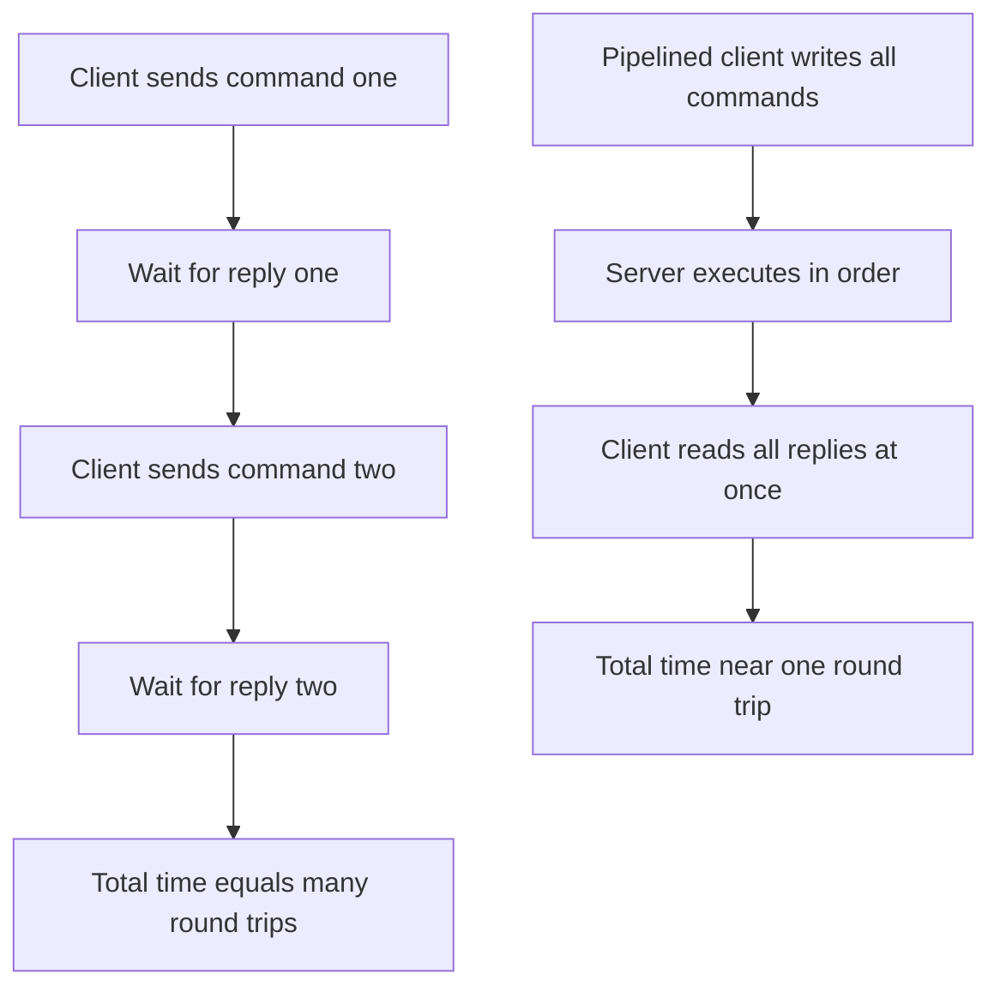

# Pipelining: Cutting Round-Trip Latency by Batching Commands

## English

Every command you send to Redis over a network connection involves a round trip: the client writes bytes, the server reads and executes, then writes a reply that the client must read before sending the next command. On a localhost connection a round trip might cost tens of microseconds; across a data centre it might be a fraction of a millisecond. Redis itself can execute hundreds of thousands of simple commands per second on a single thread, so the limiting factor is often not the server's compute but the network latency multiplied by the number of round trips. If your application issues a thousand sequential GETs, you pay a thousand round trips even though the server finishes each one almost instantly.

Pipelining is the fix. Instead of waiting for each reply before sending the next command, the client writes many commands back to back without blocking, then reads all the replies at the end. The server processes them in order and streams the responses. Because the client is not idle waiting for each round trip, the total time collapses toward the cost of a single round trip plus the server's execution time for the whole batch. This is not a Redis-specific feature — it is a property of request/response protocols over a stream — but Redis clients expose it explicitly because it is so valuable.

Importantly, pipelining is not the same as a transaction. Commands sent in a pipeline are executed one after another, but other clients' commands can be interleaved between them; there is no atomicity guarantee. If you need all-or-nothing semantics, you combine pipelining with MULTI/EXEC or use a Lua script. Pipelining also does not reduce the server's work — it only removes idle waiting time. And there are practical limits: batching tens of thousands of commands into one pipeline can build up large buffers on both client and server, consuming memory and delaying the point at which you see the first reply.

A useful mental model is a checkout queue at a shop. Without pipelining, each customer walks to the counter, pays, waits for the receipt, then the next customer steps up — the cashier sits idle between customers. With pipelining, the whole queue hands over their items at once, the cashier rings them all up, and receipts are handed back together. The cashier's speed did not change, but the total time dropped dramatically because the waiting was eliminated.

In practice, most client libraries let you enable automatic pipelining or explicitly queue commands and flush them in batches. The sweet spot is usually somewhere between a few dozen and a few hundred commands per batch, depending on payload size and latency. Measure with realistic command mixes, and remember that pipelining only helps when the client has many commands to send at once; for a single command it changes nothing.

## 中文

每一條經網絡連線送到 Redis 的指令，都牽涉一次往返（round trip）：客戶端寫出位元組，伺服器讀取並執行，然後寫回一個回覆，客戶端必須讀到這個回覆才能送出下一條指令。在本機連線上，一次往返可能只要幾十微秒；跨資料中心則可能是零點幾毫秒。Redis 本身在單執行緒上每秒能執行幾十萬條簡單指令，所以瓶頸往往不是伺服器的運算，而是網絡延遲乘以往返次數。如果你的應用程式依序發出上千條 GET，你就要付上千次往返，即使伺服器幾乎是瞬間完成每一條。

管線化（pipelining）就是解法。客戶端不是每送一條就等回覆，而是一次把許多指令連續寫出去、不阻塞，最後才一次讀回所有回覆。伺服器會依序處理並把回應串流回來。因為客戶端不再閒著等每一次往返，總時間就壓縮到接近「一次往返」加上伺服器執行整批指令的時間。這不是 Redis 獨有的功能——它是串流上請求／回應協定的通性——但 Redis 客戶端會明確提供這項能力，因為它太有價值了。

要緊的是，管線化不等於交易。管線中送出的指令會一條接一條執行，但其他客戶端的指令可以穿插其中，並沒有原子性保證。如果你需要全有或全無的語意，就要把管線化與 MULTI/EXEC 結合，或改用 Lua 腳本。管線化也不會減少伺服器的工作量——它只是消除了閒置等待的時間。而且有實際上限：把幾萬條指令塞進同一條管線，會在客戶端與伺服器兩邊累積大量緩衝，耗用記憶體，並延後你看到第一個回覆的時間。

一個好用的心智模型是商店的結帳隊伍。沒有管線化時，每位顧客走到櫃檯、付款、等收據，下一位才上前——收銀員在顧客之間閒著。有了管線化，整條隊伍一次把商品交上去，收銀員一次全部結帳，收據一起交回。收銀員的速度沒變，但因為等待被消除了，總時間大幅下降。

實務上，多數客戶端函式庫讓你啟用自動管線化，或明確地把指令排隊再一次沖出。最佳批量通常落在每批幾十到幾百條之間，取決於負載大小與延遲。要用真實的指令組合去量測，並記住：管線化只在客戶端一次有很多指令要送時才有幫助；對單一條指令而言，它什麼都沒改變。

## Key Takeaway

Pipelining removes idle round-trip waiting by sending many commands before reading replies, but it provides no atomicity and does not make the server itself faster.

## Related Concepts
- network round-trip latency
- Redis MULTI/EXEC transactions

## Diagram

