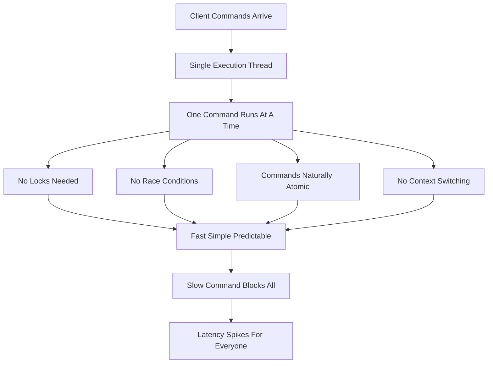

# Single-Threaded Execution: Why One Core Is Both a Feature and a Trap

## English

Redis famously executes commands on a single thread. That sounds like a limitation, but it is the source of much of its simplicity and speed. Because only one command runs at a time, no locks are needed around the data structures, there are no race conditions between commands, and each command is naturally atomic from the perspective of other clients. A GET or an INCR either sees the state before or after another command, never in the middle. This is why operations like INCR, LPUSH, and SADD are safe without any explicit synchronisation, and why MULTI/EXEC and Lua scripts can build larger atomic units on top.

The single thread also explains the performance profile. There is no thread scheduling overhead, no context switching between worker threads, and no cache-line contention from multiple cores fighting over the same data. All the data fits in one CPU's cache hierarchy, so memory access is fast and predictable. For workloads dominated by small in-memory operations, this often beats a multithreaded design that spends its time on locking. Modern Redis versions do use extra threads for some tasks — notably network I/O and some background operations — but command execution against the keyspace remains single-threaded.

The trap is that one slow command blocks everything. Because commands run one at a time, a command that takes 50 milliseconds stalls every other client for those 50 milliseconds. This is why the KEYS command, which scans the entire keyspace, is dangerous in production and why the documentation recommends SCAN, which iterates incrementally. Similarly, operations against very large collections — deleting a huge sorted set, running a range query over millions of elements, or an expensive Lua script — can cause latency spikes for all clients. The server is not broken; it is faithfully doing what it was told, one command at a time.

There are mitigations. Commands like UNLINK delete large objects asynchronously by handing the memory reclamation to a background thread. The SCAN family lets you iterate without blocking. For large collections, you can split them across multiple keys or use commands with COUNT and LIMIT parameters to bound work per call. Slow query logging (the slowlog) records commands that exceed a configurable threshold, and latency monitoring can help you spot the culprit. The general discipline is: never run an operation whose cost scales with the size of the entire dataset or a huge collection on the main thread during peak traffic.

A useful analogy is a single-lane bridge. Traffic flows smoothly as long as every vehicle crosses quickly, and the absence of lane-changing conflicts makes the crossing orderly. But one slow truck blocks everyone behind it, no matter how fast the other cars are. Designing for Redis means knowing which of your operations are trucks, and routing them away from the bridge or scheduling them for quiet hours.

## 中文

Redis 以在單一執行緒上執行指令而聞名。這聽起來像是限制，但其實是它簡單與快速的來源。因為同一時間只有一條指令在跑，資料結構周圍不需要鎖，指令之間不會有競爭條件（race condition），而且從其他客戶端的角度看，每條指令天生就是原子的。一條 GET 或 INCR 要嘛看到另一條指令執行前、要嘛看到執行後的狀態，絕不會看到中間狀態。這就是為何 INCR、LPUSH、SADD 等操作不需任何顯式同步就安全，也是為何 MULTI/EXEC 和 Lua 指令碼能在其上建構更大的原子單位。

單執行緒也解釋了它的效能特性。沒有執行緒排程的開銷，沒有工作執行緒之間的上下文切換，也沒有多核心爭搶同一份資料造成的快取行衝突。所有資料都落在同一顆 CPU 的快取層級裡，所以記憶體存取又快又可預測。對於以小型記憶體操作為主的工作負載，這往往勝過把時間花在鎖上的多執行緒設計。現代 Redis 版本確實會用額外執行緒處理某些任務——尤其是網路 I/O 與部分背景操作——但針對鍵空間的指令執行仍然是單執行緒的。

陷阱在於：一條慢指令會阻塞一切。因為指令是一條一條跑的，一條耗時 50 毫秒的指令，就會讓所有其他客戶端停頓那 50 毫秒。這就是為何會掃描整個鍵空間的 KEYS 指令在生產環境很危險，也是為何官方檔案建議改用逐步迭代的 SCAN。同樣地，對超大型集合的操作——刪除一個巨大的有序集合、對幾百萬個元素做範圍查詢，或執行昂貴的 Lua 指令碼——都可能讓所有客戶端出現延遲尖峰。伺服器沒壞；它只是忠實地照吩咐、一次做一條指令。

有緩解方法。像 UNLINK 這類指令會把記憶體回收交給背景執行緒，以非同步方式刪除大型物件。SCAN 家族讓你迭代而不阻塞。對大型集合，你可以把它拆到多個鍵，或使用帶 COUNT 與 LIMIT 引數的指令來限制每次呼叫的工作量。慢查詢日誌（slowlog）會記錄超過可設定門檻的指令，延遲監控則能幫你找出元兇。一般的紀律是：在尖峰流量期間，絕不在主執行緒上執行成本會隨整個資料集或某個巨大集合大小而膨脹的操作。

一個好用的類比是單線橋樑。只要每輛車都快速透過，車流就順暢，而且沒有變換車道的衝突，讓通行井然有序。但只要有一輛慢速卡車，就會堵住後面所有人，不管其他車有多快。為 Redis 做設計，就意味著要知道你哪些操作是卡車，並把它們導離橋樑，或安排到離峰時段。

## Key Takeaway

Redis's single-threaded command execution gives lock-free atomicity and speed, but any command whose cost scales with dataset size becomes a global latency hazard.

## Related Concepts
- Redis SCAN cursor iteration
- Redis UNLINK asynchronous deletion

## Diagram

