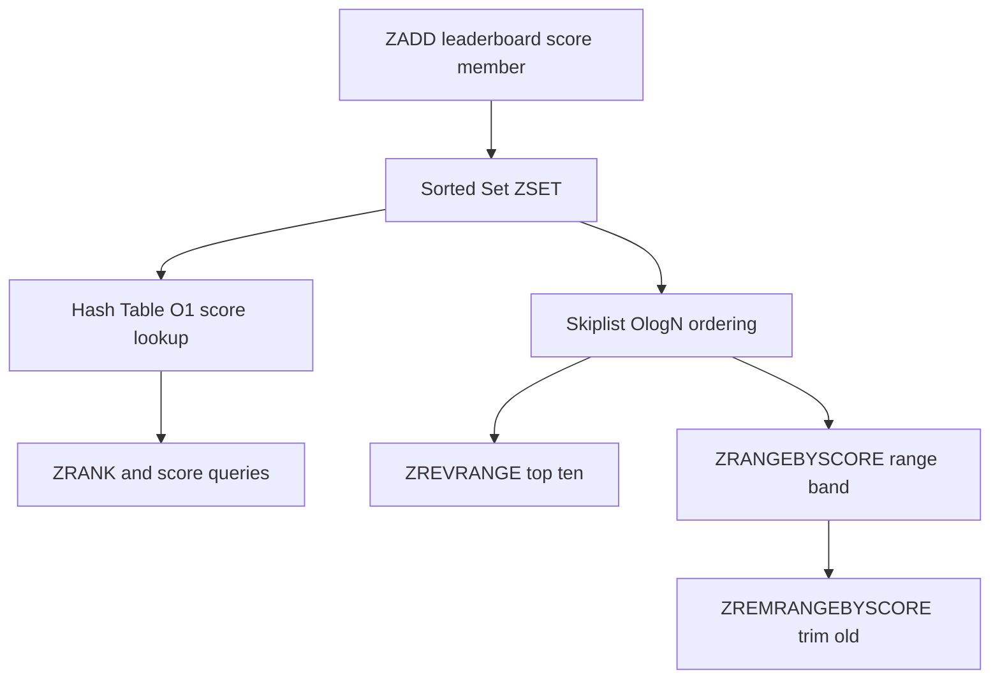

# Sorted Sets: The Ranked Leaderboard Data Structure

## English

A Redis sorted set (ZSET) is like a hash map where every member carries a numeric score, and the whole collection is always kept sorted by that score. Internally it is a skiplist plus a hash table: the hash gives O(1) lookup of a member's score, while the skiplist gives O(log N) insertion, deletion, and range queries. This dual structure is why you can ask for both "what is the score of user X?" and "who are the top 10 users?" efficiently. The score is a double-precision float, so it can be a timestamp, a price, or any rankable number, and members with equal scores are ordered lexicographically as a tie-breaker.

The classic use is a leaderboard. ZADD leaderboard 1500 alice inserts or updates alice's score in one command. ZINCRBY leaderboard 25 alice atomically bumps it, which matters because many concurrent players might update the same score without a read-modify-write race. ZREVRANGE leaderboard 0 9 WITHSCORES returns the top ten in descending order, and ZRANK leaderboard alice tells you alice's zero-based position from the bottom (ZREVRANK counts from the top). All of this stays fast even with millions of members because the skiplist keeps the ordering incrementally rather than re-sorting.

Sorted sets also shine for range queries by score. ZRANGEBYSCORE leaderboard 1000 2000 returns everyone in a score band, and because scores can be Unix timestamps, a sorted set becomes a time-ordered index. A common pattern is to store events with their timestamp as the score, then use ZRANGEBYSCORE with the current time minus a window to fetch "everything in the last five minutes" — handy for sliding-window rate limiting or recent-activity feeds. ZREMRANGEBYSCORE lets you trim old entries in the same pass.

One subtlety: scores are floats, so very large integers (beyond 2^53) lose precision, which is why timestamps in milliseconds are safe but nanosecond counters may not be. Also, sorted sets are ordered by score, not by insertion, so they are not a queue — for FIFO behaviour you would use a list or a stream. And unlike a plain set, every member is unique but the score can repeat, so ties are common and the lexicographic tie-break is worth remembering when debugging ordering surprises.

Compared with fetching rows from a SQL database and sorting in application code, a sorted set moves the ranking work into the data store, close to the data, and updates it incrementally on every write. That is the real win: you pay a small cost per ZADD and get instant, consistent rankings forever after, instead of an expensive ORDER BY over a growing table.

## 中文

Redis 的有序集合（sorted set，簡稱 ZSET）就像一個雜湊表，每個成員都帶有一個數值分數（score），而整個集合永遠按該分數排序。內部結構是跳表（skiplist）加雜湊表：雜湊表提供 O(1) 的成員分數查詢，跳表則提供 O(log N) 的插入、刪除與範圍查詢。這種雙重結構正是為何「用戶 X 的分數是多少？」和「頭十名是誰？」這兩類問題都能高效回答。分數是雙精度浮點數，可以是時間戳、價格或任何可排序的數字，而成員分數相同時會以字典序作為決勝條件。

最經典的用途是排行榜。ZADD leaderboard 1500 alice 用一條命令插入或更新 alice 的分數。ZINCRBY leaderboard 25 alice 原子地加分，這很重要，因為許多並發玩家可能同時更新同一分數，而不會出現讀取—修改—寫入的競爭條件。ZREVRANGE leaderboard 0 9 WITHSCORES 按降序返回前十名，ZRANK leaderboard alice 告訴你 alice 由低數起的零基排名（ZREVRANK 則由高數起）。即使有數百萬成員，這些操作依然快速，因為跳表是增量地維持排序，而不是每次重新排序。

有序集合在按分數範圍查詢時也大放異彩。ZRANGEBYSCORE leaderboard 1000 2000 返回分數落在某區間的所有人；而由於分數可以是 Unix 時間戳，有序集合就變成一個按時間排序的索引。常見模式是把事件以其時間戳作為分數儲存，然後用 ZRANGEBYSCORE 配合「當前時間減去一個窗口」來取出「最近五分鐘內的一切」——這對滑動窗口限流或近期動態feed很有用。ZREMRANGEBYSCORE 讓你在同一輪中修剪舊條目。

一個微妙之處：分數是浮點數，所以非常大的整數（超過 2^53）會失去精度，這就是為何毫秒時間戳安全，但奈秒計數器可能不安全。另外，有序集合是按分數排序，而非按插入順序，所以它不是隊列——要 FIFO 行為應使用列表或串流。與普通集合不同，每個成員唯一但分數可以重複，所以平手很常見，除錯排序意外時要記住字典序決勝規則。

與從 SQL 資料庫取回資料列再在應用程式碼中排序相比，有序集合把排名工作移入資料存儲、貼近資料，並在每次寫入時增量更新。這才是真正的優勢：每次 ZADD 付出少許成本，之後就能即時獲得一致且持久的排名，而不是對不斷增長的表做昂貴的 ORDER BY。

## Key Takeaway

Sorted sets keep members ordered by a numeric score using a skiplist plus hash, making leaderboards and time-ordered range queries cheap and incrementally updated.

## Related Concepts
- Skiplist
- Range queries

## Diagram

