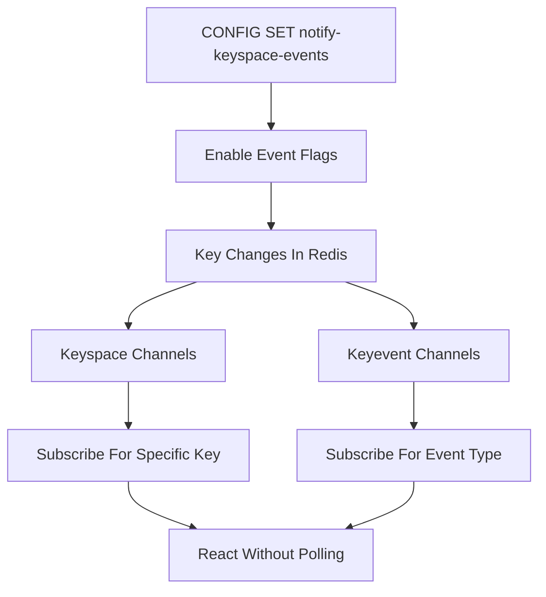

# Keyspace Notifications: Reacting to Changes Without Polling

## English

By default Redis is silent about what happens to keys — you can only ask it questions. Keyspace notifications flip this around: when enabled, Redis publishes events onto Pub/Sub channels whenever a key is created, modified, expired, or deleted. You enable them with the CONFIG SET notify-keyspace-events command, passing a string of flags that select which classes of events you care about. For example, the flag K enables keyspace events, E enables keyevent events, and letters like g (generic commands such as DEL or EXPIRE), $ (string commands), l (list), s (set), h (hash), z (sorted set), x (expired), and e (evicted) narrow the classes. A common setting is KEA or Ex, depending on whether you want all events or just expiration/eviction.

Events are delivered in two parallel channel families. Keyspace channels look like __keyspace@0__:mykey and carry the name of the event (for example "expired" or "set"). Keyevent channels look like __keyevent@0__:expired and carry the key name. The 0 is the database number. So if you want to know "what happened to this specific key?", subscribe to its keyspace channel; if you want "which keys just expired?", subscribe to the keyevent channel for expired. This two-view design lets you choose the indexing that fits your question.

The headline use case is reacting to TTL expiration. Suppose you store session tokens with a TTL and want to clean up a related resource, send a 'session ended' message, or move data to cold storage when the session dies. Instead of polling every key with TTL checks, a worker subscribes to __keyevent@0__:expired and gets a message the moment Redis actually removes the key. The same works for eviction events when maxmemory policy removes keys, which is useful for observability — you can alert when memory pressure starts evicting data.

There are important caveats. Notifications are fire-and-forget Pub/Sub: if no subscriber is connected, the event is simply lost, so they are not a durable audit log — pair them with a Stream or a database if you need guaranteed delivery. Expiration events are generated when Redis actually deletes the key, which for lazy expiration happens on access or during an active expiry cycle, so the event can arrive somewhat later than the nominal TTL. And enabling broad event classes adds CPU and network overhead, so production setups usually enable only the specific classes they need.

Architecturally, keyspace notifications turn Redis from a passive store into an event source, which is powerful for cache invalidation across services: a service that caches a value in its own memory can subscribe and drop it when the Redis key changes. But treat them as a low-latency hint, not a source of truth — design so that a missed event causes only a slightly stale cache, never data loss.

## 中文

預設情況下，Redis 對鍵的變化保持沉默——你只能主動向它提問。鍵空間通知（keyspace notifications）把這一切反轉：啟用後，每當鍵被建立、修改、過期或刪除，Redis 就會把事件發佈到 Pub/Sub 頻道。你可用 CONFIG SET notify-keyspace-events 命令啟用，傳入一串旗標來選擇你關心的事件類別。例如旗標 K 啟用鍵空間事件，E 啟用鍵事件，而 g（通用命令如 DEL 或 EXPIRE）、$（字串命令）、l（列表）、s（集合）、h（雜湊）、z（有序集合）、x（過期）、e（淘汰）等字母則收窄類別。常見設定是 KEA 或 Ex，取決於你要全部事件還是只要過期與淘汰。

事件會通過兩個平行的頻道家族傳遞。鍵空間頻道形如 __keyspace@0__:mykey，攜帶事件名稱（例如「expired」或「set」）。鍵事件頻道形如 __keyevent@0__:expired，攜帶鍵名。當中的 0 是資料庫編號。所以若你想知道「這個特定鍵發生了什麼？」，訂閱它的鍵空間頻道；若你想知道「哪些鍵剛剛過期？」，訂閱過期事件的鍵事件頻道。這種雙視角設計讓你按問題選擇合適的索引方式。

最受注目的用途是對 TTL 過期作出反應。假設你用 TTL 儲存會話權杖，並想在會話結束時清理相關資源、發送「會話結束」訊息，或把資料移到冷儲存。與其輪詢每個鍵做 TTL 檢查，一個工作進程訂閱 __keyevent@0__:expired，就能在 Redis 真正移除鍵的一刻收到訊息。淘汰事件同理，當 maxmemory 策略移除鍵時也適用，這對可觀測性很有用——你可以在記憶體壓力開始淘汰資料時發出警報。

有幾個重要注意事項。通知是「發後不理」的 Pub/Sub：若沒有訂閱者連線，事件就直接丟失，所以它們不是持久的審計日誌——若需要保證送達，應配合串流或資料庫。過期事件是在 Redis 真正刪除鍵時產生，而惰性過期會在存取時或主動過期週期中發生，所以事件可能比名義 TTL 稍遲到達。而啟用廣泛的事件類別會增加 CPU 與網路開銷，所以生產環境通常只啟用所需的特定類別。

在架構上，鍵空間通知把 Redis 從被動存儲變成事件來源，這對跨服務的快取失效很有力：一個在自己記憶體中快取值的服務可以訂閱，並在 Redis 鍵變化時丟棄快取。但要把視為低延遲的提示，而非真相來源——設計上應確保漏掉事件只會導致快取稍為過時，而絕不會造成資料遺失。

## Key Takeaway

Keyspace notifications publish key lifecycle events to Pub/Sub channels, letting services react to expirations and changes without polling — but they are best-effort, not durable.

## Related Concepts
- Pub/Sub
- TTL and expiration

## Diagram

