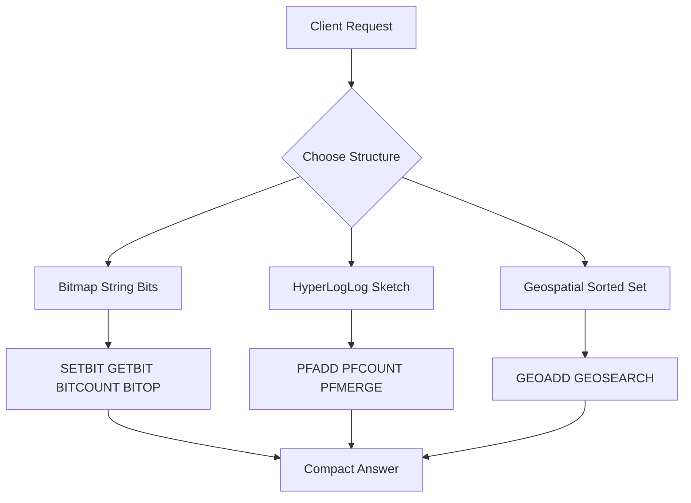

# Bitmaps, HyperLogLog, and Geospatial: Specialized Structures for Compact Answers

## English

Beyond strings, lists, hashes, sets, and sorted sets, Redis ships a handful of specialized structures that answer narrow questions with surprising efficiency. Bitmaps are not a separate type — they are plain strings treated as arrays of bits, manipulated with commands like SETBIT, GETBIT, BITCOUNT, and BITOP. Because a string can be up to 512 MB, you get up to about 4 billion bits, and operations on individual bits are O(1). This makes bitmaps ideal for boolean-per-user questions: SETBIT daily:2024-06-01 12345 1 marks user 12345 as active, BITCOUNT daily:2024-06-01 counts actives, and BITOP AND or OR across several day-bitmaps computes "active every day this week" or "active at least once". The memory cost is proportional to the highest bit offset used, so sparse IDs waste space — offset 1,000,000 allocates about 125 KB even if only one bit is set.

HyperLogLog (HLL) estimates the cardinality of a set — the number of distinct elements — using a fixed, tiny amount of memory, on the order of 12 KB per structure regardless of how many elements you add. PFADD adds elements, PFCOUNT returns the estimated distinct count, and PFMERGE combines several HLLs into one. The trade-off is accuracy: standard error is around 0.81%, and the count is an estimate, not exact. For counting unique visitors to a page per day, where 'roughly 1.2 million' is fine and storing every visitor ID would be prohibitive, HLL is a superb fit. For anything requiring exact membership or exact counts, use a set instead.

Geospatial support builds on sorted sets: GEOADD stores longitude/latitude pairs as a geohash-encoded score, and GEOSEARCH (or the older GEORADIUS) finds members within a radius or bounding box, returning them sorted by distance. Under the hood Redis encodes coordinates into a 52-bit integer via geohashing, which lets it do proximity queries on the sorted-set skiplist. This is great for 'find nearby drivers within 5 km' or 'which stores are in this rectangle', though it is planar approximation and not a full GIS — for complex polygon or routing queries you would reach for a dedicated spatial database.

A fourth family worth knowing is the probabilistic Bloom filter and Cuckoo filter, available in Redis Stack / RedisBloom rather than core Redis. A Bloom filter answers 'definitely not present' or 'possibly present' in tiny space, which is perfect for a cache-penetration guard: before hitting the database for a key, ask the filter, and skip the query if it says the key cannot exist. The catch is false positives (never false negatives) and no deletion in classic Bloom filters. Cuckoo filters support deletion.

The common thread is trading generality for compactness. Each of these structures answers one specific question — 'was this bit set?', 'how many distinct things?', 'what is nearby?', 'might this exist?' — in far less memory than a general-purpose set or sorted set would need. Knowing they exist lets you avoid storing giant sets of IDs just to count or test them, which is often the difference between fitting in RAM and not.

## 中文

除了字串、列表、雜湊、集合與有序集合，Redis 還附帶幾種專門結構，能以驚人的效率回答狹窄的問題。點陣圖（bitmap）不是獨立型別——它是被當作位元陣列處理的普通字串，用 SETBIT、GETBIT、BITCOUNT、BITOP 等命令操作。由於字串最大可達 512 MB，你最多可得約 40 億位元，而對個別位元的操作是 O(1)。這使點陣圖非常適合「每位使用者一個布林值」的問題：SETBIT daily:2024-06-01 12345 1 把使用者 12345 標記為活躍，BITCOUNT daily:2024-06-01 數出活躍人數，而對多個每日點陣圖做 BITOP AND 或 OR 可計算「本週每天都活躍」或「至少活躍一次」。記憶體成本與所用的最高位元偏移成正比，所以稀疏 ID 會浪費空間——偏移 1,000,000 會配置約 125 KB，即使只設了一個位元。

HyperLogLog（HLL）用固定且極小的記憶體估算集合的基數——即不同元素的數量——每個結構約 12 KB，不論你加入多少元素。PFADD 加入元素，PFCOUNT 返回估算的不同數量，PFMERGE 把多個 HLL 合併為一。代價是準確度：標準誤差約 0.81%，計數是估算而非精確值。對於每日統計頁面獨立訪客，若「大約 120 萬」已足夠，而儲存每個訪客 ID 又不可行，HLL 就是絕佳選擇。若需要精確的成員資格或精確計數，則應改用集合。

地理空間支援建基於有序集合：GEOADD 把經緯度對以 geohash 編碼成分數儲存，GEOSEARCH（或較舊的 GEORADIUS）找出半徑或邊界框內的成員，並按距離排序返回。底層 Redis 透過 geohashing 把座標編碼成 52 位元整數，讓它能在有序集合的跳錶上做鄰近查詢。這對「找出 5 公里內的司機」或「哪些商店在這個矩形內」很好用，不過它是平面近似，並非完整 GIS——複雜的多邊形或路徑查詢應交給專門的空間資料庫。

第四類值得認識的是機率性的布隆過濾器（Bloom filter）與布穀鳥過濾器（Cuckoo filter），它們在 Redis Stack / RedisBloom 中提供，而非核心 Redis。布隆過濾器以極小空間回答「肯定不存在」或「可能存在」，非常適合做快取穿透防護：在向資料庫查詢某鍵之前先問過濾器，若它說該鍵不可能存在就跳過查詢。缺點是假陽性（絕不會假陰性），而且經典布隆過濾器不支援刪除；布穀鳥過濾器則支援刪除。

共同的主線是以通用性換取精簡。這些結構各自回答一個特定問題——「這一位元是否已設？」、「有多少不同的東西？」、「附近有什麼？」、「這東西可能存在嗎？」——所耗記憶體遠少於通用集合或有序集合。知道它們存在，就能避免為了計數或測試而儲存龐大的 ID 集合，這往往是能否裝進 RAM 的關鍵差別。

## Key Takeaway

Bitmaps, HyperLogLog, geospatial indexes, and probabilistic filters each answer one narrow question in far less memory than a general-purpose set would need.

## Related Concepts
- Probabilistic data structures
- Memory efficiency

## Diagram

