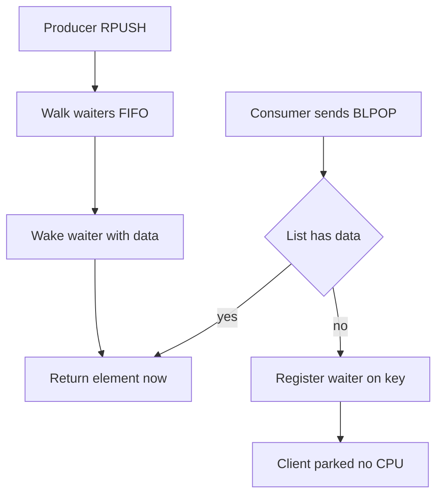

# Blocking Commands and the Event Loop: How Redis Waits Without Spinning

## English

A normal Redis command returns immediately: if the list you asked for is empty, you get nil and move on. Blocking variants like BLPOP, BRPOP, BLMOVE, BZPOPMIN and the blocking form of XREAD let a client say 'hand me an element, but if there isn't one yet, park me here for up to N seconds.' The magic is that the server does not busy-wait. Redis keeps a registry of clients that are blocked on a given key; when some other client pushes to that list (LPUSH/RPUSH) or adds to that sorted set or stream, the server walks the waiters for that key and wakes them in FIFO order, handing each one the data. Because Redis is single-threaded, a blocked client costs nothing but a small entry in that registry — no thread, no stack, no CPU. This is why a thousand idle workers waiting on a queue do not melt the server.

Compare this with polling: a worker that runs `LPOP queue` in a loop with a 100 ms sleep issues ten round trips per second per worker, and most return nil. With BLPOP the worker issues one command and sleeps inside the kernel until data arrives, so latency is near-zero and traffic is near-zero. That is the classic 'reliable-ish work queue' pattern: producers RPUSH jobs, consumers BLPOP from the other end. The catch is that once a consumer receives a job, Redis has already deleted it from the list — if the worker crashes mid-job, the job is gone. That is why people pair it with a 'processing' list (BRPOPLPUSH / BLMOVE moves the job atomically from the pending list to an in-flight list) so a supervisor can requeue orphans.

A few practical details matter. First, blocking commands inside MULTI/EXEC never block the server: since the transaction executes as one atomic block, blocking would freeze everything, so if the list is empty at EXEC time the command simply returns a nil multi-bulk reply — exactly as if the timeout had expired — rather than raising an error. Second, the timeout is a float in seconds and zero means 'block forever' — dangerous in production because a client that never returns holds a connection slot. Third, a blocked client still counts against `maxclients`, so a fleet of 10,000 idle workers can exhaust the connection limit before you notice.

Under the hood the wake-up is not a thread signalling another thread; it is the event loop noticing that a key became ready and marking the blocked client as unblocked with a reply already prepared. The reply is written when the socket is writable, exactly like any other reply. This means ordering is fair (first waiter gets served first) and there is no thundering herd: only one waiter is woken per element pushed. If you push five elements, five waiters wake; if you push one, one wakes. That tight coupling between data arrival and client wake-up is a small piece of engineering elegance that makes Redis feel like a message broker despite being a data structure server.

Finally, know the difference between blocking on a key and blocking on a stream. XREAD BLOCK with a `$` ID waits for *new* entries after the current tail, while with a concrete ID it will replay history first. BLPOP has no notion of history — it only sees the present. Choosing between them is really choosing between 'a queue that forgets' and 'a log that remembers,' and that choice shapes whether you can recover from a consumer crash.

## 中文

一般 Redis 命令會即時返回：如果你要的 list 是空的，你會拿到 nil 然後繼續。但 BLPOP、BRPOP、BLMOVE、BZPOPMIN 以及 XREAD 的阻塞版本，就讓客戶端講一句「畀我一個元素，但如果而家未有，就喺度等我最多 N 秒」。神奇之處係伺服器唔會 busy-wait 空轉。Redis 會維護一張「喺某條 key 上阻塞緊嘅客戶端」嘅登記表；當另一個客戶端 LPUSH／RPUSH 落嗰條 list、或者加嘢落嗰個 sorted set 或 stream，伺服器就會搵出等緊呢條 key 嘅人，按先到先得次序逐個叫醒，逐個派資料。因為 Redis 係單執行緒，一個阻塞中嘅客戶端除咗登記表入面一小條記錄之外，幾乎唔耗資源——唔開 thread、唔開 stack、唔燒 CPU。所以一千個閒置 worker 等緊同一條隊都唔會搞死伺服器。

同輪詢比較一下：一個 worker 用 `LPOP queue` 加 100 毫秒 sleep 去 loop，每個 worker 每秒十次 round trip，大部分都係 nil。用 BLPOP 就係發一條命令，然後喺 kernel 度瞓覺直到有資料，延遲接近零、流量亦接近零。呢個就係經典嘅「算係可靠」工作佇列模式：生產者 RPUSH 工作，消費者由另一邊 BLPOP。陷阱係：消費者一收到工作，Redis 就已經由 list 度刪走咗——如果 worker 做做下死咗，嗰份工作就永遠消失。所以人們會配一條「處理中」list（用 BRPOPLPUSH／BLMOVE 原子咁將工作由待處理 list 搬去飛行中 list），等監督程式可以將孤兒工作重新排隊。

有幾個實務細節好重要。第一，阻塞命令喺 MULTI/EXEC 入面其實唔會阻塞伺服器：因為交易係當一個原子區塊執行，阻塞會凍結成個伺服器，所以如果執行時條 list 仍然係空，該命令只會回傳一個 nil multi-bulk 回覆——同 timeout 到期時一模一樣——而唔係拋出錯誤。第二，timeout 係以秒為單位嘅浮點數，零代表「永遠阻塞」——生產環境好危險，因為一個永遠唔返嘅客戶端會霸住一個連線位。第三，阻塞中嘅客戶端仍然計入 `maxclients`，所以一隊一萬個閒置 worker 可以喺你未為意之前就用盡連線上限。

底層嘅喚醒唔係一條 thread 通知另一條 thread；而係事件迴圈發現某條 key 變得有貨，就將嗰個阻塞客戶端標記為解除阻塞，回覆已經準備好。回覆會喺 socket 可寫嘅時候寫出去，同其他任何回覆一模一樣。呢個代表次序係公平嘅（第一個等嘅人先被服務），而且冇 thundering herd：每 push 一個元素只會叫醒一個等待者。你 push 五個就五個醒，push 一個就一個醒。資料到達同客戶端喚醒之間嘅緊密耦合，係一種小巧嘅工程優雅，令 Redis 明明係資料結構伺服器，用起上嚟卻似 message broker。

最後，要分清楚「阻塞喺一條 key」同「阻塞喺一個 stream」。XREAD BLOCK 配 `$` ID 係等目前尾巴之後嘅*新*專案；配一個具體 ID 就會先重播歷史。BLPOP 完全冇歷史概念——佢只見到現在。喺兩者之間揀，其實係揀「一個會忘記嘅佇列」定「一個會記住嘅日誌」，而呢個選擇決定咗你喺消費者宕機之後能唔能夠復原。

## Key Takeaway

Blocking commands let clients wait for data without polling, at the cost of connection slots and no memory of what was already delivered.

## Related Concepts
- Event loop
- Reliable queue pattern

## Diagram

