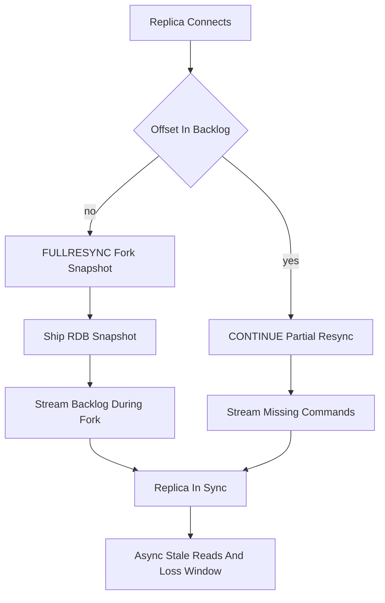

# Replication Mechanics: How a Replica Catches Up and What It Cannot Save You From

## English

Redis replication is asynchronous by default: a primary accepts writes, appends them to an in-memory replication backlog (a fixed-size ring buffer of recent commands), and streams them to replicas over a persistent connection. A replica that connects for the first time sends PSYNC with no offset, the primary replies FULLRESYNC and forks to produce an RDB snapshot, ships it, then streams the backlog accumulated during the fork. A replica that reconnects after a brief network blip sends PSYNC with its last known offset; if that offset is still inside the backlog, the primary replies CONTINUE and only the missing commands are sent — a partial resynchronisation. If the offset has fallen out of the backlog, you get a full resync again, which is expensive: a fork, a full dataset serialisation, and a burst of network traffic.

The backlog size therefore matters more than people think. If your write rate is high and the backlog is small, any replica that is down for more than a few seconds will need a full resync. The `repl-backlog-size` setting is your lever. Replicas also serve read traffic, which is the usual reason to add them: offload analytics, backups, or read-heavy endpoints. But because replication is asynchronous, a read on a replica can be stale by however long the network and the replica's processing take. Redis has WAIT, which blocks until a given number of replicas acknowledge a write (or a timeout elapses), but it is a best-effort barrier, not a consensus protocol — it does not make the write durable on the primary either unless AOF with fsync is configured.

Failover is where the model bites. If the primary dies, a replica promoted by Sentinel or Cluster may be missing the last few writes that never reached any replica. This is the classic Redis data-loss window, and it is not a bug — it is the price of asynchronous replication. There is a mitigation: `min-replicas-to-write` and `min-replicas-max-lag` make the primary refuse writes if fewer than N replicas have acknowledged within M seconds. That trades availability for safety, and it is often the right trade for anything that looks like a ledger.

Replicas are also read-only by default (`replica-read-only yes`), and a replica that is resyncing from its primary will serve stale data (or errors, depending on `replica-serve-stale-data`) until the sync finishes. Chained replication — replica of a replica — is supported and can reduce load on the primary. Since Redis 4.0 the sub-replica receives exactly the same replication stream from the master, so the chain does not add a hop of propagation latency; what it does add is an extra failure domain and extra fork work at the primary. A related consequence of the same rule: writes to an intermediate replica are local only and are never propagated to its own sub-replicas.

A subtle point: replication does not replicate expiry as a timer. The primary sends DEL (or an internal expire) to replicas when a key actually expires, and replicas do not independently expire keys on their own clock (they wait for the primary's DEL, though they will hide logically expired keys from reads). This keeps replicas consistent with the primary's view rather than with wall-clock time, which matters when clocks drift. Understanding this helps you reason about why a replica might briefly appear to have a key that the primary has already dropped.

## 中文

Redis 複製預設係異步嘅：primary 接受寫入，將命令附加到一個記憶體內嘅 replication backlog（一個固定大細、裝住近期命令嘅環形緩衝區），再經一條長連線串流畀 replica。第一次連線嘅 replica 會發 PSYNC 但唔帶 offset，primary 回 FULLRESYNC，fork 一個程序去產生 RDB 快照，傳過去，然後串流 fork 期間累積嘅 backlog。如果 replica 只係短暫斷網後重連，佢會帶住最後已知 offset 發 PSYNC；只要嗰個 offset 仲喺 backlog 入面，primary 就回 CONTINUE，只補送漏咗嘅命令——呢個叫部分重同步。如果 offset 已經跌出 backlog，就要再做一次完整重同步，代價好大：fork、完整序列化整個數據集、再加一大輪網絡流量。

所以 backlog 大細比好多人想像中更重要。如果你寫入率高但 backlog 細，任何 replica 停機超過幾秒就要做完整重同步。`repl-backlog-size` 就係你嘅調節桿。Replica 亦可以分擔讀取流量，呢個通常係加 replica 嘅原因：分流分析、備份、或者讀取密集嘅端點。但因為複製係異步，喺 replica 度讀到嘅資料可能過時，過時幾多視乎網絡同 replica 處理速度。Redis 有 WAIT 命令，會阻塞直到指定數量嘅 replica 確認咗某次寫入（或者 timeout 到），但佢只係盡力而為嘅屏障，唔係共識協議——除非你配置咗 AOF 加 fsync，否則佢唔會令寫入喺 primary 度變得持久。

故障轉移就係呢個模型最痛嘅位。如果 primary 死咗，由 Sentinel 或 Cluster 提拔嘅 replica 可能缺少最後幾筆從未到達任何 replica 嘅寫入。呢個就係經典嘅 Redis 資料遺失窗口，佢唔係 bug——而係異步複製嘅代價。有緩解方法：`min-replicas-to-write` 同 `min-replicas-max-lag` 會令 primary 喺少於 N 個 replica 喺 M 秒內確認嘅情況下拒絕寫入。呢個係用可用性換安全性，對於任何似帳簿嘅系統，通常都係正確嘅取捨。

Replica 預設亦係唯讀嘅（`replica-read-only yes`），而一個正在同 primary 重同步嘅 replica 喺同步完成之前會提供過時資料（或者錯誤，視乎 `replica-serve-stale-data`）。串鏈式複製——replica 嘅 replica——係支援嘅，可以減輕 primary 負載，但會拉長傳播鏈，因而拉長過時窗口。每多一層就多一層延遲同一個新嘅故障域。

一個微妙嘅重點：複製唔會將到期時間當計時器咁複製。當一條 key 真正到期，primary 會送 DEL（或內部 expire）畀 replica，而 replica 唔會按自己個鐘獨立令 key 到期（佢哋等 primary 嘅 DEL，雖然佢哋會喺讀取時隱藏邏輯上已到期嘅 key）。咁樣令 replica 同 primary 嘅視角一致，而唔係同牆上時鐘一致，喺時鐘有漂移時好重要。明白呢點，你就會理解為何 replica 有時會短暫顯示一條 primary 已經刪咗嘅 key。

## Key Takeaway

Asynchronous replication buys speed and read scaling but leaves a real data-loss window on failover unless you constrain writes with min-replicas settings.

## Related Concepts
- PSYNC partial resynchronisation
- Replication backlog

## Diagram

