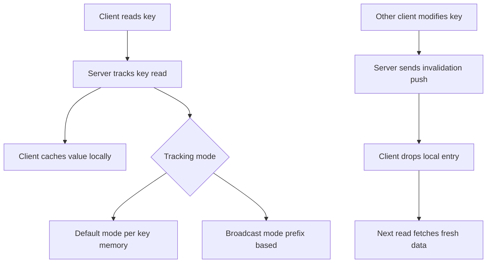

# Client-Side Caching with Tracking: Caching Without the Stale-Read Tax

## English

The fastest cache is one that lives in your own process: no network hop, no serialisation, no round trip. The problem has always been invalidation — if you cache a user's profile in local memory, how do you know when someone else changed it? Redis offers a mechanism called client-side caching with server-assisted invalidation, built around the CLIENT TRACKING command. You tell the server 'remember which keys I read,' and when any client modifies one of those keys, the server pushes an invalidation message down your existing connection. Your local cache drops the entry; the next read fetches fresh data. You get the speed of in-process caching with correctness enforced by the server.

CLIENT TRACKING accepts several optional arguments, so there is more than one mode. In the default mode, the server remembers every key each tracking client has read, which costs memory proportional to the number of tracked keys. In broadcast mode (`CLIENT TRACKING on BCAST`), the server does not remember anything per client; instead each client subscribes to key prefixes (via PREFIX options) and receives invalidation messages for any key matching those prefixes. Broadcast mode has no per-key memory cost but sends more messages, so it suits clients that cache a predictable, prefix-shaped subset of the keyspace. Default mode suits clients with a large, unpredictable working set — at the price of server memory. Two further arguments refine this: OPTIN tracks a key only when the read is immediately preceded by CLIENT CACHING YES (and OPTOUT does the opposite), which lets a client decide per read whether the key is worth tracking. NOLOOP suppresses invalidation messages for keys the tracking connection itself modifies. One trap worth knowing: if you enable BCAST without any PREFIX, Redis sends invalidation messages for every key, not just the ones you care about.

How do invalidation messages arrive? They come as RESP3 push messages on the same connection, or, for RESP2 clients, on a separate connection dedicated to tracking (you must use `CLIENT TRACKING on REDIRECT <id>` to point at a connection subscribed to invalidation via `CLIENT ID`). This is why client-side caching is tightly coupled to RESP3 adoption: RESP3 lets one connection carry both command replies and out-of-band pushes, so you do not need a second socket. Without RESP3, the redirect dance works but adds a connection per tracking client.

The invalidation is best-effort and asynchronous. Redis sends the message after the write is applied; the network may drop the connection, and the client may miss it. To handle that, clients typically use a short TTL on local entries as a safety net, or they reconnect and flush the local cache. Also note that tracking only reports keys that were actually read through Redis — if your application writes a key it never read, there is nothing tracked to invalidate, which is fine because you never cached it. And keys that expire send invalidations too, so TTL-based eviction stays consistent with local caches.

A practical pattern: use client-side caching for hot, read-mostly data — feature flags, configuration, small reference tables — where a stale read for a few hundred milliseconds is tolerable but a network round trip per request is not. Combine it with a modest local TTL as a backstop, and instrument cache-hit ratios on both layers. The result is a two-tier cache where the outer tier is Redis (shared, authoritative-ish) and the inner tier is your process memory (fast, invalidated by push). It is one of the few Redis features that genuinely changes the latency profile of a service rather than just its throughput.

## 中文

最快嘅快取就係住喺你自己 process 入面嘅快取：冇網絡跳轉、冇序列化、冇 round trip。問題一直係失效（invalidation）——如果你喺本地記憶體快取咗某個用戶嘅個人檔案，你點知幾時有其他人改咗佢？Redis 提供一個叫「伺服器輔助失效嘅客戶端快取」嘅機制，核心係 CLIENT TRACKING 命令。你同伺服器講「記住我讀過邊啲 key」，而當任何客戶端修改咗其中一條，伺服器就會沿住你現有嘅連線推送一條失效訊息。你嘅本地快取就丟棄嗰個項目；下次讀取就會攞到新鮮資料。你得到 process 內快取嘅速度，同時由伺服器強制執行正確性。

追蹤有兩種模式。預設模式下，伺服器會記住每個追蹤客戶端讀過嘅每一條 key，記憶體開支同被追蹤 key 嘅數量成正比。廣播模式（`CLIENT TRACKING on BCAST`）下，伺服器唔會為每個客戶端記任何嘢；而係每個客戶端訂閱 key 前綴（用 PREFIX 選項），然後收到任何符合嗰啲前綴嘅 key 嘅失效訊息。廣播模式冇逐 key 嘅記憶體成本，但會送多啲訊息，所以適合快取一個可預測、前綴形狀嘅 keyspace 子集嘅客戶端。預設模式就適合工作集大而不可預測嘅客戶端——代價係伺服器記憶體。

失效訊息點樣到達？佢哋會以 RESP3 push 訊息嘅形式喺同一條連線到達；對於 RESP2 客戶端，就要用一條專用連線（你要用 `CLIENT TRACKING on REDIRECT <id>`，指向一條用 `CLIENT ID` 訂閱咗失效訊息嘅連線）。呢個就係點解客戶端快取同 RESP3 嘅採用緊緊相扣：RESP3 令一條連線可以同時承載命令回覆同帶外推送，你就唔需要第二個 socket。冇 RESP3 嘅話，redirect 嘅做法行得通，但每個追蹤客戶端都要多一條連線。

失效係盡力而為而且異步嘅。Redis 喺寫入套用之後送訊息；網絡可能斷線，客戶端可能收唔到。為咗應付呢點，客戶端通常會喺本地項目加一個短 TTL 做安全網，或者重連時清空本地快取。另外要注意，追蹤只會報告真正經 Redis 讀過嘅 key——如果你嘅應用寫入一條從未讀過嘅 key，就冇嘢被追蹤、亦冇嘢要失效，咁冇問題，因為你根本冇快取過佢。而到期嘅 key 亦會送失效訊息，所以基於 TTL 嘅驅逐同本地快取保持一致。

一個實用模式：用客戶端快取處理熱門、讀多寫少嘅資料——功能開關、設定、小型參考表——呢啲資料過時幾百毫秒可以接受，但每個請求都走一次網絡就唔得。配一個適度嘅本地 TTL 做後備，並且喺兩層都量度快取命中率。結果就係一個兩層快取：外層係 Redis（共享、大致權威），內層係你 process 嘅記憶體（快、由推送失效）。呢個係少數真正改變服務延遲特性、而唔止改變吞吐量嘅 Redis 功能之一。

## Key Takeaway

CLIENT TRACKING turns Redis into an invalidation service so your process-local cache can be fast without silently going stale.

## Related Concepts
- RESP3 push messages
- Cache invalidation

## Diagram

