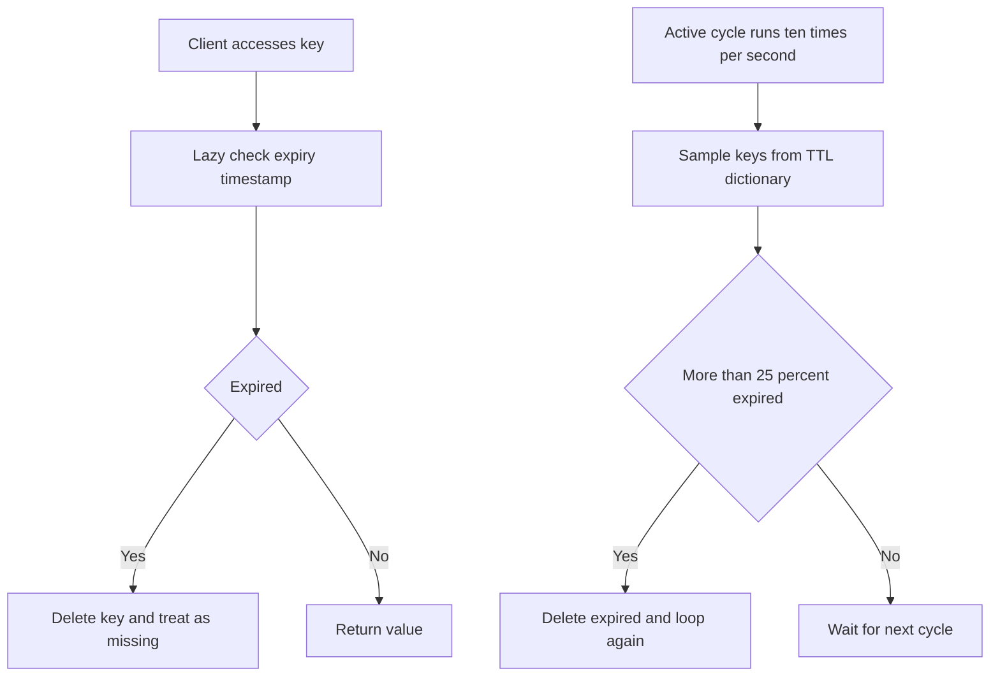

# Lazy vs Active Expiration: How Redis Actually Deletes Expired Keys

## English

When you set a TTL on a key, Redis does not start a timer that fires at the exact moment of expiry. Instead it uses two cooperating mechanisms. The first is passive (lazy) expiration: whenever a client tries to read or write a key, Redis checks the key's expiry timestamp stored in the internal dictionary metadata, and if the time has passed it deletes the key and behaves as if it never existed. This means an expired key can sit in RAM indefinitely if nobody ever touches it — which is cheap in CPU but wasteful in memory.

The second mechanism is active expiration. Roughly ten times per second Redis runs a background cycle that samples a handful of keys from the set of keys that have a TTL (Redis keeps a separate dictionary just for expiring keys), deletes the ones already expired, and repeats if the fraction of expired keys in the sample is high (a common implementation samples around 20 keys and loops while more than 25% of them were expired). This adaptive loop means a burst of expirations gets cleaned up quickly, while a mostly-live TTL set costs almost nothing to police.

A practical consequence: memory is not necessarily reclaimed the instant a TTL passes. If you set ten million keys to expire at 3:00 PM, the memory will drain over the following seconds to minutes rather than in one instant, and the active cycle will spend extra CPU doing it. This is why Redis exposes metrics like `expired_keys` and why operators watch for sudden eviction or CPU spikes after mass TTL expiry events such as a cache warm-up gone stale.

There is also a subtle correctness point for replication and persistence. Redis does not replicate the expiry moment itself; replicas and the AOF file receive explicit `DEL` (or `UNLINK`) commands when the primary actually removes a key. In the AOF, an expiring key is often rewritten as an absolute `PEXPIREAT` so that replaying the log later still expires the key at the right wall-clock time rather than the original relative TTL. This keeps replicas and restarted servers consistent with the primary's view of time.

Finally, this design explains a classic gotcha: if you use a key that is logically expired but never touched, and you also have `maxmemory` with an eviction policy, that zombie key still counts against your memory budget. The fix is not to rely on TTLs alone for capacity planning; monitor `used_memory` against the number of volatile keys, and remember that lazy deletion trades memory for CPU while active deletion trades CPU for memory — Redis blends both to keep the trade-off reasonable.

## 中文

當你為一個鍵設定 TTL，Redis 並不會啟動一個計時器在到期那一刻準時觸發。它其實用兩套互相配合的機制。第一套是被動（惰性）過期：每當客戶端嘗試讀寫某個鍵，Redis 會檢查內部字典元數據中記錄的到期時間戳，若已過期就刪除該鍵，表現得像它從未存在。這代表一個已過期的鍵若無人碰觸，可以一直佔著記憶體——CPU 成本低，但浪費記憶體。

第二套機制是主動過期。Redis 每秒大約執行十次背景週期，從「設有 TTL 的鍵集合」中抽樣少量鍵（Redis 為會過期的鍵維護一個獨立字典），刪除已過期的，若樣本中過期比例很高就重複抽樣（常見實作每次抽約 20 個鍵，若超過 25% 已過期就繼續循環）。這種自適應循環令大量到期的鍵很快被清走，而大部分仍然存活的 TTL 集合幾乎不花成本去巡邏。

實際後果是：TTL 一過，記憶體不一定即時回收。若你把一千萬個鍵設為下午三時到期，記憶體會在隨後數秒至數分鐘內逐步釋放，而非一瞬間完成，而主動循環會額外消耗 CPU 去做這件事。這就是為何 Redis 會暴露 `expired_keys` 之類的指標，而運維人員會在大量 TTL 同時到期（例如快取預熱全部變舊）之後，留意突然的驅逐或 CPU 尖峰。

複製與持久化還有一個微妙的正確性重點。Redis 不會複製「到期時刻」本身；當主節點真正刪除某鍵時，副本與 AOF 檔案收到的是明確的 `DEL`（或 `UNLINK`）命令。在 AOF 中，帶 TTL 的鍵常被改寫成絕對時間的 `PEXPIREAT`，這樣日後重播日誌時，鍵仍會依正確的實際時間到期，而不是原本的相對 TTL。這令副本與重啟後的伺服器跟主節點對時間的看法保持一致。

最後，這個設計解釋了一個經典陷阱：若某鍵邏輯上已過期但從未被碰觸，而你又設了 `maxmemory` 與驅逐策略，這個「殭屍鍵」仍然佔用你的記憶體預算。解法不是單靠 TTL 做容量規劃；要監察 `used_memory` 與帶 TTL 鍵的數量，並記住：惰性刪除是用記憶體換 CPU，主動刪除是用 CPU 換記憶體——Redis 混合兩者，令取捨維持合理。

## Key Takeaway

Redis expires keys lazily on access plus actively in background sampling cycles, so memory is reclaimed shortly after TTL rather than exactly on time.

## Related Concepts
- Keyspace Notifications
- Memory Overhead

## Diagram

