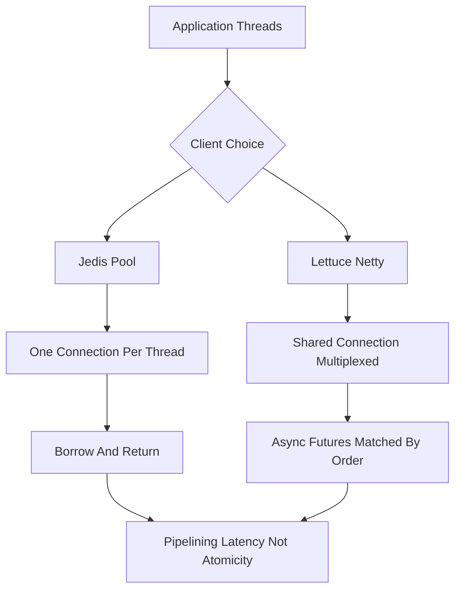

# Lettuce vs Jedis: Choosing and Tuning a Redis Client Library

## English

A Redis client library is the layer between your application code and the wire protocol (RESP, the Redis Serialization Protocol). Two Java clients dominate: Jedis and Lettuce. Jedis is the older, simpler, synchronous client — each Jedis instance wraps a single connection, so in a multi-threaded server you typically pair it with a connection pool (for example Apache Commons Pool) and borrow a connection per operation. Lettuce is built on Netty, is thread-safe, and multiplexes many concurrent commands over a single connection, with first-class async and reactive APIs. Neither is universally better; the choice depends on your concurrency model.

The key mental model is connection-per-thread versus connection-sharing. With Jedis and a pool, your throughput ceiling is roughly pool size times per-connection throughput, and a slow command holding a connection can starve other threads waiting to borrow. With Lettuce, one connection can carry thousands of in-flight commands because RESP is pipelined and responses are matched by order; the library tracks outstanding requests and dispatches replies to the right futures. That is why reactive stacks (Spring WebFlux, for example) tend to default to Lettuce.

Both clients support pipelining, but the ergonomics differ. In Jedis you can use a `Pipeline` object to queue commands and read all replies at once, which cuts round-trip latency but is still synchronous. In Lettuce, pipelining happens naturally when you issue many async commands without awaiting each one — the driver batches them onto the socket. Either way, the correctness rule is the same: pipelining changes latency, not atomicity. Commands are still executed one at a time by the server, and another client's commands can interleave between yours unless you wrap them in MULTI/EXEC or a Lua script.

Connection management has real failure modes. A pool that is too small shows up as threads blocked on `borrowObject`; a pool that is too large multiplies the number of connections the server must track (each connection costs file descriptors and some memory on the Redis side). Lettuce's shared connection can become a bottleneck if a single very large response (say a multi-megabyte `LRANGE` or `SMEMBERS`) blocks the socket for everyone. A common mitigation is to keep a separate connection for bulk or blocking operations, since blocking commands like `BLPOP` hold the connection until data arrives.

Timeouts deserve explicit thought. Set a command timeout so a hung server does not pin your threads forever, and set connect timeouts separately from read timeouts. Also decide on retry behaviour deliberately: automatic retries on non-idempotent commands (like `INCR`) can double-apply an effect. Both libraries let you configure reconnect and retry policies; the safe default is to retry connection establishment but not to blindly replay arbitrary commands. In short, treat the client as part of your system design, not an afterthought — the pool size, the async style, and the retry policy all shape how your service behaves under load and during failover.

## 中文

Redis 客戶端程式庫是應用程式碼與線路協議（RESP，即 Redis Serialization Protocol）之間的一層。Java 界有兩大客戶端：Jedis 與 Lettuce。Jedis 較舊、較簡單、同步——每個 Jedis 實例包住一條連線，所以在多執行緒的伺服器中，你通常要配一個連線池（例如 Apache Commons Pool），每次操作借一條連線。Lettuce 建基於 Netty，執行緒安全，能把大量並發命令多工共用於單一連線，並提供原生非同步與響應式 API。兩者沒有絕對優劣，取決於你的並發模型。

核心心智模型是「每執行緒一連線」對比「共用連線」。用 Jedis 加連線池，吞吐上限大約等於池大小乘以每連線吞吐，而一條慢命令佔住連線，會令其他等借連線的執行緒捱餓。用 Lettuce，一條連線可承載數千條在途命令，因為 RESP 支援管線化，回應按次序配對；程式庫追蹤未完成的請求，把回應派發給正確的 future。這就是為何響應式技術棧（例如 Spring WebFlux）傾向預設用 Lettuce。

兩者都支援管線化，但用法不同。Jedis 可用 `Pipeline` 物件排隊命令再一次讀取所有回應，減少往返延遲，但仍屬同步。Lettuce 中，當你發出大量非同步命令而不逐個等待，管線化自然發生——驅動會把它們批次送上 socket。無論哪種，正確性規則都一樣：管線化改變延遲，不改變原子性。命令仍由伺服器逐條執行，除非你包在 MULTI/EXEC 或 Lua 腳本中，否則其他客戶端的命令可以插在你的命令之間。

連線管理有真實的故障模式。池太小，會見到執行緒阻塞在 `borrowObject`；池太大，會令伺服器要追蹤的連線數倍增（每條連線在 Redis 端都佔檔案描述符與一些記憶體）。Lettuce 的共用連線若遇上單一超大回應（例如數 MB 的 `LRANGE` 或 `SMEMBERS`）阻塞 socket，會拖累所有人。常見緩解是為批量或阻塞操作保留獨立連線，因為像 `BLPOP` 這類阻塞命令會一直佔住連線直到有數據到達。

超時值得認真思考。設定命令超時，令卡住的伺服器不會永遠佔住你的執行緒；連線超時與讀取超時要分開設定。重試行為也要刻意決定：對非冪等命令（如 `INCR`）自動重試可能重複套用效果。兩個程式庫都可設定重連與重試策略；安全的預設是重試建立連線，但不盲目重播任意命令。總之，把客戶端視為系統設計的一部分而非事後補丁——池大小、非同步風格與重試策略，都決定你的服務在高負載與故障轉移時的行為。

## Key Takeaway

Jedis pools one connection per operation while Lettuce multiplexes many commands over a shared thread-safe connection, so pick based on concurrency model and tune pool size, timeouts, and retries deliberately.

## Related Concepts
- Pipelining
- Blocking Commands and the Event Loop

## Diagram

