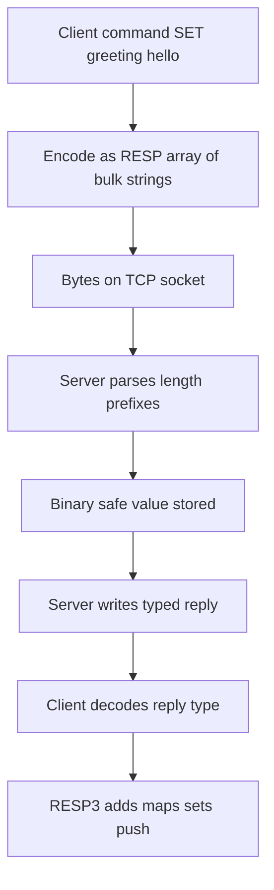

# The RESP Wire Protocol: What Actually Travels Between Client and Server

## English

Every Redis command you write eventually becomes bytes on a TCP socket in a format called RESP (Redis Serialization Protocol). Understanding RESP demystifies a lot: why some clients are fast, why a huge key can stall a connection, and why you can talk to Redis with nothing more than `telnet` or `nc`. RESP is a text-based protocol with a small set of type prefixes, and it is designed to be simple to parse and to be human-readable when you look at a packet capture.

A client sends commands as arrays of bulk strings. For example, `SET greeting hello` goes out as `*3\r\n$3\r\nSET\r\n$8\r\ngreeting\r\n$5\r\nhello\r\n`. The `*3` means an array of three elements, each `$n` declares a bulk string of length n, and every line ends with carriage-return plus line-feed. The server replies with a typed value: `+OK` for a simple string, `-ERR ...` for an error, `:42` for an integer, `$5\r\nhello` for a bulk string, `*2` for an array, and in newer protocol versions `%` for a map, `~` for a set, and `>` for a push message (used by client-side caching and pub/sub in RESP3).

The length prefixes are the clever part. Because each bulk string declares its byte length up front, the parser never has to scan for a delimiter inside binary data — you can store arbitrary bytes, including newlines and null bytes, in a Redis value. This is why Redis values are described as binary-safe. It also means the client must know the exact byte length of what it sends, which is why non-ASCII text (UTF-8 multi-byte characters) takes more bytes than characters and why a client library must encode strings correctly rather than counting characters.

RESP3, introduced alongside Redis 6, added richer types so the server can express what it means rather than flattening everything to strings and arrays. Maps and sets arrive as native types, doubles get their own prefix, and push messages let the server send out-of-band data (like invalidation notices for client-side caching) on the same connection that is carrying request/response traffic. Older clients that only speak RESP2 still work because the handshake starts in RESP2 and upgrades only if the client sends `HELLO 3`.

For debugging, RESP is a gift. You can open a raw connection and type the inline command form (`PING`, `GET foo`) because the server also accepts a simplified single-line command syntax for interactive use. Tools like `redis-cli --pipe` exploit the protocol directly to load millions of commands at maximum speed, and `MONITOR` shows the decoded command stream. Knowing RESP also explains a performance trap: a single very large reply (a multi-megabyte value) must be fully serialized and written to the socket, and the server's output buffer for that client grows accordingly — which is why `client-output-buffer-limit` exists to disconnect clients that cannot keep up.

## 中文

你寫的每一條 Redis 命令，最終都會變成 TCP socket 上的位元組，格式稱為 RESP（Redis Serialization Protocol）。理解 RESP 能解開很多疑惑：為何某些客戶端較快、為何一個巨大的鍵可以卡住連線、為何你單靠 `telnet` 或 `nc` 就能跟 Redis 對話。RESP 是文字為本的協議，只有少量類型前綴，設計上易於解析，而且在抓包時人眼可讀。

客戶端以批量字串組成的陣列送出命令。例如 `SET greeting hello` 會送出 `*3\r\n$3\r\nSET\r\n$8\r\ngreeting\r\n$5\r\nhello\r\n`。`*3` 代表三元素陣列，每個 `$n` 宣告長度為 n 的批量字串，每行以回車加換行結尾。伺服器以帶類型的值回覆：`+OK` 是簡單字串，`-ERR ...` 是錯誤，`:42` 是整數，`$5\r\nhello` 是批量字串，`*2` 是陣列；在較新的協議版本中，`%` 代表映射、`~` 代表集合、`>` 代表推送訊息（RESP3 中供客戶端快取與 pub/sub 使用）。

長度前綴是巧妙之處。每個批量字串預先宣告位元組長度，解析器永遠不必在二進位數據中掃描分隔符——你可以把任意位元組（包括換行與空位元組）存進 Redis 值。這就是為何 Redis 值被形容為二進位安全。這也代表客戶端必須知道所送內容的確切位元組長度，所以非 ASCII 文字（UTF-8 多位元組字元）所佔位元組多於字元數，客戶端程式庫必須正確編碼字串而非數字元個數。

RESP3 隨 Redis 6 引入，加入更豐富的類型，讓伺服器能表達真正含義，而非把一切壓平成字串與陣列。映射與集合以原生類型出現，浮點數有專屬前綴，推送訊息讓伺服器在同一條承載請求／回應的連線上送出帶外數據（例如客戶端快取的失效通知）。只懂 RESP2 的舊客戶端仍可運作，因為握手由 RESP2 開始，只有客戶端送出 `HELLO 3` 才升級。

對除錯而言，RESP 是一份禮物。你可以開一條原始連線，直接打單行命令形式（`PING`、`GET foo`），因為伺服器也接受簡化的單行命令語法供互動使用。`redis-cli --pipe` 之類的工具直接利用協議以最高速度載入數百萬條命令，`MONITOR` 則顯示解碼後命令流。認識 RESP 也解釋了一個效能陷阱：單一超大回應（數 MB 的值）必須完整序列化並寫入 socket，該客戶端的輸出緩衝區會相應膨脹——這就是 `client-output-buffer-limit` 存在的原因，用來斷開跟不上速度的客戶端。

## Key Takeaway

RESP is a length-prefixed, binary-safe text protocol where clients send arrays of bulk strings and the server replies with typed values, which explains binary safety, large-reply buffer limits, and why raw sockets can talk to Redis.

## Related Concepts
- Pipelining
- Client-Side Caching with Tracking

## Diagram

