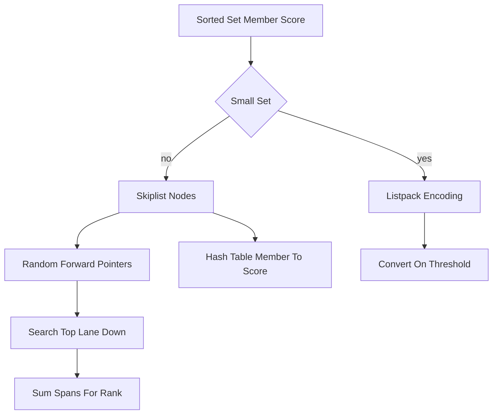

# Sorted Set Internals: Skiplists and the Cost of Ranking

## English

A sorted set stores each member with a numeric score and keeps members ordered by that score, so range queries and rank lookups are cheap. The trick is that Redis does not use a balanced tree for this. It uses a skiplist: a linked list where each node carries a random number of forward pointers, creating express lanes above the base list. Searching starts at the top lane, hops forward while the next node is smaller than the target, then drops a lane and repeats. Because lane heights are random, the expected cost of search, insert, and delete is O(log n) with a small constant, and the implementation is far simpler to write and debug than a red-black tree. Each skiplist node in Redis also stores a span value per level, counting how many nodes that pointer skips. Spans are what make ZRANK and ZREVRANK instant: to find a member's rank you sum the spans you traverse on the way down, so you never scan the list. Range queries like ZRANGEBYSCORE walk the base level from the first matching node, which is why returning a thousand adjacent members is fast even though the set may hold millions.

The cost side is memory. Every member needs a skiplist node (with an average of about 1.33 pointers per node given the usual promotion probability) plus a hash table entry mapping member to score, because ZSCORE must be O(1). That double bookkeeping is why sorted sets are one of the most memory-hungry structures in Redis: a small set of a few hundred members can cost several times what a plain hash of the same data would. Redis mitigates this with listpack encoding for small sorted sets, a compact contiguous byte array used until the set exceeds configured size or element-length thresholds, after which it converts to the skiplist plus hash representation. You can see which encoding is active with OBJECT ENCODING on the key.

A concrete example: a leaderboard with ten million players. ZADD is O(log n), ZSCORE is O(1), ZRANK is O(log n), and ZRANGE with LIMIT returns a page of the top hundred without touching the rest. Contrast that with a naive approach of storing scores in a hash and sorting in the application, which costs O(n log n) per request and transfers the whole dataset. The sorted set pushes that work into the server and keeps the wire traffic proportional to the page size.

One subtlety worth knowing: scores are IEEE 754 doubles, so very large integers lose precision past about 2^53, and NaN is rejected. Ties are broken lexicographically by member, which is deliberate and useful: ZRANGEBYLEX lets you paginate members that share the same score, and the combination of score-then-lex ordering means results are deterministic. If you need exact big-integer ordering, encode the number as a zero-padded string and use lex range queries instead of scores.

Finally, sorted sets compose well with other commands. ZADD with the GT or LT flags updates only if the new score is greater or less, which turns a leaderboard into a running maximum without read-modify-write races. ZINCRBY is atomic, so concurrent score bumps never lose updates. And ZUNIONSTORE or ZINTERSTORE can merge several sorted sets with weights, letting you build composite rankings such as a score blended from recency and popularity, all server-side.

## 中文

有序集合（sorted set）為每個成員儲存一個數值分數（score），並按分數排序，因此範圍查詢和排名查詢都很便宜。關鍵在於 Redis 並非用平衡樹來實現，而是用跳表（skiplist）：一種鏈表，每個節點帶有隨機數量的向前指針，在底層鏈表之上形成「快速通道」。搜尋由最高層開始，只要下一個節點仍小於目標就向前跳，否則降一層再重複。由於層高是隨機的，搜尋、插入、刪除的期望成本是 O(log n)，常數因子也小，而且實作和除錯遠比紅黑樹簡單。Redis 的跳表節點在每一層還儲存一個 span 值，記錄該指針跨越多少個節點。正是 span 令 ZRANK 和 ZREVRANK 變成即時操作：要找某成員的排名，只需把沿途下降時經過的 span 加總，完全不用掃描整個鏈表。像 ZRANGEBYSCORE 這類範圍查詢會由第一個符合的節點沿底層往前走，所以即使集合有幾百萬成員，取回一千個相鄰成員依然很快。

代價在於記憶體。每個成員都需要一個跳表節點（按常見的提升概率，平均每節點約 1.33 個指針），另外還要一個雜湊表條目把成員映射到分數，因為 ZSCORE 必須是 O(1)。這份雙重記錄令有序集合成為 Redis 中最耗記憶體的結構之一：幾百個成員的小集合，記憶體成本可以是同樣資料的普通雜湊好幾倍。Redis 用 listpack 編碼來緩解：小型的集合會用緊湊的連續位元組陣列儲存，直到超出設定的大小或元素長度門檻，才轉換成跳表加雜湊的表示。你可以用 OBJECT ENCODING 查看某個鍵目前用哪種編碼。

具體例子：一個有一千萬名玩家的排行榜。ZADD 是 O(log n)，ZSCORE 是 O(1)，ZRANK 是 O(log n)，而帶 LIMIT 的 ZRANGE 只回傳首一百名的一頁，完全不用碰其餘資料。相比之下，把分數存在雜湊裡、在應用層排序的土法每次請求要 O(n log n)，還要傳輸整份資料。有序集合把這些工作推給伺服器，令網絡流量與頁面大小成正比。

一個值得留意的細節：分數是 IEEE 754 雙精度浮點數，所以超過約 2^53 的大整數會失精度，而 NaN 會被拒絕。分數相同時按成員的字典序排列，這是刻意設計而且很有用：ZRANGEBYLEX 讓你可以分頁取出同分的成員，而「先分數後字典序」的排序保證結果確定。若你需要精確的大整數排序，可把數字編碼成補零的字串，改用字典序範圍查詢而非分數。

最後，有序集合與其他命令組合得很好。ZADD 帶 GT 或 LT 旗標時，只在新分數更大或更小時才更新，令排行榜可以當作「持續最大值」使用，而無需讀取—修改—寫入的競爭風險。ZINCRBY 是原子操作，並發加分不會遺失更新。而 ZUNIONSTORE 或 ZINTERSTORE 可以按權重合併多個有序集合，讓你在伺服器端建立複合排名，例如把新鮮度和熱門程度混合成一個分數。

## Key Takeaway

Sorted sets pair a skiplist with per-level spans and a member-to-score hash, giving O(log n) rank and range operations at the price of roughly double the memory of a plain hash.

## Related Concepts
- Skiplist data structure
- Time complexity of Redis commands

## Diagram

