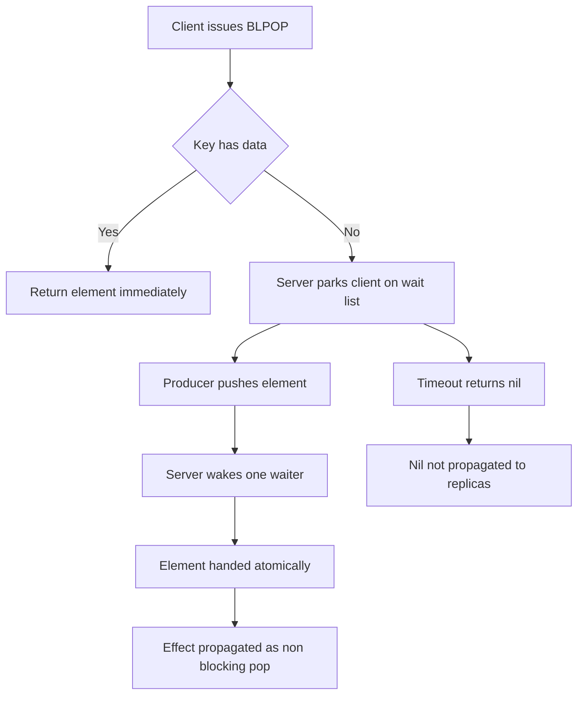

# Blocking on the Wrong Thing: Why BLPOP and Friends Have Subtleties

## English

Blocking commands such as BLPOP, BRPOP, BLMOVE, and BZPOPMIN let a consumer wait for an item to appear instead of polling in a loop. The server parks the client on a wait list keyed by the list or sorted set it is watching, and when a push arrives, the server wakes one waiter and hands it the element in the same step. This is efficient: no busy polling, no wasted round trips, and the element is delivered atomically so two consumers never receive the same item. But the semantics have sharp edges that surprise people.

The most important one is that blocking commands only unblock when data is created. If you BLPOP on a key that already holds elements, it returns immediately, which is fine, but if you delete a key and recreate it, waiters are not automatically notified of the recreation itself, only of pushes that add data. Similarly, a blocked client is not woken by a rename or by a restore of a serialized key in every version, so patterns that swap keys around can leave consumers waiting on a key name that no longer receives pushes. Design your queues so that producers push to the same key that consumers block on, rather than rotating key names.

The timeout argument is in seconds and accepts fractional values in modern Redis, but there is a subtlety with replication and persistence. A blocking command that times out returns a nil reply, and this nil is not propagated to replicas or the AOF, because nothing changed. However, when a blocking command does succeed, the effect (the element being popped) is propagated as a non-blocking equivalent, such as LPOP, so replicas apply the same state change deterministically. This is why you should not rely on the exact timing of a timeout across a failover: the replica never saw the wait.

Inside MULTI/EXEC, blocking commands do not block. They behave as if the timeout were zero and return nil immediately if no element is available, because a transaction must not stall the server waiting for data that another client might never produce. The same applies within Lua scripts: you cannot block inside a script. If you need "wait for data then do several things atomically," the idiomatic shape is a loop in the client: BLPOP to get an item, then a MULTI/EXEC or Lua script to process it, accepting that the pop and the processing are separate steps.

A practical alternative for multi-consumer work queues is the combination of XREADGROUP with BLOCK on a stream, which gives you consumer groups, acknowledgements, and a pending entries list for redelivery. Lists with BLPOP are simpler and faster but have no acknowledgement: if a consumer crashes after popping, the item is gone. Streams trade some throughput for at-least-once delivery. Choose lists for fire-and-forget jobs and streams when losing a job is unacceptable. Also remember that blocking commands hold a connection; a hundred blocked consumers need a hundred connections or a client library that multiplexes them, which is exactly why connection pooling and blocking commands interact awkwardly.

## 中文

BLPOP、BRPOP、BLMOVE、BZPOPMIN 這類阻塞命令讓消費者等待元素出現，而不是在迴圈中輪詢。伺服器會把客戶端掛在一個以它所監視的列表或有序集合為鍵的等待名單上；當有 push 到達時，伺服器喚醒其中一個等待者，並在同一步把元素交給它。這樣很有效率：沒有忙等輪詢、沒有浪費的往返，而且元素是原子地交付，兩個消費者不會拿到同一個元素。但箇中語意有幾個令人意外的尖角。

最重要的一點是：阻塞命令只在資料被建立時才會解除阻塞。如果你對一個已經有元素的鍵執行 BLPOP，它會立即回傳，這沒問題；但如果你刪除一個鍵再重新建立它，等待者不會因為「重新建立」這個動作本身而被通知，只會因真正加入資料的 push 而被喚醒。同樣地，被封鎖的客戶端不會因為 rename，或某些版本中 restore 一個序列化鍵而被喚醒，所以那些把鍵搬來搬去的模式，可能令消費者在一個不再收到 push 的鍵名上苦苦等待。設計佇列時，應讓生產者 push 到消費者所阻塞的同一個鍵，而不要輪換鍵名。

逾時參數以秒為單位，現代 Redis 接受小數值，但在複製與持久化上有個微妙之處。逾時而回的阻塞命令會回傳 nil，而這個 nil 不會傳播到副本或 AOF，因為根本沒有任何改變。相反，當阻塞命令成功時，其效果（元素被彈出）會以非阻塞的等效命令（例如 LPOP）傳播，令副本確定性地套用同一狀態改變。這就是為何不應依賴逾時在故障轉移前後的精確時序：副本從未見過那次等待。

在 MULTI/EXEC 之內，阻塞命令不會阻塞。它們視逾時為零，若無元素可用便立即回傳 nil，因為事務不應為了等待另一個客戶端可能永遠不會產生的資料而卡住伺服器。在 Lua 腳本內亦然：你不能在腳本內阻塞。如果你需要「等到資料後再原子地做幾件事」，慣用做法是在客戶端寫迴圈：先用 BLPOP 取一件，再用 MULTI/EXEC 或 Lua 腳本處理它，並接受「彈出」與「處理」是兩個獨立步驟。

對於多消費者的工作佇列，一個實用替代方案是串流上的 XREADGROUP 配 BLOCK，它提供消費者群組、確認機制，以及用於重新派遞的待處理項目清單（pending entries list）。配 BLPOP 的列表更簡單更快，但沒有確認：若消費者在彈出後當機，該項目就永遠消失。串流以部分吞吐量換取至少一次派遞。無法承受遺失工作的場景用串流，隨手丟棄的任務用列表。另外要記住，阻塞命令會佔住連線；一百個阻塞的消費者需要一百條連線，或一個能多工復用它們的客戶端程式庫——這正是連線池與阻塞命令互動起來別扭的原因。

## Key Takeaway

Blocking commands are efficient and atomic but only wake on data creation, never block inside transactions or scripts, and cannot guarantee delivery the way stream consumer groups can.

## Related Concepts
- Redis Streams consumer groups
- Connection pooling in Redis clients

## Diagram

