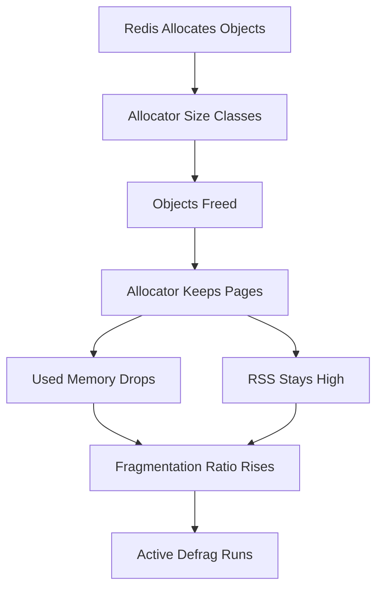

# Memory Fragmentation and the Allocator: Why Used Bytes Do Not Match RSS

## English

When you run INFO memory, you see several numbers that rarely agree: used_memory, used_memory_rss, mem_fragmentation_ratio, and allocator stats. Understanding why they diverge explains a class of production surprises where Redis reports plenty of free memory but the operating system kills the process, or where deleting millions of keys does not shrink the resident set size.

Redis does not call malloc for every object. It uses an allocator library, historically jemalloc by default on Linux, which manages pools of memory in size classes. When you free a 100-byte object, jemalloc does not necessarily return that page to the kernel; it keeps it in its own free lists so the next allocation of a similar size is fast. This is good for performance and bad for the illusion of memory reclamation. used_memory counts bytes Redis believes are allocated for its data, while used_memory_rss is what the operating system has actually mapped into the process. The ratio between them, mem_fragmentation_ratio, above roughly 1.5 suggests the allocator is holding memory the application no longer needs; below 1 means the process is relying on swap, which is catastrophic for latency.

Fragmentation arises from two sources. Internal fragmentation is wasted space inside an allocation, for example when a size class rounds 90 bytes up to 96. External fragmentation is free memory scattered between live allocations so that a large contiguous request cannot be satisfied even though total free bytes are sufficient. Both grow when your workload mixes many small and large objects, or when keys of wildly varying sizes are created and deleted over time. A workload that stores millions of tiny keys and then deletes most of them often leaves a Swiss cheese of holes.

Redis offers ACTIVE DEFRAG, which can be enabled at runtime or in the configuration file. When active, Redis periodically attempts to relocate live objects into contiguous regions and release the vacated pages back to the allocator and the operating system. It costs CPU, so it is usually enabled only when fragmentation is a known problem. The command MEMORY PURGE asks the allocator to return free pages to the kernel, but it only helps if the allocator has pages it can release. MEMORY DOCTOR gives a human-readable diagnosis, and MEMORY STATS dumps detailed allocator figures.

Practical advice follows from this. First, monitor mem_fragmentation_ratio over time rather than reacting to a single reading; a ratio that climbs steadily after a bulk delete is a signal. Second, if you frequently delete large numbers of keys, consider doing it in batches with UNLINK (which frees memory in a background thread) rather than DEL, to avoid blocking the event loop. Third, when running in containers, set maxmemory below the container limit and leave headroom for fragmentation, replication buffers, and copy-on-write during background saves, because the kernel counts RSS, not used_memory. A common rule of thumb is to reserve twenty to thirty percent of the container limit as headroom, though the right figure depends on your write rate and whether persistence is enabled.

## 中文

執行 INFO memory 時，你會見到幾個很少一致的數字：used_memory、used_memory_rss、mem_fragmentation_ratio，以及配置器統計。理解它們為何分歧，就能解釋一類生產環境的意外：Redis 報告大量可用記憶體，作業系統卻殺掉進程；或者刪除幾百萬個鍵之後，常駐記憶體集（RSS）毫不縮小。

Redis 不會為每個物件呼叫 malloc。它使用配置器程式庫，Linux 上歷來預設是 jemalloc，以大小類別管理記憶體池。當你釋放一個 100 位元組的物件，jemalloc 不一定把那頁還給核心；它會留在自己的空閒清單中，令下一次相近大小的分配更快。這對效能好，對「記憶體已回收」的錯覺則不好。used_memory 計算 Redis 認為已為其資料分配的位元組，而 used_memory_rss 是作業系統實際映射到進程的記憶體。兩者之比 mem_fragmentation_ratio 若高於約 1.5，表示配置器保留了應用已不再需要的記憶體；低於 1 則表示進程正在依賴交換空間，對延遲是災難性的。

碎片有兩個來源。內部碎片是分配內部浪費的空間，例如大小類別把 90 位元組進位到 96。外部碎片則是空閒記憶體散落在存活分配之間，令一個大的連續請求無法滿足，即使空閒位元組總量足夠。當工作負載混合大量小物件與大物件，或大小差異極大的鍵隨時間被建立與刪除，兩種碎片都會增長。一個先儲存幾百萬個極小鍵、再刪掉大部分的工作負載，往往留下一片「瑞士芝士」般的空洞。

Redis 提供 ACTIVE DEFRAG，可在執行時或設定檔中啟用。啟用後，Redis 會定期嘗試把存活物件搬移到連續區域，並把騰空的頁還給配置器和作業系統。它消耗 CPU，所以通常只在碎片是已知問題時才啟用。MEMORY PURGE 命令要求配置器把空閒頁還給核心，但只有當配置器確實有頁可還時才有效。MEMORY DOCTOR 給出人類可讀的診斷，MEMORY STATS 則傾印詳細的配置器數字。

實務建議由此而來。第一，隨時間監察 mem_fragmentation_ratio，而不是對單次讀數反應；若比率在大量刪除後持續攀升，就是訊號。第二，若你經常刪除大量鍵，考慮用 UNLINK（在背景執行緒釋放記憶體）分批進行，而非 DEL，以免阻塞事件迴圈。第三，在容器中運行時，把 maxmemory 設在容器限制以下，並為碎片、複製緩衝區，以及背景儲存期間的寫時複製（copy-on-write）預留餘裕，因為核心計的是 RSS，不是 used_memory。常見經驗法則是預留容器限制的兩至三成作餘裕，但正確數字取決於你的寫入速率以及是否啟用持久化。

## Key Takeaway

Redis reports allocated bytes while the OS counts resident pages, so allocator-held free memory and fragmentation can make a healthy-looking instance get killed; monitor the fragmentation ratio and leave RSS headroom.

## Related Concepts
- jemalloc memory allocator
- Container memory limits for Redis

## Diagram

