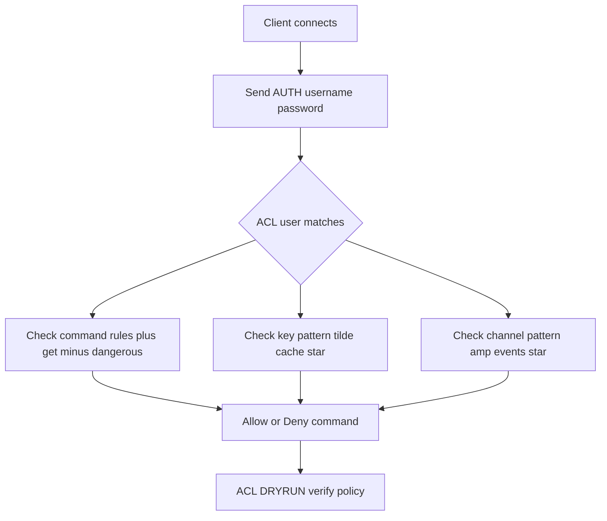

# ACLs: Fine-Grained Permissions for Commands and Keys

## English

Redis ACLs (Access Control Lists) let you define named users that are allowed only certain commands and only certain key patterns. Before ACLs existed, the only protection was the `requirepass` password, which granted full access to everything — a single shared secret. Since Redis 6, you can create users with the `ACL SETUSER` command and attach rules: `+get` allows GET, `-@dangerous` removes a whole command category, and `~cache:*` restricts the user to keys matching that glob pattern. A user can also be limited to specific channels for Pub/Sub with `&events:*`.

Think of it as a hotel keycard system. The old password was a master key that opened every door. ACLs are keycards programmed per guest: the cleaning staff can open guest rooms but not the safe, and a guest can open their own room but not the manager's office. The `~cache:*` pattern means a compromised caching service can never accidentally `FLUSHALL` the whole database or read another service's keys, even if the attacker has valid credentials.

A typical setup creates one user per application or per environment. `ACL SETUSER billing on >secret ~billing:* +@read +@write -@dangerous` gives the billing service read/write on its own keys only, and explicitly denies dangerous commands like `FLUSHALL`, `CONFIG`, and `KEYS`. The default user still exists and can be disabled with `ACL SETUSER default off`. You can inspect the rules with `ACL LIST` and test what a user can do with `ACL DRYRUN <user> <command>` without actually running it — invaluable for verifying a policy before deploying.

ACLs are stored in the ACL file (configured via `aclfile`) or in the config, and can be persisted with `ACL SAVE`. One subtlety: key patterns are checked against the literal key string, so a command that touches multiple keys (like `MGET` or a Lua script) is checked against every key. Since Redis 7, scripts run with the permissions of the calling user, so a user restricted to `~cache:*` cannot use a script to reach other keys; Redis 7 also added an explicit `redis.acl_check_cmd` API for scripts that want to test a command against the current user's rules. This makes ACLs a real security boundary rather than a suggestion.

The practical lesson: treat Redis as a multi-tenant system even when it is not. Separate users per service, deny `@dangerous` by default, and scope keys with prefixes. If a credential leaks, the blast radius is one key namespace instead of the entire dataset.

## 中文

Redis 的 ACL（Access Control List，存取控制清單）讓你定義具名使用者，只允許他們執行某些命令，而且只能存取符合特定模式的鍵。在 ACL 出現之前，唯一的保護是 `requirepass` 密碼，一旦通過就擁有全部權限——等於一個共用萬能鑰匙。自 Redis 6 起，你可以用 `ACL SETUSER` 建立使用者並附加規則：`+get` 允許 GET，`-@dangerous` 移除整個危險命令類別，`~cache:*` 則把使用者限制在符合該 glob 模式的鍵上。使用者也可以透過 `&events:*` 限制只能訂閱特定頻道。

可以想像成酒店的房卡系統。舊的密碼是能開所有門的萬能匙；ACL 則是為每位客人設定的房卡：清潔人員能開客房但開不了保險箱，客人能開自己的房但進不了經理室。`~cache:*` 這個模式意味著即使快取服務被入侵，攻擊者也無法 `FLUSHALL` 整個資料庫或讀取其他服務的鍵，即使他持有有效憑證。

典型做法是每個應用或每個環境建立一個使用者。`ACL SETUSER billing on >secret ~billing:* +@read +@write -@dangerous` 讓帳單服務只對自己的鍵有讀寫權，並明確拒絕 `FLUSHALL`、`CONFIG`、`KEYS` 等危險命令。預設使用者仍然存在，可用 `ACL SETUSER default off` 停用。你可以用 `ACL LIST` 檢視規則，並用 `ACL DRYRUN <user> <command>` 在不真正執行的情況下測試某使用者能否執行某命令——部署前驗證政策時極之有用。

ACL 存放在 ACL 檔案（透過 `aclfile` 設定）或設定檔中，可用 `ACL SAVE` 持久化。一個微妙之處：鍵模式是對實際的鍵字串做比對，所以牽涉多個鍵的命令（如 `MGET` 或 Lua 腳本）會逐一檢查每個鍵。自 Redis 7 起，腳本以呼叫者的權限執行，因此被限制在 `~cache:*` 的使用者無法藉腳本觸及其他鍵；Redis 7 還加入了明確的 `redis.acl_check_cmd` API，讓腳本可以針對目前使用者的規則測試某個命令。這使 ACL 成為真正的安全邊界，而非擺設。

實務上的教訓：即使 Redis 不是多租戶系統，也要當它是。每個服務分開使用者、預設拒絕 `@dangerous`、用前綴劃分鍵空間。憑證一旦洩漏，爆炸半徑就只是一個鍵命名空間，而不是整個資料集。

## Key Takeaway

ACLs turn a single shared password into per-user, per-command, per-key permissions, shrinking the blast radius of a leaked credential.

## Related Concepts
- Command Categories
- Key Namespacing

## Diagram

