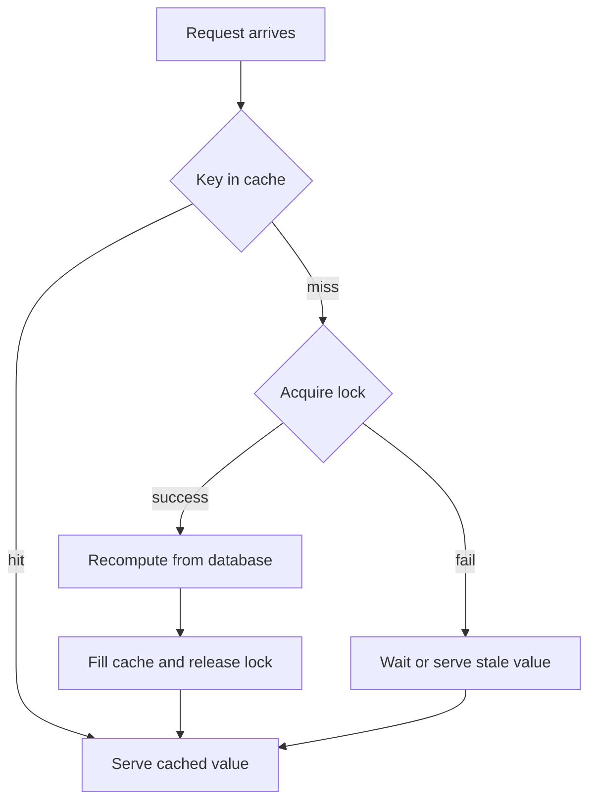

# Hot Keys and Cache Stampedes: When One Key Melts Your Server

## English

A hot key is a single key that receives a disproportionate share of traffic — a celebrity's profile, a homepage configuration, a trending product. Because Redis Cluster routes each key to exactly one hash slot on one node, a hot key lands on exactly one node, and that node's single-threaded event loop must serve every request for it. Other nodes sit idle while one core saturates. This is the traffic equivalent of a supermarket with twenty checkout lanes but only one selling the item everyone wants.

Worse is the cache stampede (also called dog-piling or thundering herd). Suppose a key holds an expensive database query result with a TTL of 60 seconds. At expiry, the key vanishes, and every concurrent request that misses now hits the database simultaneously. If the key is hot, thousands of requests can arrive in the same millisecond, all recomputing the same value. The database, not Redis, is what falls over — and then the recomputation fails, the cache never refills, and the outage becomes self-sustaining.

The classic mitigation is a lock: on a miss, the first request acquires a short-lived lock key with `SET lock:foo <token> NX PX 5000`, recomputes, fills the cache, and releases the lock. Others either wait briefly and retry, or serve a slightly stale value. That last idea is powerful: you can keep a logical TTL inside the value itself and, when it is past, have one worker refresh it in the background while everyone else keeps reading the old value. The key never disappears, so there is no miss window at all. Randomized TTL jitter (adding a random few seconds to each expiry) also spreads a wave of expirations that were all set at the same moment.

For genuinely hot keys, replication helps only for reads, and only if clients can read from replicas. Another approach is to shard the hot key manually: store `hotkey:0` through `hotkey:9` and have clients pick one at random, then sum or merge the results. For counters this works naturally; for opaque blobs it does not. Client-side caching with server-assisted invalidation (the tracking feature) is often the best answer, because the hot value is served from application memory and Redis only sends a small invalidation message when it changes.

Key takeaway: measure key-level hit rates and request counts, not just overall stats. A handful of keys usually accounts for most traffic, and those are the ones that decide whether your cache layer survives a traffic spike.

## 中文

熱鍵（hot key）是指單一鍵承受不成比例的流量——某位名人的個人檔案、首頁設定、熱門商品。由於 Redis Cluster 把每個鍵路由到某一個節點上的某一個雜湊槽，熱鍵必然落在唯一一個節點，而該節點的單執行緒事件迴圈必須服務它的每一個請求。其他節點閒著，一個核心卻已飽和。這就像超市有二十條收銀線，但只有一條在賣所有人都想要的東西。

更糟的是快取雪崩（cache stampede，又叫 dog-piling 或 thundering herd）。假設某個鍵存著一個昂貴的資料庫查詢結果，TTL 是 60 秒。到期一刻鍵消失，所有同時未命中的請求一齊打到資料庫。若該鍵是熱鍵，成千上萬個請求可能在同一毫秒到達，全部重算同一個值。倒下的是資料庫而不是 Redis——然後重算失敗，快取永遠填不回去，故障便自我延續。

經典的緩解方法是加鎖：未命中時，第一個請求用 `SET lock:foo <token> NX PX 5000` 取得短命的鎖鍵，重算、填入快取、釋放鎖。其他請求則短暫等待後重試，或直接回傳稍舊的值。後者威力很大：你可以把邏輯 TTL 存在值裡面，過期後由一個工作程序在背景刷新，其他人繼續讀舊值。鍵永遠不消失，根本沒有未命中的空窗。為 TTL 加上隨機抖動（每個到期時間隨機加幾秒）也能打散同一刻設定的一整批到期。

對於真正極熱的鍵，複製只對讀取有幫助，而且前提是客戶端能讀取副本。另一個做法是手動分片：儲存 `hotkey:0` 到 `hotkey:9`，客戶端隨機挑一個，再把結果加總或合併。對計數器這很自然，對不透明的資料塊則不行。結合伺服器輔助失效的客戶端快取（tracking 功能）往往是最佳答案，因為熱值直接由應用記憶體提供，Redis 只在值變更時送出小小的失效訊息。

重點：要量度鍵層級的命中率和請求數，而不只看整體統計。少數幾個鍵通常佔去大部分流量，而正是它們決定你的快取層能否捱過流量高峰。

## Key Takeaway

A few hot keys decide your fate: guard them with locks, stale-while-revalidate, TTL jitter, or client-side caching before a stampede takes down the database behind Redis.

## Related Concepts
- Cache Stampede
- Client-Side Caching

## Diagram

