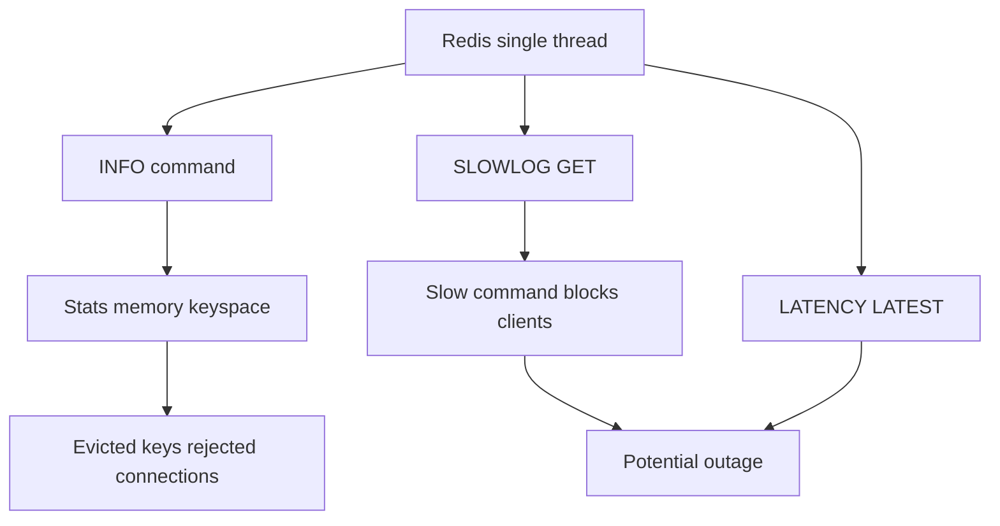

# Monitoring Redis: Reading INFO, Latency, and Slowlog Before Things Break

## English

Redis exposes a great deal of operational truth through a few commands, and knowing which numbers matter is a skill in itself. `INFO` returns sections — `server`, `clients`, `memory`, `persistence`, `stats`, `replication`, `cpu`, `cluster`, `keyspace` — as plain text lines of `field:value`. The `stats` section gives `keyspace_hits` and `keyspace_misses`, whose ratio is your cache hit rate; the `memory` section gives `used_memory` and `used_memory_rss`, whose divergence points at fragmentation; and `keyspace` lists each database with its key count, expiring keys, and average TTL.

Two counters deserve special attention: `evicted_keys` and `rejected_connections`. Evictions mean the maxmemory limit is being hit and Redis is discarding keys according to the eviction policy — data you expected to be there is silently gone. Rejected connections mean the client limit (`maxclients`) was reached. Both are silent failures from the application's point of view: the app just sees a miss or a connection error. Watching these trends over time, rather than only when things break, is how you catch capacity problems early.

`SLOWLOG GET` records commands that exceeded a configurable duration (`slowlog-log-slower-than`, in microseconds). Because Redis is single-threaded, one slow command blocks every other client — so the slowlog is not just a performance curiosity, it is a list of potential outages. Common culprits are `KEYS *` over a large keyspace, `SMEMBERS` on a huge set, or a Lua script that loops over many keys. Note that the slowlog measures execution time only, not time spent waiting for the network or blocked on I/O, so a command can feel slow to the client yet never appear in the log.

`LATENCY` commands complement this. `LATENCY LATEST` reports the most recent latency spikes per event type, and `LATENCY HISTORY <event>` shows the trend. Redis records events such as `command` (slow commands), `fork` (the pause when a background save forks), and `expire-cycle`. This is how you discover that your periodic RDB save is causing multi-millisecond stalls, or that the active expiration cycle is struggling under a flood of short-lived keys.

Finally, `CLIENT LIST` shows every connected client with its address, age, idle time, and last command — invaluable for spotting connection leaks or a misbehaving service. `CLIENT NO-EVICT` and `CLIENT KILL` let you protect important connections and terminate bad ones. The overarching idea: Redis is extremely observable if you look, but almost all of its failure modes are quiet. Build dashboards around hit rate, evictions, rejected connections, memory versus RSS, slowlog entries, and fork latency, and alert on trends rather than absolute thresholds.

## 中文

Redis 透過少數幾個命令揭露大量營運真相，而懂得哪些數字重要本身就是一門技能。`INFO` 回傳多個區段——`server`、`clients`、`memory`、`persistence`、`stats`、`replication`、`cpu`、`cluster`、`keyspace`——以純文字的 `欄位:值` 行呈現。`stats` 區段提供 `keyspace_hits` 與 `keyspace_misses`，兩者之比就是你的快取命中率；`memory` 區段提供 `used_memory` 與 `used_memory_rss`，兩者背離就暗示記憶體碎片化；`keyspace` 則列出每個資料庫的鍵數、設有到期的鍵數和平均 TTL。

有兩個計數器值得特別留意：`evicted_keys` 與 `rejected_connections`。逐出表示已觸及 maxmemory 上限，Redis 正按逐出策略丟棄鍵——你以為還在的資料已悄悄消失。連線被拒表示已達客戶端上限（`maxclients`）。從應用角度看，兩者都是靜默失敗：應用只看到一次未命中或一個連線錯誤。持續觀察這些趨勢，而不是等出事才看，才是及早發現容量問題的方法。

`SLOWLOG GET` 記錄執行時間超過可設定門檻（`slowlog-log-slower-than`，單位微秒）的命令。由於 Redis 是單執行緒，一個慢命令會阻塞所有其他客戶端——所以 slowlog 不只是效能趣聞，而是一份潛在故障清單。常見元兇包括在大鍵空間上執行 `KEYS *`、對巨大集合執行 `SMEMBERS`，或是在大量鍵上迴圈的 Lua 腳本。注意 slowlog 只量度執行時間，不計網絡等待或被 I/O 阻塞的時間，所以某命令對客戶端而言很慢，卻可能從不出現在日誌中。

`LATENCY` 系列命令正好補足這點。`LATENCY LATEST` 報告每種事件類型最近的延遲尖峰，`LATENCY HISTORY <event>` 顯示趨勢。Redis 會記錄 `command`（慢命令）、`fork`（背景儲存分叉時的停頓）、`expire-cycle` 等事件。這就是你發現定期 RDB 儲存造成數毫秒停頓，或主動到期週期在大量短命鍵下吃不消的方法。

最後，`CLIENT LIST` 顯示每個已連線客戶端的位址、連線年齡、閒置時間和最後執行的命令——找出連線洩漏或行為異常的服務時極之有用。`CLIENT NO-EVICT` 與 `CLIENT KILL` 讓你保護重要連線、終止不良連線。總體概念：只要去看，Redis 的可觀測性極高，但它幾乎所有故障模式都是安靜的。圍繞命中率、逐出、連線被拒、記憶體對比 RSS、slowlog 條目和 fork 延遲建立儀表板，並對趨勢而非絕對門檻發出警報。

## Key Takeaway

Redis fails quietly, so instrument hit rate, evictions, rejected connections, RSS versus used memory, slowlog, and fork latency, and alert on trends rather than single thresholds.

## Related Concepts
- Eviction Policies
- Slowlog

## Diagram

