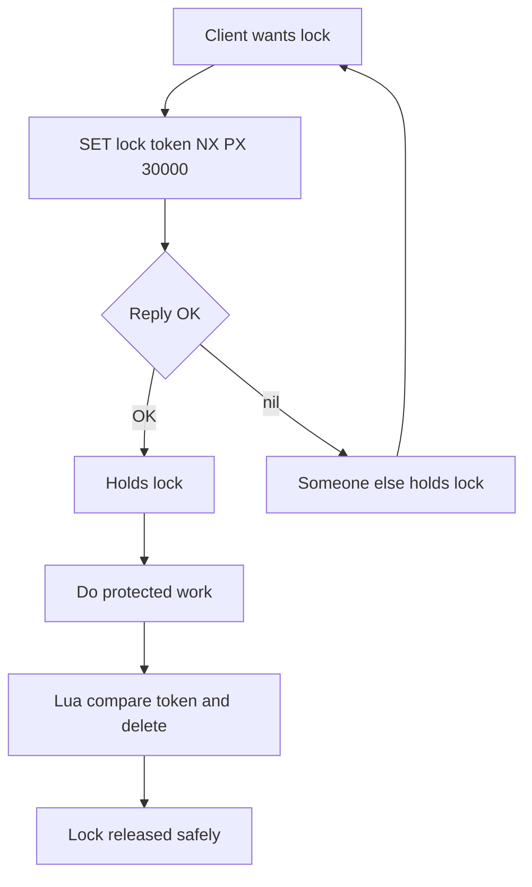

# The In-Memory Data Store as a Shared Coordination Point

## English

Most people first meet Redis as a cache: put a value in, get it out fast, let it expire. But the more interesting use is coordination — letting several independent processes agree on something without talking to each other directly. Think of a busy car park with one shared whiteboard at the entrance: every driver reads the same board to decide which space is free, so nobody needs to phone anyone else. Redis plays that whiteboard role because it is a single logical point that everyone can reach, and because its commands execute one at a time, a read-modify-write sequence on one key cannot be interleaved with another client's sequence.

The classic primitive here is the distributed lock. A client runs SET lock_name my_token NX PX 30000 — NX means "only set if the key does not already exist", and PX 30000 gives the key a 30-second expiry so a crashed holder cannot block everyone forever. If the command returns OK, you hold the lock; if it returns nil, someone else does. The random token matters because releasing the lock should be conditional: you delete the key only if its value still equals your token, which you check inside a Lua script so the compare-and-delete is atomic. Without the token, a client whose lock already expired could delete a lock now held by somebody else.

Beyond locks, the same idea powers counters and rate limiters (INCR on a key with a TTL), leader election (whoever wins SET NX is the leader), and work distribution (LPUSH a job onto a list, workers take it with BRPOP). All of these lean on the same property: a single authoritative place where a small piece of state changes atomically, so a fleet of stateless application servers can behave as if they shared memory.

There is an important caveat. Redis is not a consensus system. If the primary crashes before replicating a lock acquisition, a replica promoted by Sentinel may not know the lock exists, and two clients can briefly believe they hold it. For strict mutual exclusion across failures you need something like a quorum-based algorithm (for example, Redlock-style majority reads, or a real consensus store such as etcd or ZooKeeper). For the vast majority of application-level coordination — deduplicating jobs, throttling API calls, choosing one cron runner — the small risk window is acceptable and the simplicity is worth it.

The mental shift is this: stop thinking of Redis as a faster database and start thinking of it as a shared scratchpad that all your processes can read and write atomically. That framing explains why commands like SET NX, INCR, and list pops exist at all, and why they are documented as atomic single operations rather than as things you compose yourself.

## 中文

大部分人第一次接觸 Redis 都當它是快取：放一個值進去、快速拿出來、到期就消失。但更有趣的用法是「協調」——讓幾個互不相干的程序不必直接通訊，也能對某件事達成共識。想像一個繁忙的停車場，入口只有一塊共用白板：每位司機都看同一塊板來決定哪個車位空著，所以誰都不用打電話給誰。Redis 就扮演這塊白板的角色，因為它是所有人都能連到的單一邏輯點，而且它的命令是一條一條依序執行的，所以對同一個鍵的「讀—改—寫」序列不會被另一個客戶端的序列插進來。

這裡最經典的原語是分散式鎖。客戶端執行 SET lock_name my_token NX PX 30000——NX 的意思是「只有在鍵不存在時才設定」，而 PX 30000 給這個鍵 30 秒的到期時間，這樣即使持有者當機，也不會永遠卡住所有人。如果命令回傳 OK，你就拿到鎖；回傳 nil，就代表別人拿著。那個隨機 token 很重要，因為釋放鎖應該是有條件的：只有當鍵的值仍然等於你的 token 時才刪除，而這個「比較後刪除」要放進 Lua 指令碼裡執行才會原子。沒有 token 的話，一個鎖已經過期的客戶端，可能會把別人現在持有的鎖刪掉。

除了鎖，同一個概念也支撐著計數器與限流器（對帶 TTL 的鍵做 INCR）、領導者選舉（誰贏了 SET NX 誰就是 leader），以及工作分派（用 LPUSH 把任務推入 list，worker 用 BRPOP 取走）。這些全都依賴同一個特性：有一個權威的單一位置，讓一小塊狀態原子地改變，於是一整群無狀態的應用伺服器就能表現得像共用記憶體一樣。

但有一個重要警告。Redis 不是共識系統。如果主節點在把某次鎖的取得複製出去之前就當機，Sentinel 提升的副本可能根本不知道這個鎖存在，於是兩個客戶端會短暫地都以為自己持有鎖。若要在故障情況下做到嚴格的互斥，你需要像以 quorum 為基礎的演算法（例如 Redlock 風格的過半數讀取，或 etcd、ZooKeeper 這類真正的共識儲存）。但對絕大多數應用層的協調——任務去重、API 限流、挑一個 cron 執行者——這個小小的風險視窗是可以接受的，換來的簡單性很值得。

心態上的轉變是這樣：不要再把 Redis 想成「更快的資料庫」，而是想成「所有程序都能原子讀寫的共用草稿紙」。這個框架解釋了為什麼 SET NX、INCR、list pop 這類命令會存在，也解釋了為什麼它們被檔案描述為原子的單一操作，而不是讓你自己組合出來的東西。

## Key Takeaway

Redis is best understood as a shared, atomically-updated scratchpad that lets independent processes coordinate, not just as a fast cache.

## Related Concepts
- Distributed locks with SET NX PX
- Atomic commands and single-threaded execution

## Diagram

