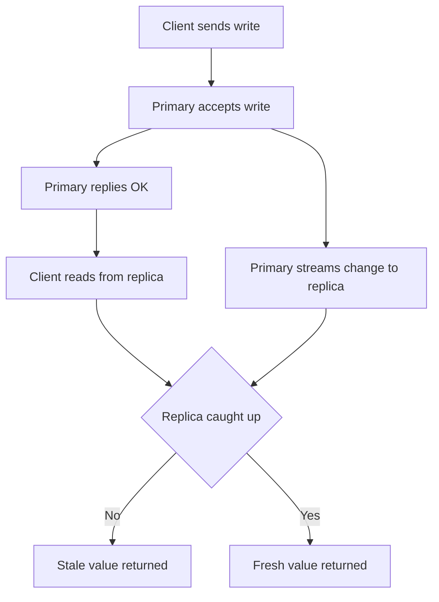

# Replication Lag and the Read-Your-Writes Problem

## English

The moment you add a replica and start sending reads to it, you inherit a subtle class of bugs that have nothing to do with Redis being slow. Replication in Redis is asynchronous by default: the primary accepts a write, replies OK to the client immediately, and streams the change to replicas afterwards. Between those two events there is a window — usually sub-millisecond on a LAN, but easily tens or hundreds of milliseconds under load, during a network hiccup, or while a replica is catching up after a restart. During that window, a read sent to the replica can return the old value even though the write already succeeded.

A concrete failure: a user updates their profile picture. The write goes to the primary, the app redirects to a page that reads the profile from a replica, and the user sees their old picture. They refresh and it is fixed. This is the read-your-writes anomaly, and it is one of the most common sources of "it works but sometimes looks broken" bug reports in systems that scale reads with replicas. The same class of problem applies to any read-after-write flow: create-then-list, post-then-fetch, increment-then-display.

The standard mitigation is to pin a user to the primary for reads for a short period after they write. You can implement this by storing a per-session flag, or by writing a key like recent_write:<user_id> with a short TTL (say, five seconds) on the primary, and having the read path check that key first — if it exists, read from the primary. Another approach is to track a replication offset: after a write, the client records the primary's current offset, and the replica only serves that client once its own offset has caught up. Some client libraries expose this; if yours does not, the TTL flag is usually good enough.

It is also worth knowing what replicas are and are not for. They give you read scaling and a warm standby for failover, but they are not a backup: a replica faithfully reproduces a mistaken DEL or FLUSHALL. They also do not protect against primary memory exhaustion or a bug that corrupts data at the application layer. For those you need real backups — periodic RDB snapshots copied off the host, ideally verified by restoring them somewhere.

Finally, remember that Sentinel failover can also lose writes. When a primary dies, any writes that had not reached a replica are gone, and clients that were talking to the old primary may have received OK for writes that no longer exist. If your application cannot tolerate that, you need to think about write durability (WAIT command, AOF with fsync every write, or an external log) rather than assuming replication equals safety.

## 中文

當你加了一個副本、開始把讀取導向它，你就繼承了一類很微妙的 bug，而這跟 Redis 慢不慢完全無關。Redis 的複製預設是非同步的：主節點接受寫入、立刻回 OK 給客戶端，之後才把變更串流給副本。在這兩件事之間有一個窗口——在區域網路上通常是次毫秒級，但在高負載、網路抖動、或副本重啟後正在追進度時，很容易變成幾十甚至幾百毫秒。在這個窗口內，送到副本的讀取可能回傳舊值，即使寫入早已成功。

一個具體的失敗情境：使用者更新大頭貼。寫入送到主節點，應用重新導向到一個從副本讀取個人檔案的頁面，使用者看到的還是舊照片。重新整理就好了。這就是「讀取自己的寫入」異常，也是在用副本擴展讀取的系統裡，「功能明明正常但有時看起來壞掉」這類 bug 報告最常見的來源之一。同一類問題適用於任何「寫後即讀」的流程：建立後列出、發佈後抓取、遞增後顯示。

標準的緩解方式，是在使用者寫入後的短時間內，把他的讀取釘在主節點上。你可以用一個 per-session 旗標來實作，或在主節點寫一個像 recent_write:<user_id> 這樣帶短 TTL（比如五秒）的鍵，讓讀取路徑先檢查這個鍵——存在就從主節點讀。另一個做法是追蹤複製偏移量：寫入後客戶端記下主節點當前的 offset，副本要等自己的 offset 追上才服務這個客戶端。有些客戶端函式庫有提供；如果你的沒有，TTL 旗標通常就夠用了。

也值得搞清楚副本「是」什麼、「不是」什麼。它們給你讀取擴展能力和一個熱備援用於故障轉移，但它們不是備份：副本會忠實地重現一次錯誤的 DEL 或 FLUSHALL。它們也保護不了你免於主節點記憶體耗盡，或應用層 bug 造成的資料損毀。那些你需要真正的備份——定期把 RDB 快照複製到主機之外，最好還原到某處驗證過。

最後，記住 Sentinel 的故障轉移也可能丟寫入。主節點死掉時，任何還沒到達副本的寫入就沒了，而原本連著舊主節點的客戶端，可能已經收到某些寫入的 OK，而那些寫入已經不存在。如果你的應用無法承受，就要思考寫入持久性（WAIT 命令、每次寫入都 fsync 的 AOF，或外部日誌），而不是假設複製等於安全。

## Key Takeaway

Asynchronous replication means replicas can serve stale reads right after a write, so read-your-writes flows need explicit pinning to the primary or offset tracking.

## Related Concepts
- Asynchronous replication
- Read-your-writes consistency

## Diagram

