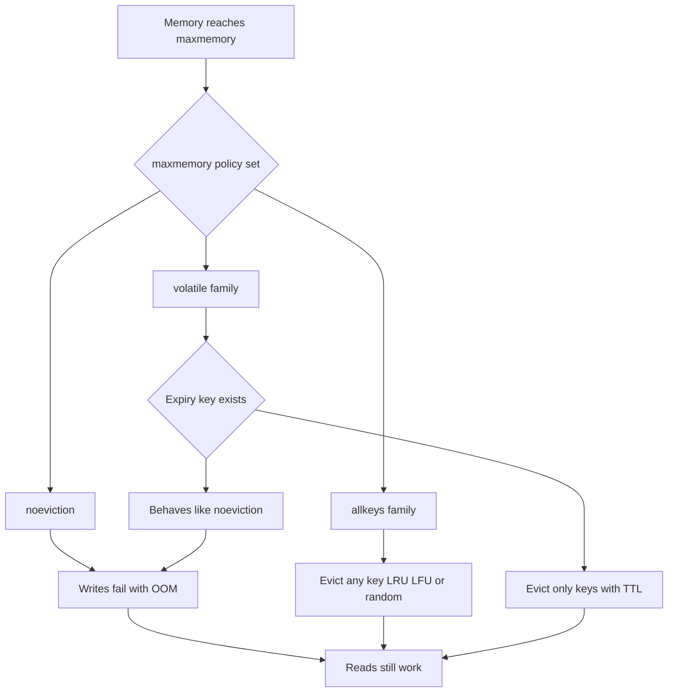

# Choosing the Right Eviction Policy Before Memory Runs Out

## English

Sooner or later every Redis instance hits maxmemory. What happens next is not automatic and not obvious: it depends entirely on the maxmemory-policy setting, and getting it wrong turns a cache into an outage. The default in recent versions is noeviction, which means writes that would exceed the limit fail with an OOM error while reads keep working. That is a reasonable default for a database-like workload, but it is a terrible default for a cache, because your application starts throwing errors the moment memory fills.

The policies fall into two families. The allkeys-* family evicts from the entire keyspace: allkeys-lru evicts the least recently used key, allkeys-lfu evicts the least frequently used, allkeys-random picks at random. The volatile-* family only evicts keys that have an expiry set: volatile-lru, volatile-lfu, volatile-random, volatile-ttl (evict the soonest to expire). The volatile family is useful when one instance holds both critical data (no TTL) and cache data (with TTL) — eviction then only touches the cache portion. If no evictable key exists, volatile policies behave like noeviction and return OOM errors, which is a common surprise.

LRU and LFU in Redis are approximations, not exact. Redis does not maintain a true recency list; instead it samples a small number of keys (controlled by maxmemory-samples, default 5) and evicts the least recently used among the sample. Raising the sample size improves accuracy at some CPU cost. LFU, added later, keeps a per-key counter with a logarithmic increment and a decay over time, so a key that was hot last week but cold today will gradually lose its score. LFU is often the better choice for caches with stable hot sets (a product catalogue, a homepage feed), while LRU suits workloads where recency is a good proxy for usefulness (session data, recent queries).

A practical rule: size your instance so that steady-state usage sits comfortably below maxmemory — say 60–70% — so eviction is a safety valve rather than a constant churn. If you see evicted_keys climbing steadily in INFO stats, your cache is too small or your TTLs are too long. If you see keyspace_hits dropping relative to keyspace_misses, your working set no longer fits. Both are signals to add memory or shard the cache, not to fiddle with the policy.

Also be aware that eviction costs CPU. Each eviction is a key deletion, and under a burst of writes you can spend significant time freeing memory. And on a replica, eviction does not happen locally: the primary decides what to evict and sends DEL commands downstream, so replicas can temporarily exceed maxmemory. Plan headroom accordingly.

## 中文

每個 Redis 實例遲早都會撞到 maxmemory。接下來會發生什麼並不是自動的、也不明顯：它完全取決於 maxmemory-policy 這個設定，而設錯就會把快取變成事故。近幾版的預設值是 noeviction，意思是會超過上限的寫入會以 OOM 錯誤失敗，而讀取照常運作。對資料庫型的工作負載來說這是合理的預設，但對快取來說是糟糕的預設，因為記憶體一滿，你的應用就開始拋錯。

這些策略分成兩大家族。allkeys-* 家族從整個鍵空間淘汰：allkeys-lru 淘汰最近最少使用的鍵，allkeys-lfu 淘汰最不常使用的，allkeys-random 隨便挑。volatile-* 家族只淘汰設有到期時間的鍵：volatile-lru、volatile-lfu、volatile-random、volatile-ttl（淘汰最快到期的）。當同一個實例同時存放關鍵資料（沒有 TTL）和快取資料（有 TTL）時，volatile 家族很有用——淘汰只會動到快取那部分。如果沒有任何可淘汰的鍵，volatile 策略的行為就跟 noeviction 一樣、回傳 OOM 錯誤，這是很多人會嚇一跳的地方。

Redis 裡的 LRU 和 LFU 都是近似值，不是精確的。Redis 並不維護真正的「最近使用」清單；它改成抽樣少數幾個鍵（由 maxmemory-samples 控制，預設 5），淘汰樣本裡最久沒用的那個。提高取樣數會提升準確度，代價是一些 CPU。後來加入的 LFU 則為每個鍵保留一個計數器，用對數式遞增並隨時間衰減，所以上週很熱、今天很冷的鍵會逐漸掉分。對於熱集合穩定的快取（商品目錄、首頁動態），LFU 往往是更好的選擇；而當「最近」是「有用」的良好代理時（session 資料、近期查詢），LRU 更合適。

一條實用規則：把實例的容量規劃成穩定狀態的使用量舒適地低於 maxmemory——比如 60–70%——讓淘汰是安全閥而不是持續不斷的翻攪。如果你在 INFO stats 裡看到 evicted_keys 穩定攀升，代表你的快取太小、或 TTL 太長。如果你看到 keyspace_hits 相對 keyspace_misses 在下降，代表你的工作集合已經放不下了。這兩個都是「加記憶體或切分快取」的訊號，而不是去調策略。

也要知道淘汰會耗 CPU。每次淘汰都是一次鍵刪除，在一陣寫入爆發下，你可能花可觀的時間在釋放記憶體。而在副本上，淘汰不會本地發生：由主節點決定淘汰什麼、再把 DEL 命令送下去，所以副本可能暫時超過 maxmemory。規劃時要留相應的餘裕。

## Key Takeaway

maxmemory-policy decides whether a full instance degrades gracefully or starts failing writes, so choose it deliberately and watch evicted_keys as a capacity signal.

## Related Concepts
- maxmemory-policy
- LRU and LFU approximations

## Diagram

