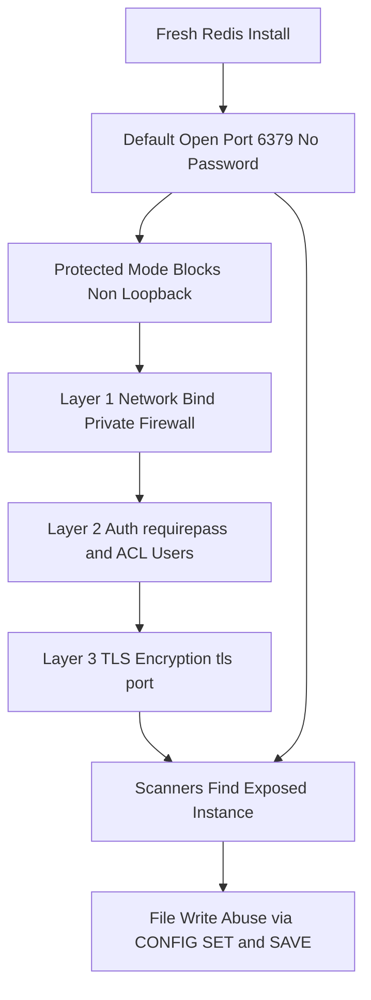

# Connecting Safely: TLS, Auth, and the Default Configuration Trap

## English

A freshly installed Redis is, by default, a wide-open server: it listens on port 6379, has no password, and accepts commands from anyone who can reach it. The `protected-mode` setting added in Redis 3.2 blocks non-loopback connections when no password is set, but it is a safety net, not a security model. The classic failure mode is a Redis instance exposed to the internet, found by an automated scanner within hours, and abused to write files (for example, using `CONFIG SET dir` and `CONFIG SET dbfilename` plus `SAVE` to drop an SSH key or a cron job onto disk). The first line of defence is therefore network: bind to a private interface, use firewall rules or a security group, and never publish the port to the public internet.

The second layer is authentication. The `requirepass` directive sets a single shared password that clients must send with `AUTH`. Modern Redis (6.0 and later) adds ACLs, which let you define named users, each with a password and a list of allowed commands and key patterns — so an analytics job can be given read-only access to `cache:*` keys and nothing else. This limits blast radius: a leaked credential for a read-only user cannot run `FLUSHALL`. Rotating passwords and using separate users per application is a cheap habit that pays off during incidents.

Third comes transport encryption. Redis supports TLS natively since version 6.0, configured with directives such as `tls-port`, `tls-cert-file`, `tls-key-file`, and `tls-ca-cert-file`. When TLS is enabled, plain-text connections on the normal port can be disabled entirely. This matters most when Redis traffic crosses a network boundary you do not fully control — a cloud provider's internal network, a shared VPC, or a container overlay. Even inside a trusted network, TLS protects against passive sniffing of session tokens or cached personal data.

A subtlety: enabling TLS changes how clients connect. Most client libraries need an explicit flag (for example, a `rediss://` URL scheme in many drivers, versus `redis://` for plain text) and may need the CA certificate to verify the server. Misconfiguration often shows up as a connection reset rather than a clear error, so test the full path in staging. Also remember that replication links and Sentinel connections need their own TLS settings; securing only the client-facing port leaves the replica link exposed.

Finally, treat configuration as code. Keep `redis.conf` in version control, disable dangerous commands for untrusted users (ACLs can deny `FLUSHALL`, `CONFIG`, `KEYS`, and `DEBUG`), and rename or disable commands you never use. Run `CONFIG GET` on a live instance occasionally to confirm the deployed settings match what you believe. Security here is mostly about removing easy wins: no open port, no passwordless access, no unencrypted traffic across untrusted links, and no over-privileged users.

## 中文

剛安裝好的 Redis 預設是一個門戶大開的伺服器：它監聽 6379 端口、沒有密碼，任何能連上的人都可以下指令。Redis 3.2 加入的 `protected-mode` 會在沒有設定密碼時阻擋非本機連線，但這只是一張安全網，不是完整的安全模型。經典的失敗情境是：一個暴露在公網的 Redis 實例，幾小時內就被自動掃描器找到，然後被用來寫入檔案（例如用 `CONFIG SET dir` 和 `CONFIG SET dbfilename` 配合 `SAVE`，把 SSH 金鑰或 cron 任務寫到磁碟上）。所以第一道防線是網絡：綁定到私有網卡、使用防火牆規則或安全群組，永遠不要把端口發佈到公網。

第二層是認證。`requirepass` 指令設定一組共用密碼，客戶端要用 `AUTH` 送出。較新的 Redis（6.0 起）加入 ACL，可以定義具名使用者，每個使用者有自己的密碼，以及允許的指令清單和鍵模式——於是分析工作可以只獲授權讀取 `cache:*` 的鍵，其他一律不行。這限制了爆炸半徑：一個唯讀使用者的憑證外洩，也無法執行 `FLUSHALL`。定期輪換密碼、每個應用使用獨立使用者，是成本很低、事故時回報很高的習慣。

第三層是傳輸加密。Redis 自 6.0 起原生支援 TLS，透過 `tls-port`、`tls-cert-file`、`tls-key-file`、`tls-ca-cert-file` 等指令設定。啟用 TLS 後，可以完全關閉普通端口上的明文連線。這在你無法完全掌控的網絡邊界上最為重要——雲端供應商的內部網絡、共用的 VPC，或容器覆蓋網絡。即使在被信任的網絡內，TLS 也能防止會話令牌或被快取的個人資料被動地被嗅探。

有一個細節：啟用 TLS 會改變客戶端的連線方式。多數客戶端程式庫需要明確的旗標（例如許多驅動用 `rediss://` 網址方案代表 TLS，`redis://` 則是明文），而且可能需要 CA 憑證來驗證伺服器。設定錯誤通常表現為連線被重置，而不是清楚的錯誤訊息，所以要在測試環境驗證整條路徑。另外要記住，複製連結和 Sentinel 連線各自需要 TLS 設定；只保護面向客戶端的端口，會讓複本連結暴露在外。

最後，把設定當成程式碼管理。把 `redis.conf` 放進版本控制，對不受信任的使用者停用危險指令（ACL 可以拒絕 `FLUSHALL`、`CONFIG`、`KEYS`、`DEBUG`），並重新命名或停用永遠用不到的指令。偶爾在運行中的實例上執行 `CONFIG GET`，確認部署的設定和你以為的一致。這裡的安全主要是消除容易得手的機會：不開放的端口、沒有無密碼存取、跨越不受信任連結時沒有明文流量，以及沒有過度授權的使用者。

## Key Takeaway

A default Redis install is an open door; secure it in layers — network binding, authentication and ACLs, TLS, and disciplined configuration — because scanners find exposed instances fast.

## Related Concepts
- ACLs: Fine-Grained Permissions for Commands and Keys
- The RESP Wire Protocol: What Actually Travels Between Client and Server

## Diagram

