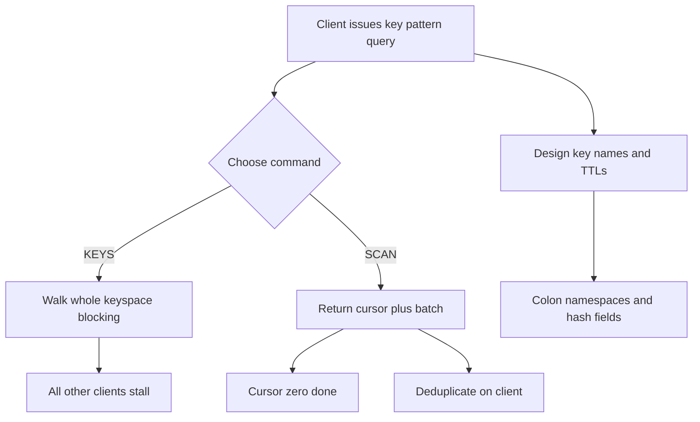

# Keyspace Design: Naming, Cardinality, and the Cost of KEYS

## English

Redis has no schemas, but it does have conventions, and the biggest one is the key name itself. A common pattern is colon-separated namespaces: `user:1001:profile`, `order:2024-06:shipped`, `cache:product:42`. The colons are not special to Redis — they are just characters in a string — but tools and humans both read them as hierarchy. This matters because `SCAN` supports a `MATCH` glob pattern, so `SCAN 0 MATCH user:1001:*` can walk one user's keys, and monitoring dashboards can group keys by prefix. Consistent naming turns a flat keyspace into something navigable.

Why not just use `KEYS user:*`? Because `KEYS` walks the entire keyspace in one blocking operation. Redis executes commands on a single thread, so while `KEYS` runs, every other client waits. On a database with millions of keys this can stall the server for seconds. `SCAN` is the production-safe alternative: it returns a cursor and a batch of keys, and you call it repeatedly until the cursor comes back as zero. `SCAN` guarantees that keys present for the whole iteration are returned at least once, but it may return duplicates and does not guarantee a consistent snapshot — so deduplicate on the client side if that matters.

Key cardinality is the next trap. Storing one key per user is fine; storing one key per request identifier with no expiry is a slow memory leak. Every key carries overhead — the key string, the object header, the dictionary entry — so millions of tiny keys cost far more than the raw data suggests. A useful rule: if a key is a cache entry, give it a TTL so it disappears on its own. If it is durable state, ask whether it belongs in a hash field instead of a separate key. A hash like `user:1001` with fields `name`, `email`, `last_seen` uses one key and one expiry, instead of three keys and three expiries.

Hashes also enable partial reads and writes: `HGET user:1001 email` fetches one field without transferring the whole object, and `HSET` updates one field without a read-modify-write cycle. For small objects, Redis stores hashes in a compact listpack encoding below a configurable size threshold, which is more memory-efficient than separate keys. The trade-off is that you cannot expire individual fields on older versions (field-level TTL arrived later), so design around whole-object expiry unless you specifically need per-field lifetimes.

Finally, think about what a key name encodes. Embedding a timestamp or a version in the key (for example `session:v2:abc`) lets you invalidate an entire generation by changing the prefix, and lets you migrate formats without ambiguity. Avoid unbounded prefixes: a key like `event:2024:...` grows forever unless something deletes it. The discipline is simple — pick a naming convention, document it, always set a TTL on cache-like keys, and never run `KEYS` in production. These small choices determine whether your keyspace stays comprehensible at ten million keys or collapses into an unnavigable pile.

## 中文

Redis 沒有 schema，但有慣例，而最大的一條就是鍵名本身。常見模式是用冒號分隔的命名空間：`user:1001:profile`、`order:2024-06:shipped`、`cache:product:42`。冒號對 Redis 並不特殊——它只是字串裡的一個字元——但工具和人都會把它讀成階層。這很重要，因為 `SCAN` 支援 `MATCH` 萬用字元模式，所以 `SCAN 0 MATCH user:1001:*` 可以走訪某個使用者的鍵，監控儀表板也可以按前綴分組。一致的命名把扁平的鍵空間變成可導航的東西。

為什麼不直接用 `KEYS user:*`？因為 `KEYS` 會在一個阻塞操作中走遍整個鍵空間。Redis 在單一執行緒上執行指令，所以 `KEYS` 執行期間，其他所有客戶端都要等。在擁有數百萬個鍵的資料庫上，這可能讓伺服器停頓數秒。`SCAN` 是生產環境安全的替代方案：它回傳一個游標和一批鍵，你反覆呼叫直到游標回傳零。`SCAN` 保證在整個迭代期間一直存在的鍵至少會被回傳一次，但可能回傳重複項，也不保證一致的快照——所以如果在意，就在客戶端去重。

鍵的基數是下一個陷阱。每個使用者存一個鍵沒問題；每個請求識別碼存一個鍵又沒有過期時間，就是慢性記憶體洩漏。每個鍵都有開銷——鍵字串、物件標頭、字典項目——所以數百萬個小鍵的成本遠高於原始資料所暗示的。一個有用的規則：如果鍵是快取項目，給它 TTL 讓它自己消失。如果是持久狀態，問問它是否應該放在雜湊的欄位裡，而不是獨立鍵。像 `user:1001` 這樣帶有 `name`、`email`、`last_seen` 欄位的雜湊，用一個鍵和一個過期時間，而不是三個鍵和三個過期時間。

雜湊也支援部分讀寫：`HGET user:1001 email` 只取一個欄位，不用傳輸整個物件；`HSET` 只更新一個欄位，不需要讀取—修改—寫回的循環。對於小物件，Redis 在低於可設定的尺寸門檻時，會用緊湊的 listpack 編碼儲存雜湊，比獨立鍵更省記憶體。代價是較舊版本無法讓個別欄位過期（欄位級 TTL 是後來才加入的），所以除非你確實需要每個欄位各自的存活期，否則要圍繞整個物件過期來設計。

最後，想想鍵名編碼了什麼。把時間戳或版本嵌入鍵名（例如 `session:v2:abc`），可以讓你改變前綴就讓整個世代失效，也可以無歧義地遷移格式。避免無界前綴：像 `event:2024:...` 這樣的鍵除非有東西刪除它，否則會永遠增長。紀律很簡單——選定命名慣例、寫成文件、對類快取的鍵一律設 TTL，而且永遠不要在生產環境執行 `KEYS`。這些小選擇決定你的鍵空間在千萬個鍵時仍然可理解，還是崩塌成一堆無法導航的東西。

## Key Takeaway

Use colon-separated key namespaces, prefer SCAN over KEYS, watch key cardinality, and always set TTLs on cache-like keys — naming and lifecycle discipline keep a flat keyspace manageable.

## Related Concepts
- Lazy vs Active Expiration: How Redis Actually Deletes Expired Keys
- Memory Overhead: Why a 100 MB Dataset Can Eat 200 MB of RAM

## Diagram

