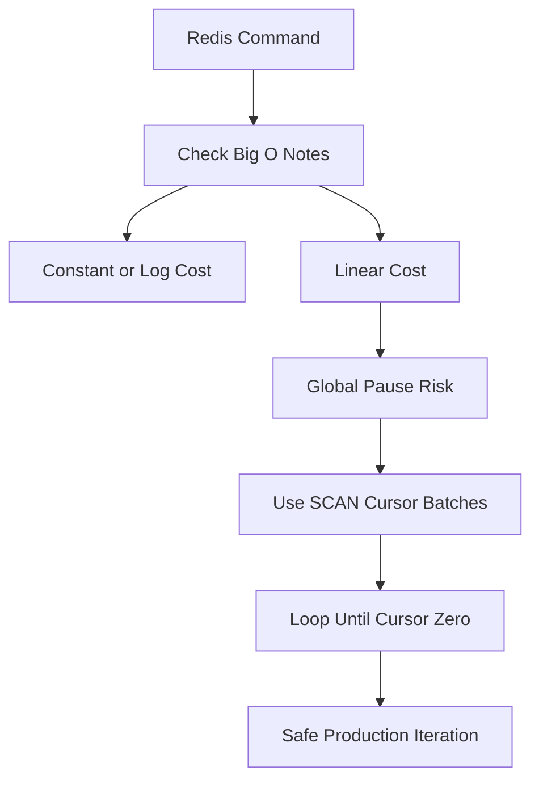

# Command Complexity: Reading the Big-O Notes Before You Deploy

## English

Every Redis command has a documented time complexity, and those notes are the difference between a fast system and an outage. `GET`, `SET`, `HGET`, `LPUSH`, and `ZADD` are O(1) or O(log N) — effectively constant at any realistic size. But `KEYS` is O(N) over the whole keyspace, `SMEMBERS` is O(N) over a set, `LRANGE mylist 0 -1` is O(N) over a list, and `ZRANGE key 0 -1 WITHSCORES` is O(log N + M) where M is the number of returned elements. In a single-threaded server, an O(N) command on a large structure is a global pause for every other client.

The subtlety is that many commands are "cheap per element but expensive in total." `HGETALL` on a hash with a million fields returns a million field-value pairs in one reply, which means building a huge response buffer and blocking the event loop while it is serialised. The fix is to iterate: `HSCAN` walks a hash in batches using a cursor, and `SSCAN` and `ZSCAN` do the same for sets and sorted sets. These are the production-safe siblings of `HGETALL`, `SMEMBERS`, and `ZRANGE` when the collection might be large. The pattern is always the same: loop with the cursor until it returns zero, process each batch, and never assume the collection is small.

Aggregate commands deserve special attention. `SINTERSTORE`, `SUNIONSTORE`, and `ZUNIONSTORE` combine entire sets or sorted sets, and their cost scales with the total number of elements involved. `SORT` without `BY` or `GET` is O(N log N) and can be very expensive on large lists. `BITCOUNT` over a huge bitmap is O(N) in the number of bytes. None of these are wrong to use — they are the right tool when the data is genuinely small — but you need to know the size before you call them. A common incident pattern is a set that was tiny in development and grew to millions of members in production, turning an innocuous `SMEMBERS` into a multi-second stall.

Lists have their own asymmetry. `LPUSH` and `RPUSH` are O(1), and `LPOP`/`RPOP` are O(1), which makes lists excellent queues. But `LINSERT`, `LREM`, and index-based access like `LINDEX key 500000` are O(N) because a list is a linked structure — reaching the middle means walking from an end. `LRANGE` near the ends is cheap; `LRANGE` over the whole list is not. Similarly, `ZRANGEBYSCORE` with a narrow range is cheap because the skiplist jumps straight to the boundary, but a range covering everything returns everything.

The practical discipline is to consult the complexity section of the documentation for any command you have not used before, and to reason about the worst-case size of the data structure it touches. Prefer the SCAN family for iteration, cap the size of collections you operate on in bulk, and use `SLOWLOG` to catch commands that took longer than a threshold you set. `SLOWLOG GET` shows the most recent slow commands with their duration and arguments, which is often enough to identify the exact call that is stalling the server. Treat O(N) as a warning label, not a ban — just make sure N is a number you actually know.

## 中文

每個 Redis 指令都有文件記載的時間複雜度，而這些註記就是快速系統與事故之間的差別。`GET`、`SET`、`HGET`、`LPUSH`、`ZADD` 是 O(1) 或 O(log N)——在任何現實規模下實際上都是常數。但 `KEYS` 是對整個鍵空間的 O(N)，`SMEMBERS` 是對集合的 O(N)，`LRANGE mylist 0 -1` 是對列表的 O(N)，而 `ZRANGE key 0 -1 WITHSCORES` 是 O(log N + M)，其中 M 是回傳的元素數。在單執行緒的伺服器上，對大型結構執行 O(N) 指令，就是對其他所有客戶端的全域暫停。

微妙之處在於，很多指令是「每個元素便宜，但總量昂貴」。對一個有百萬欄位的雜湊執行 `HGETALL`，會在一個回覆中回傳百萬個欄位—值對，意味著要建立巨大的回應緩衝區，並在序列化時阻塞事件迴圈。解法是迭代：`HSCAN` 用游標分批走訪雜湊，`SSCAN` 和 `ZSCAN` 對集合和有序集合做同樣的事。當集合可能很大時，這些就是 `HGETALL`、`SMEMBERS`、`ZRANGE` 的生產安全版本。模式永遠一樣：用游標迴圈直到回傳零，處理每一批，永遠不要假設集合很小。

聚合指令值得特別注意。`SINTERSTORE`、`SUNIONSTORE`、`ZUNIONSTORE` 會合併整個集合或有序集合，成本隨涉及的元素總數增長。沒有 `BY` 或 `GET` 的 `SORT` 是 O(N log N)，在大型列表上可能非常昂貴。對巨大點陣圖執行 `BITCOUNT` 是 O(N)（以位元組數計）。這些都不是不能用——當資料確實很小時，它們是正確的工具——但呼叫前你需要知道大小。常見的事故模式是：一個在開發環境很小的集合，在生產環境長到數百萬成員，把無害的 `SMEMBERS` 變成數秒的停頓。

列表有其自身的不對稱性。`LPUSH` 和 `RPUSH` 是 O(1)，`LPOP`/`RPOP` 是 O(1)，這讓列表成為優秀的佇列。但 `LINSERT`、`LREM`，以及像 `LINDEX key 500000` 這種基於索引的存取，都是 O(N)，因為列表是鏈式結構——要到達中間就得從一端走過去。靠近兩端的 `LRANGE` 很便宜；涵蓋整個列表的 `LRANGE` 則不然。同樣地，範圍很窄的 `ZRANGEBYSCORE` 很便宜，因為跳表會直接跳到邊界，但涵蓋全部的範圍會回傳全部。

實際的紀律是：對於任何你沒用過的指令，查閱文件中的複雜度段落，並推斷它所觸及的資料結構的最壞情況大小。迭代時優先使用 SCAN 家族，限制你批量操作的集合大小，並用 `SLOWLOG` 捕捉超過你所設門檻的指令。`SLOWLOG GET` 顯示最近的慢指令及其耗時和參數，通常足以找出讓伺服器停頓的那個呼叫。把 O(N) 當成警告標籤，而不是禁令——只要確保 N 是一個你真正知道的數字。

## Key Takeaway

Check each command's documented complexity, prefer the SCAN family over bulk reads on large collections, and use SLOWLOG to catch the O(N) calls that stall a single-threaded server.

## Related Concepts
- Single-Threaded Execution: Why One Core Is Both a Feature and a Trap
- Monitoring Redis: Reading INFO, Latency, and Slowlog Before Things Break

## Diagram

