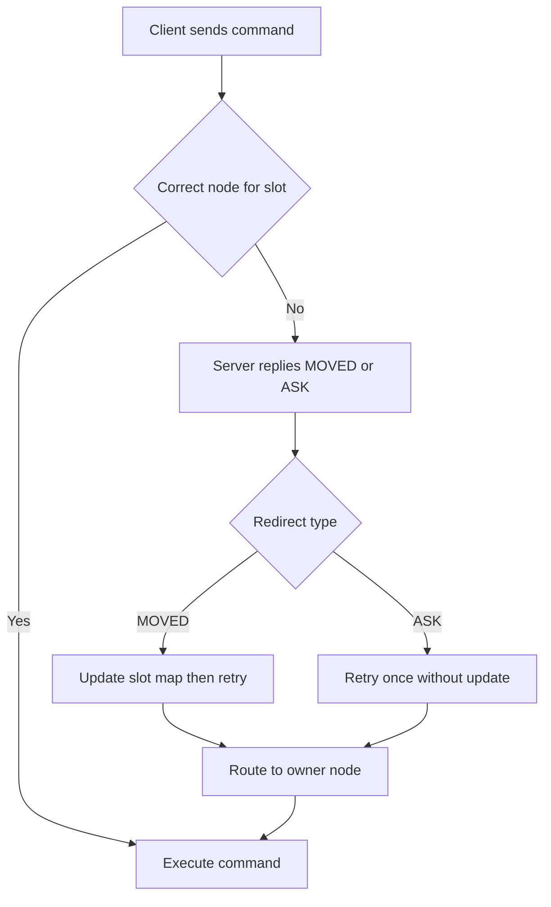

# Cluster-Aware Clients and MOVED/ASK Redirections

## English

In Redis Cluster the keyspace is split across hash slots, and each node only owns a subset of those slots. A client that connects to the wrong node for a given key does not get a silent error — it gets a redirect. The server replies with a MOVED error that names the slot and the address of the node that currently owns it. The client is then expected to reconnect to the right node and retry. A well-behaved cluster client therefore keeps a local slot-to-node map and refreshes it whenever it sees a MOVED, so most requests go straight to the correct node after a short warm-up. If you write your own client or use a thin driver, you must implement this redirect handling yourself; otherwise every misrouted command will fail.

The second redirect type is ASK. It appears during slot migration: when a slot is being moved from one node to another, the source node may still hold some keys of that slot while the destination holds the rest. If a command arrives at the source for a key that has already moved, the source replies with an ASK redirect pointing at the destination. The crucial difference is that ASK means 'ask this node just this once' — the client should send the command to the destination but must not permanently update its slot map, because the migration is still in progress. MOVED, by contrast, means 'the slot has permanently moved; update your map.'

A subtle consequence is that multi-key commands only work when all the keys land in the same slot. Commands like MGET or SUNION across unrelated keys will fail with a CROSSSLOT error because the keys hash to different slots on different nodes. Redis provides hash tags: if a key contains a substring wrapped in curly braces, only that substring is hashed. So user:{42}:name and user:{42}:email both hash on the literal text 42 and therefore land in the same slot. This is how you deliberately co-locate related keys so that multi-key operations and transactions remain possible.

From an operations standpoint, redirects are cheap but not free. Each MOVED or ASK costs an extra network round trip, and a client with a stale map can generate a storm of them after a failover or resharding event. Good client libraries hide this, but you should still watch for spikes in redirect counts in your monitoring. A stable cluster with a warm client map should see near-zero redirects; a persistent trickle suggests your client is not caching the map or that a slot is oscillating between nodes.

Finally, remember that cluster mode changes what atomicity means. MULTI/EXEC and Lua scripts can only touch keys in the same slot, and the cluster bus gossips slot ownership between nodes so that everyone agrees on the map. Designing keys with hash tags from day one is far easier than retrofitting them after your data is spread across nodes.

## 中文

在 Redis Cluster 中，鍵空間被切分到不同的雜湊槽（hash slot），而每個節點只擁有一部分槽。若客戶端把某個鍵送到錯誤的節點，伺服器不會靜默報錯，而是回傳重定向。伺服器會回覆一個 MOVED 錯誤，指明該槽以及目前擁有它的節點位址，客戶端理應重新連線到正確節點並重試。行為良好的叢集客戶端因此會在本地維護一份「槽到節點」的映射表，每當看到 MOVED 就刷新它，於是經過短暫暖機後，大多數請求都能直接送到正確節點。若你自行撰寫客戶端或使用較精簡的驅動，就必須自己實作這套重定向處理，否則每個送錯的指令都會失敗。

第二種重定向是 ASK。它出現在槽遷移期間：當某個槽正從一個節點搬到另一個節點，來源節點可能仍持有該槽的部分鍵，而目的節點持有其餘的鍵。若指令抵達來源節點，而該鍵已經搬走，來源就會回覆 ASK，指向目的節點。關鍵差別在於：ASK 的意思是「就這一次，去問那個節點」——客戶端應把該指令送到目的節點，但不可永久更新槽映射，因為遷移仍在進行中。相對地，MOVED 的意思是「這個槽已永久搬走，請更新你的映射」。

一個微妙的後果是：多鍵指令只有在所有鍵都落在同一個槽時才能運作。像 MGET 或 SUNION 這類橫跨不相關鍵的指令，會因為鍵雜湊到不同節點上的不同槽，而以 CROSSSLOT 錯誤失敗。Redis 提供了雜湊標籤（hash tag）：若鍵中含有以大括號包住的子字串，就只有該子字串會參與雜湊。因此 user:{42}:name 與 user:{42}:email 都以字面文字 42 做雜湊，於是落在同一個槽。這就是刻意把相關鍵放在一起、讓多鍵操作與事務仍可行的做法。

從維運角度看，重定向很便宜但並非免費。每個 MOVED 或 ASK 都要多花一次網路往返，而映射表過期的客戶端在故障轉移或重新分片之後，可能引發大量重定向風暴。好的客戶端函式庫會把這件事藏起來，但你仍應在監控中留意重定向次數的尖峰。一個穩定、客戶端映射已暖機的叢集，重定向應該接近零；若持續出現零星重定向，代表你的客戶端沒有快取映射，或某個槽在節點之間來回震盪。

最後要記得，叢集模式改變了「原子性」的含義。MULTI/EXEC 與 Lua 腳本只能碰同一個槽裡的鍵，而叢集匯流排（cluster bus）會在節點之間以 gossip 協定傳播槽的歸屬，讓所有人對映射達成共識。從第一天就用雜湊標籤設計鍵，遠比資料已經散落在各節點之後再回頭補救容易得多。

## Key Takeaway

Cluster clients must understand MOVED (permanent, update your slot map) versus ASK (temporary, retry once during migration), and hash tags are how you keep related keys in the same slot.

## Related Concepts
- Redis Cluster hash slots
- CROSSSLOT errors and hash tags

## Diagram

