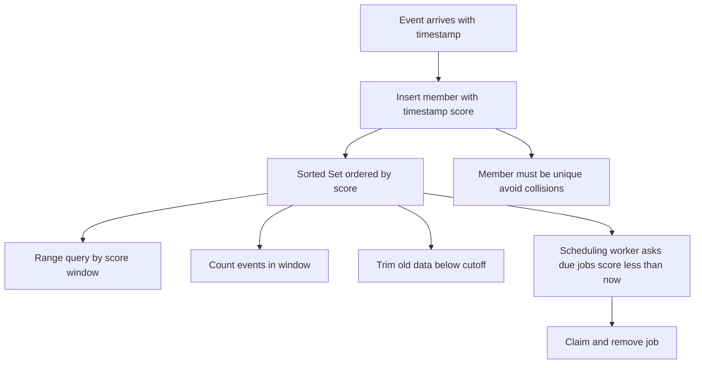

# Sorted Set Range Queries as a Time-Series and Scheduling Engine

## English

A sorted set maps each member to a numeric score and keeps members ordered by that score, which makes it a natural fit for anything that is fundamentally 'ordered by a number'. The most common trick is to use a Unix timestamp (seconds or milliseconds) as the score and some unique identifier as the member. Because range queries by score are efficient, you can ask for 'everything between time A and time B' with ZRANGEBYSCORE, or count events in a window with ZCOUNT. This gives you a lightweight time-series store: every event is one member, retrieval by time window is a range scan, and trimming old data is a single ZREMRANGEBYSCORE call that deletes everything below a cutoff timestamp. No separate index, no schema, no background compaction job.

Scheduling is the other classic use. Imagine you want to run a job at a future time. You insert the job into a sorted set with its scheduled execution time as the score. A worker then periodically asks for all members whose score is less than or equal to 'now' — that is, everything that is due. Because the set is ordered, this query is cheap and does not require scanning the whole collection. Once a job is claimed, you remove it (or move it to an 'in progress' set) so another worker does not pick it up. This is the skeleton of a delayed-job queue, and it is exactly the pattern behind many small scheduling systems built on Redis.

One important limitation: a sorted set is a set, so members must be unique. If two events share both the same timestamp and the same identifier, the second insert overwrites the first's score rather than creating a duplicate. In practice you avoid this by making the member unique — for example by appending a random suffix or a monotonic counter to the identifier, or by using millisecond precision so collisions are rare. Also remember that scores are floating-point numbers, so very large millisecond timestamps are still exact up to the point where double precision runs out, which is far beyond any realistic date.

For time-series workloads, a useful refinement is bucketing. Instead of one giant sorted set holding years of events, keep one sorted set per time bucket, such as one per hour or per day, with a key naming convention that includes the bucket. Then a query for a wide range touches only the buckets that overlap, and old buckets can simply be expired with a TTL rather than trimmed member by member. This keeps each individual key small, which matters because a single very large sorted set costs memory and makes operations on it heavier even when they are logarithmically bounded.

Finally, be aware that range queries return members, not scores, unless you ask for them with the WITHSCORES option. If you need the timestamp back, request it explicitly. And because removal is not automatic, a scheduling system must have a strategy for jobs that are claimed but never completed — typically a visibility timeout that re-inserts the job after a grace period, mirroring how reliable queues work elsewhere.

## 中文

有序集合（sorted set）把每個成員映射到一個數值分數，並依分數維持成員的排序，這讓它非常適合任何本質上「依某個數字排序」的東西。最常見的技巧是用 Unix 時間戳（秒或毫秒）當分數，用某個唯一識別碼當成員。由於依分數做範圍查詢很有效率，你可以用 ZRANGEBYSCORE 要求「時間 A 到時間 B 之間的一切」，或用 ZCOUNT 計算某個時間窗內的事件數。這就給你一個輕量的時序資料庫：每個事件是一個成員，依時間窗檢索就是一次範圍掃描，而修剪舊資料只是一次 ZREMRANGEBYSCORE 呼叫，把低於截止時間戳的一切刪掉。不需要額外的索引、不需要 schema、不需要背景壓縮工作。

排程是另一個經典用途。想像你想在未來某個時間執行一個任務。你把該任務插入有序集合，以它預定的執行時間當分數。接著一個工作者會週期性地詢問所有分數小於或等於「現在」的成員——也就是所有已到期的項目。因為集合是有序的，這個查詢很便宜，不需要掃描整個集合。一旦任務被認領，你就把它移除（或搬到一個「進行中」的集合），以免另一個工作者又撿走它。這就是延遲任務佇列的骨架，也是許多建立在 Redis 上的小型排程系統背後的模式。

一個重要限制：有序集合是集合，所以成員必須唯一。若兩個事件同時擁有相同的時間戳與相同的識別碼，第二次插入會覆寫第一次的分數，而不是產生重複項。實務上你透過讓成員唯一來避免這件事——例如在識別碼後面附加隨機後綴或單調遞增計數器，或使用毫秒精度讓碰撞變得罕見。另外要記得，分數是浮點數，所以極大的毫秒時間戳在雙精度耗盡之前仍是精確的，而那遠超過任何現實中的日期。

對時序工作負載而言，一個有用的改良是分桶（bucketing）。與其用一個巨大的有序集合裝下好幾年的事件，不如每個時間桶（例如每小時或每天）各用一個有序集合，鍵的命名慣例包含該桶。這樣一來，查詢一段較寬的範圍只會碰到有重疊的桶，而舊桶可以直接用 TTL 過期，不必逐一修剪成員。這讓每個鍵都保持小，而這很重要，因為單一超大的有序集合會耗費記憶體，即使操作是對數界限，實際做起來也更沉重。

最後要注意，範圍查詢預設回傳成員而非分數，除非你加上 WITHSCORES 選項。若你需要拿回時間戳，就得明確要求。而由於移除並非自動，排程系統必須有一套策略來處理「已認領但從未完成」的任務——通常是可見性逾時（visibility timeout），在寬限期後把任務重新插入，這與其他地方可靠佇列的做法如出一轍。

## Key Takeaway

Using timestamps as sorted-set scores turns Redis into a compact time-series index and a delayed-job scheduler, as long as you keep members unique and bucket large datasets into smaller keys.

## Related Concepts
- ZRANGEBYSCORE and ZCOUNT
- Delayed job queues

## Diagram

