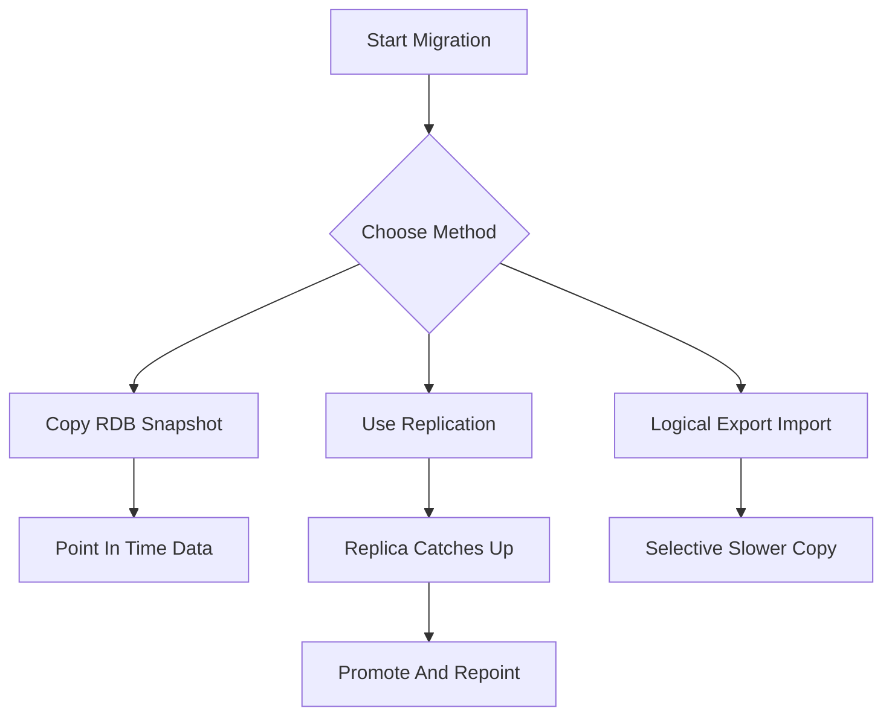

# Migrating Between Redis Versions and Deployments Without Losing Data

## English

Sooner or later you will need to move data: upgrading to a new major version, moving from a self-managed server to a managed service, or changing your topology. Redis gives you a few migration primitives, and understanding what each one preserves is the key to a safe move. The simplest is to copy the RDB snapshot file to the new server and start it with that file in its data directory. This is fast and preserves everything in the snapshot, but it captures a point in time — any writes that happen after the snapshot are lost unless you quiesce the source first or replay them separately.

A more live approach is replication. You can make the new server a replica of the old one, let it catch up, then promote the new server to primary and repoint your clients. This is essentially what a managed failover does under the hood, and it minimizes downtime because the replica streams changes continuously. The catch is that replication is asynchronous by default: there is a window where the replica lags, so you must wait until it has caught up before promoting, and you must account for clients that are still writing to the old primary during the switch. A common pattern is to put the old primary into a read-only state or pause writers briefly, confirm the replica is in sync, promote it, then move clients over.

A third option is logical export and import. Tools that read keys and their values and re-insert them on the destination let you migrate selectively — only certain key patterns, only certain databases — and they work across versions where the on-disk format may have changed. The downside is that they are slower and can miss very short-lived keys or keys that expire during the migration. For large datasets, a full logical copy can take a long time and put load on both sides, so it is usually reserved for cases where binary snapshot compatibility is not available.

Whichever path you choose, the details matter. RDB files are generally forward-compatible in the sense that newer servers can read older snapshots, but the reverse is not guaranteed, so downgrading with a snapshot is risky. Expiration times are stored in the snapshot and are preserved, but a key that expires during a long migration may simply vanish on the destination. If you use modules or features that are version-specific, verify they exist on the target before you start. And always take a fresh backup of the source before touching anything, because migration is exactly the moment when a mistake is hardest to undo.

Finally, plan the cutover rather than improvising it. Write down the sequence: quiesce or throttle writers, take a final snapshot or confirm replication sync, start the destination, run a smoke test against it with a handful of representative reads and writes, then flip the connection strings. Keeping the old deployment running but read-only for a short while gives you a rollback path if the new one misbehaves, and it costs almost nothing compared to discovering a problem after the old data is gone.

## 中文

遲早你都需要搬移資料：升級到新的大版本、從自管伺服器搬到託管服務，或改變拓撲。Redis 提供幾種遷移原語，而理解每一種保留了什麼，是安全搬遷的關鍵。最簡單的是把 RDB 快照檔複製到新伺服器，並讓它以該檔作為資料目錄啟動。這很快，也會保留快照中的一切，但它捕捉的是某個時間點——除非你先讓來源靜止，或另行重放，否則快照之後發生的任何寫入都會遺失。

更即時的做法是複製（replication）。你可以讓新伺服器成為舊伺服器的副本，等它追上，再把新伺服器提升為主節點並把客戶端重新指向它。這本質上就是託管故障轉移在底層做的事，而且因為副本會持續串流變更，能將停機降到最低。問題在於複製預設是非同步的：副本存在落後的時間窗，所以你必須等它追上才能提升，而且必須處理切換期間仍寫入舊主節點的客戶端。常見模式是把舊主節點設為唯讀或短暫暫停寫入者，確認副本已同步，提升它，再把客戶端移過去。

第三種選項是邏輯匯出與匯入。會讀取鍵及其值、再於目的端重新插入的工具，讓你選擇性地遷移——只搬某些鍵樣式、只搬某些資料庫——而且它們能跨越磁碟格式可能已改變的版本。缺點是較慢，且可能漏掉壽命極短的鍵或在遷移期間過期的鍵。對大型資料集而言，完整的邏輯複製可能耗時很久，並對兩端造成負載，所以通常只在無法使用二進位快照相容性時才採用。

無論選哪條路，細節都很重要。RDB 檔一般而言是向前相容的，也就是較新的伺服器能讀取較舊的快照，但反向並不保證，所以用快照降級是有風險的。過期時間會存在快照中並被保留，但在漫長遷移期間過期的鍵，可能就在目的端消失了。若你使用模組或特定版本才有的功能，開始前先確認目標端具備它們。而且動手前務必先對來源做一份全新的備份，因為遷移正是犯錯最難挽回的時刻。

最後，要規劃切換而不是臨時應變。把順序寫下來：讓寫入者靜止或限流、做最後一份快照或確認複製同步、啟動目的端、用幾個具代表性的讀寫對它做煙霧測試，然後切換連線字串。讓舊部署以唯讀狀態再跑一小段時間，能在新部署出狀況時給你一條回滾路徑，而這與「舊資料沒了之後才發現問題」相比，代價幾乎為零。

## Key Takeaway

Snapshot copy, replication-based promotion, and logical export each trade off speed, downtime, and completeness, so choose deliberately and always keep a rollback path.

## Related Concepts
- RDB snapshot compatibility
- Replication-based cutover

## Diagram

