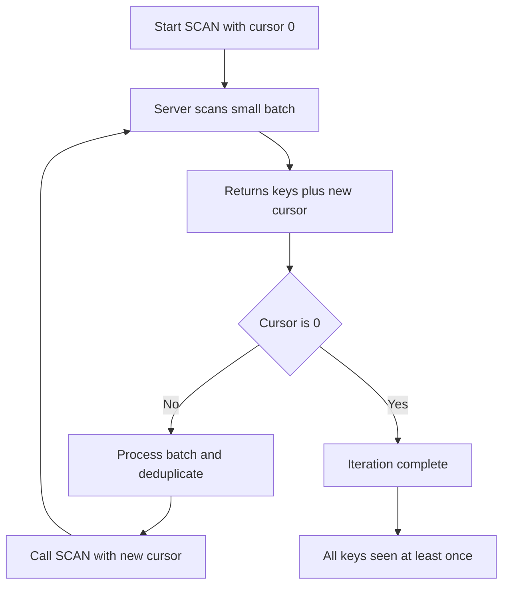

# SCAN and Cursor Iteration: Walking the Keyspace Without Freezing the Server

## English

KEYS * is the classic Redis footgun: it walks the entire keyspace in one command, and because Redis executes commands on a single thread, every other client waits until it finishes. On a database with millions of keys that can mean hundreds of milliseconds or more of total unavailability. SCAN exists to solve exactly this. Instead of returning everything at once, SCAN returns a small batch of keys plus a cursor — an opaque number you feed back into the next call. When the cursor comes back as 0, the iteration is complete. Each individual SCAN call is cheap (bounded work per call), so you can loop over the whole keyspace in many small steps, interleaving other commands in between and never blocking the server for long.

The critical guarantee to understand is what SCAN does and does not promise. It guarantees that every key present from the start of the iteration to its end will be returned at least once. It does not guarantee that a key is returned only once — duplicates are possible and you must deduplicate if that matters. Keys that are added or deleted during the iteration may or may not appear. This is the price of not holding a snapshot: SCAN trades perfect consistency for bounded latency. The cursor is not an offset or an index; it encodes a position in the hash table's bucket layout, which is why it looks like a random large integer and why you must never compute it yourself.

The same cursor pattern applies to collections: SSCAN for sets, HSCAN for hashes, ZSCAN for sorted sets. These are especially useful for large hashes and sorted sets where HGETALL or ZRANGE 0 -1 would return enormous payloads. HSCAN and ZSCAN accept an optional MATCH pattern and a COUNT hint. COUNT is a hint about how much work to do per call — not a hard limit on returned elements — so you may get more or fewer than COUNT items. A larger COUNT means fewer round trips but more work per call; tune it to your latency budget.

A practical iteration loop looks like: start with cursor 0, call SCAN cursor MATCH pattern COUNT 1000, process the returned keys, then repeat with the new cursor until it returns 0. In a cluster, you must run this loop once per primary node, because each node only knows its own slice of the keyspace — SCAN on one node never returns keys owned by another. Also remember that MATCH filtering happens after elements are fetched, so a very selective pattern still costs you the full per-call scan work; it filters results, it does not speed up the walk.

Finally, treat SCAN as a maintenance and admin tool rather than a hot-path operation. It is perfect for one-off jobs like finding keys with a given prefix to clean up, auditing TTLs, or building an inventory. If your application needs to enumerate keys constantly, that is usually a sign the keyspace design should change — for example, keeping an index in a set or sorted set instead of discovering keys by pattern. The mental model: KEYS is a sledgehammer that stops the world; SCAN is a hand trowel you can use while the server keeps serving everyone else.

## 中文

KEYS * 是 Redis 經典的「踩坑」指令：它會用單一指令掃描整個鍵空間，而由於 Redis 以單線程執行指令，其他所有客戶端都要等它完成。在擁有數百萬個鍵的資料庫上，這可能代表數百毫秒甚至更長的完全不可用。SCAN 正是為解決這個問題而生。它不會一次過回傳所有東西，而是回傳一小批鍵，外加一個游標（cursor）——一個不透明的數字，你要把它傳回下一次呼叫。當游標回傳 0 時，代表迭代完成。每一次 SCAN 呼叫都很便宜（每次呼叫的工作量有上限），所以你可以用許多小步驟循環走完整個鍵空間，中間穿插其他指令，永遠不會長時間阻塞伺服器。

要理解最關鍵的保證，就是搞清楚 SCAN 承諾什麼、不承諾什麼。它保證：從迭代開始到結束期間一直存在的鍵，至少會被回傳一次。它不保證一個鍵只被回傳一次——重複是可能的，如果這對你有影響，就要自行去重。迭代期間新增或刪除的鍵，可能會也可能不會出現。這就是不持有快照的代價：SCAN 以完美一致性換取有界延遲。游標不是偏移量或索引；它編碼的是雜湊表桶佈局中的某個位置，所以它看起來像一個隨機的大整數，也所以你不應該自己計算它。

同樣的游標模式適用於集合：集合用 SSCAN、雜湊用 HSCAN、有序集合用 ZSCAN。對於大型雜湊和有序集合特別有用，因為 HGETALL 或 ZRANGE 0 -1 會回傳極大的負載。HSCAN 和 ZSCAN 接受可選的 MATCH 模式和 COUNT 提示。COUNT 只是「每次呼叫做多少工作」的提示——不是回傳元素數量的硬性上限——所以你可能拿到比 COUNT 多或少的項目。COUNT 越大，往返次數越少，但每次呼叫的工作量越大；按你的延遲預算來調整。

實際的迭代迴圈長這樣：由游標 0 開始，呼叫 SCAN cursor MATCH pattern COUNT 1000，處理回傳的鍵，然後用新游標重複，直到它回傳 0。在叢集環境中，你必須對每個主節點各跑一次這個迴圈，因為每個節點只知道鍵空間中屬於自己的那一部分——在某個節點上執行 SCAN 永遠不會回傳由其他節點擁有的鍵。另外要記住，MATCH 過濾是在取出元素之後才發生，所以即使模式非常有選擇性，你仍然要付出每次呼叫的完整掃描成本；它只是過濾結果，並不會加快走訪速度。

最後，把 SCAN 當成維護和管理工具，而不是熱路徑操作。它非常適合一次性任務，例如找出某個前綴的鍵來清理、審核 TTL，或建立清單。如果你的應用程式需要不斷列舉鍵，這通常代表鍵空間設計應該改變——例如用一個集合或有序集合維護索引，而不是靠模式去發現鍵。心法就是：KEYS 是會讓全世界停下來的鐵鎚；SCAN 是一把小鏟子，你可以一邊用它，伺服器一邊繼續服務其他人。

## Key Takeaway

SCAN replaces the blocking KEYS command with bounded, cursor-based batches that guarantee at-least-once visibility of stable keys while never freezing the server.

## Related Concepts
- Keyspace design and key naming
- Command complexity and Big-O

## Diagram

