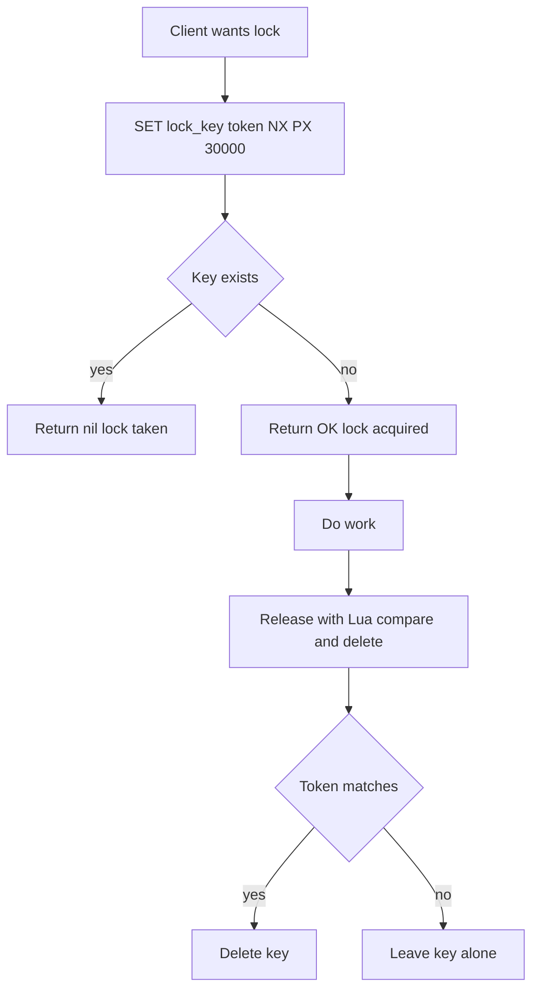

# Locks That Expire: Building a Safe Distributed Mutex on Top of SET NX

## English

A distributed lock is a way for several processes — on different machines, in different containers — to agree that only one of them does some piece of work at a time. Redis is a popular place to build one because a single Redis instance serializes commands, making it a natural arbiter. The primitive is the conditional set: SET lock_key unique_token NX PX 30000. NX means "only set if the key does not already exist," so exactly one caller wins and gets OK; everyone else gets nil and knows the lock is taken. PX 30000 gives the key a 30-second expiry so that if the winner crashes, the lock does not stay stuck forever. This expiry is the whole point — a lock without a timeout is a deadlock waiting to happen.

The unique_token is not decoration. Suppose the winner takes longer than the expiry, the key evaporates, and a second process acquires the lock. When the first process finally finishes and tries to release the lock, a naive DEL would delete the second process's lock. Instead, release must be conditional: only delete the key if its value still equals your token. That is a compare-and-delete, which in plain Redis is a short Lua script (GET then DEL if equal) executed atomically. The token is how you prove "this lock is still mine."

Even with all that, the classic caveat stands: a lock built on a single Redis instance is only as safe as that instance's availability. If the Redis primary fails over to a replica that had not yet received the SET, two clients can believe they hold the lock. The widely-cited Redlock algorithm tries to address this by acquiring the lock on a majority of independent Redis instances, but it has been publicly debated by distributed-systems researchers who argue that timing assumptions (clock drift, pauses, network delays) can still break it. The honest takeaway for an undergraduate: a Redis lock is a coordination convenience, not a mathematical guarantee, and you should design the protected work to be idempotent or otherwise safe if two workers occasionally overlap.

Practical rules follow from this. Keep critical sections short so the lock rarely expires mid-work. Do not use the lock to protect a long batch job; use it to protect a quick check-then-act. Consider a fencing token: a monotonically increasing number issued with the lock that the downstream resource checks, so a stale holder's writes get rejected even if it thinks it still holds the lock. And always release in a finally block, with the compare-and-delete script, so an exception does not leave the lock sitting until it expires.

A useful analogy: the lock is a bathroom key with a timer attached. NX is the rule that only one key exists. The expiry is the timer that frees the bathroom if someone faints inside. The token is your name written on the key so you do not accidentally hand your key back when someone else is already using the bathroom. And the fencing token is the bouncer at the door who checks the ticket number and refuses anyone holding an old one.

## 中文

分散式鎖是一種機制，讓多個進程——在不同機器、不同容器上——達成共識：同一時間只有其中一個執行某項工作。Redis 是建立分散式鎖的熱門選擇，因為單一 Redis 實例會序列化指令，天然就是一個仲裁者。基本原語是條件式設定：SET lock_key unique_token NX PX 30000。NX 的意思是「只有在鍵不存在時才設定」，所以恰好一個呼叫者勝出並得到 OK；其他人都得到 nil，知道鎖已被佔用。PX 30000 給這個鍵 30 秒的到期時間，這樣如果勝出者崩潰，鎖不會永遠卡住。這個到期時間正是重點——沒有逾時的鎖就是一個等待發生的死鎖。

unique_token 不是裝飾。假設勝出者執行時間超過到期時間，鍵消失了，第二個進程取得了鎖。當第一個進程終於完成、嘗試釋放鎖時，天真的 DEL 會刪掉第二個進程的鎖。所以釋放必須是有條件的：只有當鍵的值仍然等於你的 token 時才刪除。這就是「比較後刪除」（compare-and-delete），在純 Redis 中就是一小段 Lua 腳本（先 GET，相等才 DEL），原子地執行。token 就是你證明「這個鎖仍然是我的」的方式。

即使做了這一切，經典的警告仍然成立：建立在單一 Redis 實例上的鎖，其安全性只等於該實例的可用性。如果 Redis 主節點故障轉移到一個尚未收到該 SET 的副本，兩個客戶端就可能都相信自己持有鎖。廣受引用的 Redlock 演算法試圖透過在大多數獨立的 Redis 實例上取得鎖來解決這個問題，但分散式系統研究者曾公開辯論，指出時間假設（時鐘漂移、暫停、網路延遲）仍可能令它失效。對本科生來說，誠實的結論是：Redis 鎖是一種協調上的便利，不是數學上的保證；你應該把受保護的工作設計成冪等（idempotent），或在兩個工作者偶爾重疊時仍然安全。

由此得出實用規則。讓臨界區保持簡短，使鎖很少在工作途中到期。不要用鎖來保護長時間的批次工作；用它來保護快速的「檢查後行動」。考慮使用圍欄令牌（fencing token）：一個隨鎖發出的單調遞增數字，由下游資源檢查，這樣即使某個過期的持有者以為自己仍持有鎖，它的寫入也會被拒絕。而且一定要在 finally 區塊中用「比較後刪除」腳本釋放，免得例外發生時鎖一直留到到期。

一個好用的類比：這個鎖就像一把附計時器的洗手間鑰匙。NX 是「只有一把鑰匙存在」的規則。到期時間是計時器，若有人在裡面昏倒就自動開門。token 是寫在鑰匙上的你的名字，免得別人正在用洗手間時，你誤把自己的鑰匙交回去。而圍欄令牌就是門口的保安，檢查票號，拒絕任何拿著舊票的人。

## Key Takeaway

SET NX PX plus a unique token and compare-and-delete release gives you a practical Redis mutex, but it is a coordination convenience rather than a hard guarantee, so make protected work idempotent.

## Related Concepts
- Atomic operations and race conditions
- Replication mechanics and failover

## Diagram

