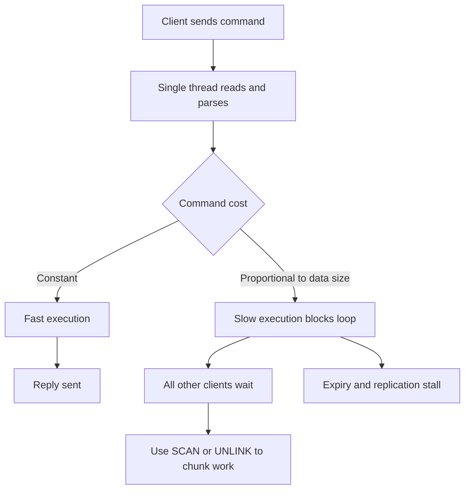

# The Single-Threaded Event Loop, Seen Through the Lens of a Slow Command

## English

Redis executes commands one at a time on a single thread. That sentence is easy to read and hard to feel. To feel it, imagine a checkout counter with exactly one cashier. Customers arrive, the cashier serves them strictly in order, and each transaction takes a tiny fraction of a millisecond. Throughput is enormous because transactions are short. Now imagine one customer arrives with a cart of 10,000 items. The cashier must scan every item, and every other customer in line waits. That is what a single slow Redis command does to your whole server: it is not that Redis is slow, it is that one command held the only cashier hostage.

What makes a command slow? Complexity. Commands like KEYS, FLUSHALL, or a ZRANGE over a million-element sorted set do work proportional to the size of the data, not a constant amount. A command that is O(N) over a huge collection can take tens or hundreds of milliseconds. During that time no other client is served, no expiration cycle runs, and no replication stream is produced. Even a command that looks innocent — like DEL on a very large collection — must free every element, which can take a long time. This is why Redis provides UNLINK, which removes the key from the keyspace immediately and frees the memory in a background thread, so the visible latency is small.

There is a second, subtler source of blocking: the client itself. If a client sends a huge command (say a multi-megabyte MSET or a giant Lua script), the server must read and parse it before executing. Large payloads cost time on the receive path. Similarly, a client that requests a massive reply (like a full HGETALL of a huge hash) makes the server spend time serializing the response and the network spend time draining it. The fix is usually to break work into chunks — use SCAN-style iteration or paginate with ranges — so each round trip is small and the cashier can serve others in between.

What about slow clients? Redis has output buffers per client. If a client is slow to read, its buffer grows, and Redis can be configured to disconnect clients that exceed a limit (the client-output-buffer-limit settings). This prevents one slow consumer from consuming server memory indefinitely. On the input side, Redis reads and parses commands in the event loop, so a flood of small commands from many clients is handled fine — the loop is efficient at many tiny events — but a single giant command is a single giant event.

The practical discipline is: know the complexity of every command you put on a hot path, prefer incremental variants (SCAN, HSCAN, UNLINK, and range queries with small limits) over whole-collection operations, and keep individual payloads modest. When you genuinely need a long computation, do it outside Redis — fetch data in pages, compute in your application, write results back — or use a Lua script only when it is short and bounded. The single thread is a feature: it gives you atomicity and predictable behavior without locks. The price is that you must never hand the cashier a cart of 10,000 items.

## 中文

Redis 在單一線程上一次執行一個指令。這句話讀起來容易，感受起來難。要感受它，想像一個只有一位收銀員的結帳櫃檯。顧客陸續到來，收銀員嚴格按順序服務，每筆交易只花零點幾毫秒。吞吐量巨大，因為交易很短。現在想像一位顧客推著裝了 10,000 件貨品的購物車到來。收銀員必須逐件掃描，隊伍裡其他每位顧客都要等。這就是一個緩慢的 Redis 指令對你整個伺服器做的事：不是 Redis 慢，而是一個指令把唯一的收銀員挾持了。

什麼令指令變慢？複雜度。像 KEYS、FLUSHALL，或在百萬元素的有序集合上做 ZRANGE 這類指令，其工作量與資料大小成正比，而不是固定量。一個在巨大集合上 O(N) 的指令可能要花數十或數百毫秒。在這段時間內，沒有其他客戶端被服務，到期週期不會執行，複製串流也不會產生。即使看起來無害的指令——例如對一個非常大的集合做 DEL——也必須釋放每一個元素，這可能耗時很久。這就是為什麼 Redis 提供 UNLINK：它立即從鍵空間移除鍵，並在背景線程釋放記憶體，所以可見延遲很小。

還有第二個更微妙的阻塞來源：客戶端本身。如果客戶端送出一個巨大的指令（例如數 MB 的 MSET 或一個巨型 Lua 腳本），伺服器必須在執行前讀取並解析它。大負載在接收路徑上耗費時間。同樣地，一個要求巨量回覆的客戶端（例如對一個巨大雜湊做完整的 HGETALL）會令伺服器花時間序列化回應，網路花時間排空它。解決方法通常是將工作切塊——用 SCAN 式迭代或用範圍分頁——讓每次往返都很小，收銀員可以在中間服務其他人。

那慢客戶端呢？Redis 為每個客戶端設有輸出緩衝區。如果客戶端讀取慢，它的緩衝區會增長，而 Redis 可以設定為斷開超過上限的客戶端（client-output-buffer-limit 設定）。這防止一個慢消費者無限期地消耗伺服器記憶體。在輸入端，Redis 在事件迴圈中讀取並解析指令，所以來自許多客戶端的大量小指令沒問題——事件迴圈擅長處理許多微小事件——但單一巨大指令就是單一巨大事件。

實務紀律是：知道你在熱路徑上放的每個指令的複雜度，偏好增量式變體（SCAN、HSCAN、UNLINK，以及帶小上限的範圍查詢）而非整個集合的操作，並讓個別負載保持適中。當你確實需要長時間計算時，在 Redis 之外做——分頁取資料，在應用程式中計算，再把結果寫回——或者只在 Lua 腳本簡短且有界時才使用它。單線程是個優點：它給你原子性和可預測行為，無需鎖。代價是你永遠不能把一車 10,000 件貨品交給收銀員。

## Key Takeaway

Because one thread serves every client, a single high-complexity command or oversized payload stalls the entire server; prefer incremental, bounded operations on hot paths.

## Related Concepts
- Command complexity and Big-O
- Blocking commands and the event loop

## Diagram

