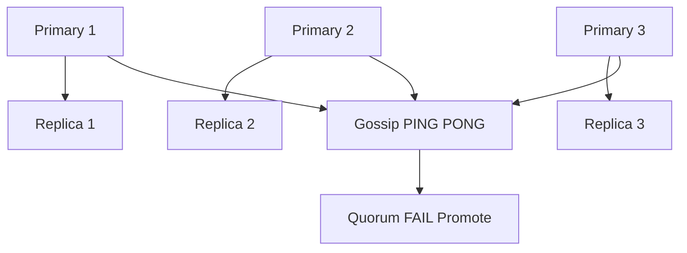

# Cluster Topology: Why Redis Cluster Needs a Minimum of Three Primaries

## English

Redis Cluster splits the 16384 hash slots across primaries and requires each primary to have at least one replica that can take over. That means the smallest sensible production cluster is three primaries with three replicas — six nodes for what looks like a simple three-node job. The reason is quorum: the cluster's failure detection is a gossip protocol where nodes exchange PING/PONG messages carrying a view of who is reachable. A node marks a peer as PFAIL (possibly failed) locally, and only when enough other nodes independently agree does it become FAIL, at which point a replica can be promoted. If you ran a single primary with replicas, a network partition could leave the lone primary isolated but still serving writes, and no majority exists to arbitrate. With three primaries, any partition leaves at most one side without a majority, and only the majority side keeps accepting writes. This is the same majority logic that makes Raft-style systems need odd numbers, but Redis Cluster applies it per-shard through the cluster bus rather than through a single consensus log.

The practical consequence is that cluster sizing is driven by failure tolerance first and capacity second. A three-primary cluster tolerates one primary failure without losing slot coverage, because that primary's replica is promoted and the remaining primaries update their slot maps. Lose two primaries simultaneously and the cluster stops accepting writes entirely — even if the surviving primary has plenty of memory and CPU free. This surprises people who think of sharding purely as horizontal scaling. You are not just spreading load; you are buying a quorum, and the quorum is what lets the system decide, without a central coordinator, which half of a split network is allowed to keep working.

There is also a subtlety about replicas and reads. By default a replica serves only reads if you explicitly ask for them (READONLY mode on the connection), and even then it may serve stale data, because replication is asynchronous. Redis does not wait for replicas to acknowledge a write before replying to the client. So a cluster gives you availability and sharding, not linearizable consistency. If a primary fails after acknowledging a write that has not yet reached its replica, that write can vanish when the replica is promoted. This is a documented trade-off, not a bug, and it is why Redis Cluster is often described as offering high availability rather than strong durability.

Finally, the cluster bus is a separate TCP port (the client port plus 10000 by convention) used for gossip, failure reports, and slot migration coordination. Misconfigured firewalls that open only the client port produce a cluster that looks healthy from one node and completely broken from another, with nodes endlessly flapping between PFAIL and OK. When debugging a cluster that will not stabilise, checking the cluster bus connectivity and the output of CLUSTER NODES on every node is usually faster than staring at client errors. The topology is not an implementation detail — it is the thing that determines what your system does on its worst day.

A useful mental model: think of Redis Cluster as several independent primary-replica pairs that have agreed in advance on how to divide the keyspace, plus a lightweight democratic process for deciding when to replace a fallen member. There is no single brain. Everything that looks like a decision is really a majority of nodes converging on the same gossip-derived conclusion, and everything that looks like a guarantee is really a probability that the majority saw the same thing at roughly the same time.

## 中文

Redis Cluster 將 16384 個雜湊槽（hash slot）分散到多個主節點（primary），並要求每個主節點至少有一個可以接手的副本（replica）。這意味著最小可行的生產級叢集是三個主節點加三個副本——六個節點去做一件看起來三個節點就夠的事。原因在於法定人數（quorum）：叢集的故障偵測是一套 gossip 協議，節點之間交換 PING/PONG 訊息，訊息中附帶各自對「誰還活著」的看法。一個節點會在本地把某個同伴標記為 PFAIL（可能失效），只有當足夠多的其他節點獨立地得出相同結論時，它才會升級為 FAIL，屆時副本才可以被提升。如果你只跑一個主節點加副本，一次網絡分區就可能讓那個孤立的主節點仍在接受寫入，而沒有任何多數派可以仲裁。有三個主節點時，任何分區最多只會讓一邊失去多數，只有多數那一邊繼續接受寫入。這與 Raft 類系統需要奇數節點是同一套多數邏輯，只是 Redis Cluster 是透過叢集匯流排（cluster bus）逐個分片地套用，而不是透過單一共識日誌。

實際後果是：叢集規模首先由容錯能力決定，容量反而是其次。三主叢集可以承受一個主節點失效而不失去槽覆蓋，因為該主節點的副本會被提升，其餘主節點更新各自的槽映射。若同時失去兩個主節點，叢集會完全停止接受寫入——即使僅存的主節點記憶體和 CPU 都還很充裕。這一點常令把分片純粹理解為橫向擴展的人感到意外。你不只是在分攤負載，你是在購買一個法定人數，而這個法定人數正是讓系統能在沒有中央協調者的情況下，決定網絡分裂時哪一半可以繼續工作的東西。

還有一個關於副本與讀取的微妙之處。預設情況下副本只在你明確要求時才服務讀取（連線上開啟 READONLY 模式），而且即使如此，它也可能提供過時資料，因為複製是非同步的。Redis 在回覆客戶端之前不會等待副本確認寫入。所以叢集給你的是可用性和分片，不是線性一致（linearizable consistency）。如果一個主節點在確認了一筆尚未到達副本的寫入之後失效，當副本被提升時那筆寫入可能憑空消失。這是文件載明的取捨，不是缺陷，也正是為何 Redis Cluster 常被形容為提供高可用而非強持久性。

最後，叢集匯流排是另一個 TCP 埠（慣例上是客戶端埠加 10000），用於 gossip、故障報告和槽遷移協調。只開放客戶端埠的防火牆設定，會造出一個從某個節點看很健康、從另一個節點看卻完全壞掉的叢集，節點在 PFAIL 與 OK 之間無止境地跳動。當你除錯一個無法穩定的叢集時，檢查叢集匯流排的連通性，以及在每個節點上執行 CLUSTER NODES 的輸出，通常比盯著客戶端錯誤訊息更快。拓撲不是實作細節——它決定了你的系統在最壞那天會做什麼。

一個有用的心智模型：把 Redis Cluster 想成幾組獨立的「主—副本」配對，它們事先講好如何分割鍵空間，再加上一套輕量的民主程序來決定何時替換倒下的成員。它沒有單一的大腦。所有看起來像「決定」的東西，其實是多數節點對同一份 gossip 推論達成收斂；所有看起來像「保證」的東西，其實是多數派大致同時看到同一件事的機率。

## Key Takeaway

Redis Cluster's three-primary minimum exists to guarantee a majority for failure arbitration, not to spread load — sizing it is a decision about failure tolerance first and capacity second.

## Related Concepts
- Gossip protocol and failure detection
- Asynchronous replication and lost writes

## Diagram

