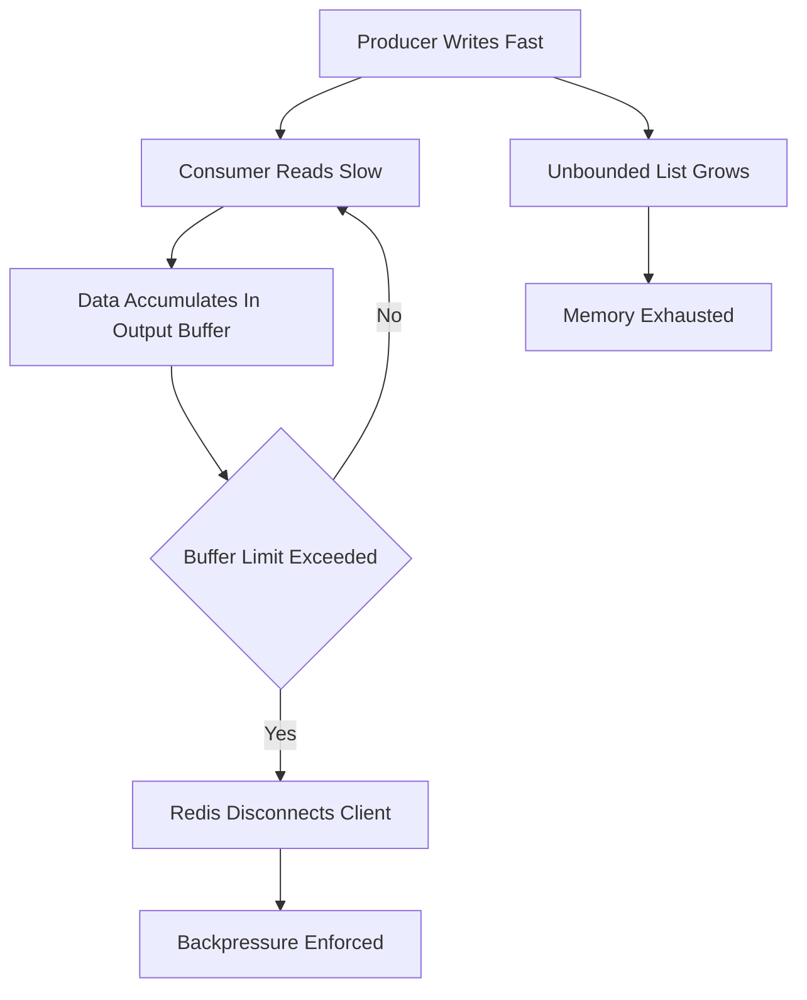

# Handling Backpressure: When the Producer Outruns the Server

## English

Redis is fast, but 'fast' is a rate, not a guarantee. Every connection has an output buffer, and every client has an input buffer, and both are finite. When a producer writes faster than a consumer reads — a common shape in list-based queues, stream consumers that fall behind, or pub/sub subscribers on a slow link — data accumulates in the server's output buffer for that client. Redis has configurable limits here: the normal client-output-buffer-limit, the replica and pubsub variants, expressed as a hard byte limit, a soft byte limit, and a soft limit duration. Exceed the hard limit, or hold above the soft limit for the configured number of seconds, and Redis disconnects that client. This is backpressure enforced by disconnection, and it is the mechanism that stops one slow subscriber from consuming all the server's memory.

Understanding this changes how you design queue-like workloads. A naive pattern is a producer doing LPUSH into a list and a worker doing BRPOP in a loop. If the worker dies or stalls, the list grows without bound, and because the list is an ordinary key it is not subject to output buffer limits — it just eats memory until maxmemory is reached and eviction or errors begin. The fix is not a Redis setting but a design decision: cap the queue. You can check LLEN before pushing and shed or reject load, or use a bounded pattern where the producer blocks or backs off. Redis gives you the primitives; it does not give you flow control for free. The same applies to Streams with MAXLEN or MINID trimming, which let you keep a bounded window of history instead of an ever-growing log.

On the client side, backpressure often appears as a connection pool that is saturated. If every pooled connection is blocked waiting for a reply, new requests queue in the application, latency climbs, and timeouts cascade. This is why blocking commands like BLPOP and BRPOP should not be issued on connections shared with ordinary commands — a connection parked in a blocking call cannot serve anything else. Dedicated connections for blocking work, or a client library that manages this for you, keep the pool from being starved. Similarly, pipelining large batches can look efficient while quietly inflating the server's output buffer for that client, because the server queues all the replies before the client reads them.

There is a related trap with pub/sub specifically. Pub/sub has no persistence and no acknowledgement: if a subscriber is slow, messages pile up in its output buffer, and if it exceeds the limit it is disconnected and silently loses everything it had not yet read. There is no redelivery. This makes pub/sub unsuitable for work queues and suitable for notifications where losing a message is acceptable. Streams with consumer groups exist precisely to give you acknowledgement, pending-entry lists, and redelivery — at the cost of more bookkeeping and explicit trimming. Choosing between them is really a question about what should happen when a consumer is slower than the producer.

A practical discipline: decide, for every data path, what happens when the consumer is ten times slower than normal. Does the queue grow unboundedly? Does the producer get an error? Does the slow consumer get disconnected? Does the data get trimmed away? If the answer is 'it just grows', you have found the place where your system will fail under load. Redis is honest about this — it will disconnect clients and it will refuse writes when maxmemory is hit without an eviction policy — but only if you have configured the limits and designed the paths to respect them. Backpressure is not a feature you enable; it is a property you either design in or discover in production.

## 中文

Redis 很快，但「快」是一個速率，不是一個保證。每個連線都有輸出緩衝區，每個客戶端都有輸入緩衝區，兩者都是有限的。當生產者寫入的速度快過消費者讀取的速度——這在以 list 為基礎的佇列、落後的 stream 消費者、或慢速鏈路上的 pub/sub 訂閱者身上很常見——資料就會在伺服器為該客戶端維護的輸出緩衝區中累積。Redis 在這裡有可設定的上限：一般的 client-output-buffer-limit，以及 replica 和 pubsub 的變體，以硬性位元組上限、軟性位元組上限、軟性上限持續時間來表達。超過硬性上限，或在設定的秒數內一直高於軟性上限，Redis 就會斷開該客戶端。這就是以斷線形式強制執行的背壓（backpressure），也是阻止單一慢速訂閱者吃掉整個伺服器記憶體的機制。

理解這一點會改變你設計類佇列工作負載的方式。一個天真的模式是生產者用 LPUSH 推入 list，工作者用 BRPOP 迴圈取出。如果工作者掛掉或停滯，list 就會無界增長，而因為 list 是普通鍵，它不受輸出緩衝區上限約束——它只會一直吃記憶體，直到觸及 maxmemory，然後開始淘汰或報錯。解法不是某個 Redis 設定，而是一個設計決定：為佇列設上限。你可以在推入前檢查 LLEN 並卸載或拒絕負載，或採用生產者會阻塞或退讓的有界模式。Redis 給你的是原語；它不會免費給你流量控制。同樣的道理適用於 Streams 的 MAXLEN 或 MINID 修剪，它們讓你保留有界的歷史窗口，而不是不斷增長的日誌。

在客戶端這一側，背壓常常表現為連線池飽和。如果池中每條連線都在阻塞等待回覆，新請求就在應用層排隊，延遲攀升，逾時接連發生。這就是為何像 BLPOP、BRPOP 這類阻塞命令不應該在與普通命令共用的連線上發出——一條停在阻塞呼叫中的連線無法服務任何其他事情。為阻塞工作使用專用連線，或使用會替你管理這件事的客戶端函式庫，可以避免連線池被餓死。同樣地，大量 pipeline 批次看起來很有效率，卻可能在悄悄撐大該客戶端在伺服器的輸出緩衝區，因為伺服器會先把所有回覆排隊，等客戶端來讀。

pub/sub 有一個相關的陷阱。pub/sub 沒有持久化、沒有確認：如果訂閱者慢，訊息會堆積在它的輸出緩衝區，一旦超過上限它就被斷開，並悄悄丟失所有尚未讀取的訊息。沒有重送。這使 pub/sub 不適合工作佇列，而適合「丟掉一則也無所謂」的通知。帶有消費者群組（consumer group）的 Streams 正是為了給你確認、待處理條目清單（pending entries list）和重送而存在——代價是更多簿記工作和明確的修剪。在兩者之間選擇，本質上是在問：當消費者比生產者慢時，應該發生什麼。

一個實用的紀律：對每一條資料路徑，先決定當消費者比正常慢十倍時會怎樣。佇列會無界增長嗎？生產者會收到錯誤嗎？慢速消費者會被斷線嗎？資料會被修剪掉嗎？如果答案是「它就是一直長大」，你就找到了系統在高負載下會失敗的地方。Redis 在這方面很誠實——它會斷開客戶端，在觸及 maxmemory 而沒有淘汰策略時會拒絕寫入——但前提是你設定了上限，並把各條路徑設計成尊重這些上限。背壓不是一個你可以開啟的功能；它是一種你若不是設計進去、就會在生產環境中發現的性質。

## Key Takeaway

Backpressure in Redis is enforced through output-buffer limits that disconnect slow clients and through your own decision to bound queues — if a data path has no answer for 'what if the consumer is ten times slower', it will fail under load.

## Related Concepts
- client-output-buffer-limit
- Stream consumer groups and pending entries

## Diagram

