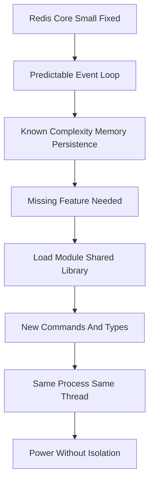

# Modules and the Extension Boundary: What Redis Deliberately Does Not Do

## English

Redis ships with a fixed set of data types and commands, and that is a design stance rather than an oversight. The core is deliberately small so that the single-threaded event loop stays predictable: every command has a known complexity, a known memory profile, and a known interaction with persistence and replication. When you need something the core does not provide — a new data type, a specialised index, a search engine, a JSON document model — the intended answer is a module: a shared library loaded into the server process that registers new commands and data types through a C API. Modules run in the same process and the same thread as everything else, so a badly written module can block the entire server exactly as a slow command can. That is the price of the extension boundary: power without isolation.

Several widely used capabilities arrive this way. RedisJSON adds a document type with path-based access; RediSearch adds secondary indexes and a query language; RedisBloom adds probabilistic structures beyond the built-in HyperLogLog; RedisTimeSeries adds a time-series type with downsampling and retention rules. Each of these could in principle be built on top of strings and sorted sets by a client library, and people did exactly that for years. The module approach wins because the operations become atomic and server-side: a filtered search over a million documents does not require shipping them to the client, and a JSON path update does not require read-modify-write races. The general lesson is that pushing computation to where the data lives beats moving data to where the computation lives, and modules are how Redis lets you do that without forking the server.

Modules also illustrate a boundary you should respect even without them. A common anti-pattern is using Redis as a general-purpose compute engine — running large Lua scripts that iterate over thousands of keys, or issuing commands whose complexity is linear in the size of a collection. Because execution is single-threaded, one such command delays every other client. The Big-O notes in the command documentation are not academic; they tell you how long the event loop will be unavailable. A module that implements an efficient index is fine; a hand-rolled index rebuilt by scanning keys on every request is not, and it will look like a Redis performance problem when it is really an architecture problem.

There is also an operational dimension. A module is a binary artifact with its own version compatibility with the Redis server version, its own memory behaviour, and its own bugs. Upgrading Redis may require upgrading modules in lockstep, and a module crash takes the server down with it because they share a process. Managed Redis offerings often restrict which modules are available, so a design that depends on a particular module may not be portable to every provider. None of this argues against modules — they are the right tool for many jobs — but it argues for treating them as part of your dependency surface, with the same scrutiny you would give a database extension or a kernel module.

A good way to internalise the boundary is to ask, for any new requirement, which of three things it is: a data shape the core already models well (use it), a computation that belongs next to the data (consider a module or a carefully bounded server-side script), or a computation that belongs in your application (do it there and cache the result). Most performance disasters in Redis deployments come from misclassifying the third as the second. The core's smallness is a feature: it means the behaviour you depend on is documented, bounded, and unlikely to surprise you. Extensions are how you go beyond it, and like all extensions, they should be chosen deliberately rather than accumulated.

## 中文

Redis 內建一組固定的資料型別和命令，這是一種設計立場，而非疏忽。核心刻意保持精簡，好讓單執行緒事件迴圈維持可預測：每條命令都有已知的複雜度、已知的記憶體特性，以及與持久化和複製之間已知的互動方式。當你需要核心不提供的東西——新的資料型別、專門的索引、搜尋引擎、JSON 文件模型——官方預期的答案是模組（module）：一個載入伺服器行程的共享函式庫，透過 C API 註冊新命令與資料型別。模組與其他一切跑在同一個行程、同一個執行緒中，所以寫得不好的模組可以像慢命令一樣阻塞整個伺服器。這就是擴展邊界的代價：有力量，但沒有隔離。

有幾項廣泛使用的能力就是這樣來的。RedisJSON 加入以路徑存取的 JSON 文件型別；RediSearch 加入二級索引與查詢語言；RedisBloom 加入內建 HyperLogLog 之外的機率型結構；RedisTimeSeries 加入帶降採樣與保留規則的時間序列型別。這些原則上都可以由客戶端函式庫在 string 和 sorted set 之上搭建，而人們也確實這樣做了很多年。模組方案勝出，是因為操作變成原子且伺服器端執行：在一百萬份文件上做過濾搜尋，不需要把它們全部送到客戶端；JSON 路徑更新也不需要讀—改—寫的競態。普遍的教訓是：把計算推到資料所在之處，勝過把資料搬到計算所在之處，而模組就是 Redis 讓你在不分支伺服器的前提下做到這件事的方法。

模組也說明了即使不用模組你也該尊重的一條界線。一個常見的反模式是把 Redis 當成通用計算引擎——執行遍歷數千個鍵的大型 Lua 腳本，或發出複雜度與集合大小成線性的命令。因為執行是單執行緒的，這樣一條命令會延誤所有其他客戶端。命令文件中的 Big-O 註記不是學術點綴；它們告訴你事件迴圈會有多久無法服務。一個實作高效索引的模組沒問題；一個每次請求都靠掃描鍵重建的手工索引則不然，而且它會看起來像 Redis 效能問題，實際上卻是架構問題。

還有一個運維層面。模組是二進位產物，有自己的 Redis 伺服器版本相容性、自己的記憶體行為、自己的缺陷。升級 Redis 可能需要同步升級模組，而模組崩潰會連帶把伺服器拖垮，因為它們共用一個行程。託管的 Redis 服務往往限制可用模組，所以依賴某個特定模組的設計未必能移植到每個供應商。這些都不構成反對模組的理由——對許多工作而言它們是正確的工具——但這意味著你應該把它們視為依賴面的一部分，用審視資料庫擴充或核心模組的同等嚴格態度來對待。

把這條界線內化的一個好方法，是對任何新需求先問它屬於三者中的哪一類：核心已經建模良好的資料形狀（就用它）、應該貼近資料的計算（考慮模組或小心設界限的伺服器端腳本）、還是屬於應用程式的計算（就在那裡做，然後快取結果）。Redis 部署中大多數效能災難，都來自把第三類誤判成第二類。核心的精簡是一項優點：它意味著你所依賴的行為是有文件記載、有界限、且不太會令你意外的。擴展是你超越它的方式，而如同所有擴展，它們應該被刻意選擇，而不是不斷累積。

## Key Takeaway

Redis keeps its core deliberately small and pushes new capabilities into modules that share the server process — powerful, but with no isolation and a real dependency surface to manage.

## Related Concepts
- Server-side computation vs client-side computation
- Command complexity and the event loop

## Diagram

