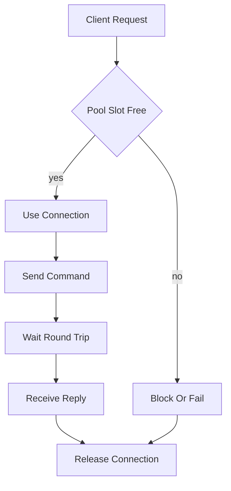

# Client-Side Connection Pools: Why One Connection Is Never Enough

## English

Every Redis client library hides a connection pool underneath, and understanding it explains a whole class of production surprises. A single TCP connection to Redis is strictly request-then-response: the server processes commands in order, so if you send one command and wait for the reply before sending the next, your throughput is bounded by round-trip time. With a 0.5 ms round trip, that is at most 2000 commands per second no matter how fast Redis is. A pool of N connections lets N commands be in flight at once, multiplying throughput roughly by N until you saturate the server's single command-execution thread.

The pool has a size, and that size is a hard ceiling. When all connections are busy, a caller either blocks waiting for one (the default in many libraries, with a timeout) or fails immediately depending on configuration. This is why a pool exhaustion incident looks like a sudden latency cliff rather than a gradual slowdown: requests queue behind a fixed number of sockets. Sizing the pool is a trade-off — too small and you bottleneck on the client, too large and you create hundreds of idle sockets consuming server-side memory and file descriptors for no gain, since the server's command execution is serial anyway.

Pools also interact badly with blocking commands. If a connection issues BLPOP with a long timeout, that socket is unavailable to every other caller for the duration. A pool of ten connections where three are parked on blocking pops has effectively shrunk to seven. The same applies to SUBSCRIBE in the older pub/sub model, and to WATCH inside a transaction, which pins state to a specific connection. The rule of thumb: keep blocking and stateful operations on dedicated connections outside the general pool.

Health checks matter too. A pooled connection can be silently dead — the server restarted, a firewall dropped the idle socket, a failover moved the primary. Libraries handle this differently: some validate on borrow, some rely on a background ping, some simply surface the error to the caller and let it retry. Knowing which your library does tells you whether a failover produces one burst of errors or a slow trickle of mysterious timeouts. Many clients also expose a minimum-idle setting so the pool stays warm after a burst rather than tearing down connections and paying TCP and TLS handshake costs again.

Finally, connection count is a server-side resource. Each connection has buffers, and Redis has a configurable maximum number of clients. A fleet of application instances each with a pool of fifty can quietly exceed that limit, and the server will start refusing new connections — often exactly during a deploy when every instance reconnects at once. Budget your total connections as instances multiplied by pool size, and leave headroom.

## 中文

每個 Redis 客戶端程式庫底層都藏著一個連線池，理解它就等於理解了一整類生產環境的意外。一條連到 Redis 的 TCP 連線是嚴格的「請求—回應」模式：伺服器按順序處理命令，所以如果你送出一條命令、等回應之後才送下一條，你的吞吐量就被往返時間鎖死了。若往返時間是 0.5 毫秒，那麼不管 Redis 本身多快，你每秒最多隻能送 2000 條命令。一個有 N 條連線的池子可以讓 N 條命令同時在途，吞吐量大致乘以 N，直到把伺服器那條單一的命令執行執行緒餵飽為止。

池子有大小，而這個大小是硬天花板。當所有連線都在忙，呼叫方要麼阻塞等待（許多程式庫的預設行為，附帶逾時），要麼立刻失敗，視設定而定。這就是為什麼連線池耗盡的事故看起來像一道突然的延遲懸崖，而不是逐漸變慢：請求排在固定數量的 socket 後面。池子大小的取捨是——太小則瓶頸在客戶端，太大則製造幾百條閒置 socket，白白消耗伺服器端記憶體與檔案描述符，因為伺服器的命令執行本來就是序列化的。

連線池和阻塞式命令的互動也很糟。如果某條連線發出帶長逾時的 BLPOP，那個 socket 在整個期間都無法給其他呼叫方使用。一個十條連線的池子裡有三條卡在阻塞式 pop 上，實際上就縮成七條。同樣的道理適用於舊式 pub/sub 的 SUBSCRIBE，以及事務中的 WATCH——它把狀態釘在某條特定連線上。經驗法則：把阻塞式與有狀態的操作放在一般池子之外的專用連線上。

健康檢查也很重要。池中的連線可能已經悄悄死掉——伺服器重啟了、防火牆丟棄了閒置 socket、故障轉移把主節點搬走了。各家程式庫處理方式不同：有些在借出時驗證，有些靠背景 ping，有些直接把錯誤丟給呼叫方讓它自己重試。知道你的程式庫是哪一種，就能判斷一次故障轉移會產生一陣錯誤爆發，還是一縷神秘的逾時細流。許多客戶端還提供最小閒置數設定，讓池子在流量爆發後保持溫熱，而不是拆掉連線、重新付出 TCP 與 TLS 握手的成本。

最後，連線數是伺服器端的資源。每條連線都有緩衝區，而 Redis 有可設定的最大客戶端數。一整批應用例項、每個池子五十條連線，可能悄悄超過上限，伺服器就開始拒絕新連線——而且往往正好發生在部署時、每個例項同時重連的那一刻。把你全部的連線數當成「例項數乘以池子大小」來編預算，並留點餘裕。

## Key Takeaway

A connection pool is a fixed-size window on a serial server: size it from your concurrency needs, keep blocking and stateful commands off the shared pool, and budget the total connection count across all application instances.

## Related Concepts
- Pipelining and round-trip latency
- Blocking commands and the event loop

## Diagram

