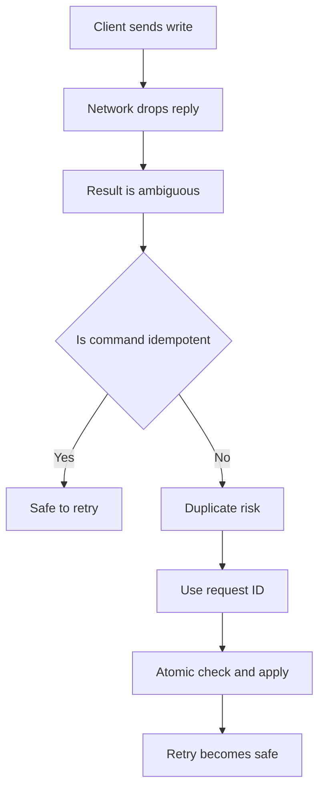

# Idempotency and Retries: Making Writes Safe When the Network Lies

## English

The nastiest failure mode in any networked system is the ambiguous result: you sent a command, the connection dropped before the reply arrived, and you genuinely do not know whether the server applied it. Redis makes this vivid because writes are so cheap that retrying feels harmless. But a retried INCR increments twice, a retried LPUSH inserts a duplicate job, and a retried payment debit charges a customer twice. The network does not tell you which happened; only your data model can.

The first tool is choosing commands whose repetition is harmless. SET is naturally idempotent — setting a key to the same value twice yields the same state. DEL of an already-deleted key is a no-op. But INCR, INCRBY, APPEND, LPUSH, and ZINCRBY are all relative operations: they apply the change to whatever the current state is, so replaying them compounds the effect. Whenever you can express a write as an absolute assignment rather than a relative adjustment, you buy retry safety for free.

When you genuinely need a counter or an append, the second tool is a request identifier. Write the operation as a keyed record — for example, store the outcome under a key derived from a unique request ID using SET with the NX option so the second attempt is rejected, or use a Lua script that checks whether the ID has been seen and only then applies the mutation. Because scripts execute atomically, the check-and-apply cannot interleave with a concurrent duplicate. The cost is that you must retain the IDs long enough to cover your retry window, which means a TTL roughly matching your maximum retry horizon.

The third tool is making the retry decision explicit rather than automatic. Many client libraries retry on connection errors by default, which silently converts an ambiguous failure into a duplicate write. Knowing whether your client retries, how many times, and on which error classes is essential. A common safer pattern is: retry only errors that occurred before the command could have reached the server (connection refused, DNS failure), and treat mid-flight disconnects as unknown outcomes requiring an idempotency check or a reconciliation pass.

This connects to a broader principle: exactly-once delivery does not exist over an unreliable channel, but exactly-once effect does, if every write is either idempotent by construction or guarded by a deduplication key. Design the write path so that a duplicate is either impossible or detectable, and the network's ambiguity stops being a correctness problem and becomes merely a performance one.

## 中文

任何網路系統裡最惱人的故障模式就是「結果不明」：你送出了命令，連線在回應抵達前斷了，而你真的不知道伺服器有沒有套用它。Redis 讓這件事特別鮮明，因為寫入太便宜，重試感覺毫無害處。但重試的 INCR 會加兩次，重試的 LPUSH 會插入重複的工作，重試的扣款會向客戶收兩次錢。網路不會告訴你發生了哪一種，只有你的資料模型能回答。

第一個工具是挑選重複執行也無害的命令。SET 天生冪等——把同一個鍵設成同一個值兩次，結果狀態相同。刪除一個已經不存在的鍵是空操作。但 INCR、INCRBY、APPEND、LPUSH、ZINCRBY 全都是相對操作：它們把變化套用到當前狀態上，所以重放會疊加效果。只要你能把寫入表達成絕對賦值而非相對調整，你就免費換到了重試安全性。

當你真的需要計數器或追加時，第二個工具是請求識別碼。把操作寫成一筆以鍵記錄的結果——例如用帶 NX 選項的 SET 把結果存在由唯一請求 ID 衍生的鍵下，讓第二次嘗試被拒絕；或用一段 Lua 腳本先檢查該 ID 是否見過、才套用變更。因為腳本原子執行，檢查與套用不可能和並行的重複請求交錯。代價是你必須把這些 ID 保留得夠久以涵蓋重試窗口，也就是說 TTL 要大致對應你的最大重試時距。

第三個工具是把重試決策變得明確，而不是自動發生。許多客戶端程式庫預設會在連線錯誤時重試，這等於悄悄把「結果不明」轉變成重複寫入。知道你的客戶端會不會重試、重試幾次、對哪些錯誤類別重試，至關重要。一種較安全的常見模式是：只重試那些在命令可能抵達伺服器之前就發生的錯誤（連線被拒、DNS 失敗），而把中途斷線視為結果未知，需要冪等檢查或一次對帳處理。

這連接到一個更廣的原則：在不可靠的通道上不存在「恰好一次送達」，但「恰好一次效果」存在——只要每一筆寫入不是天生冪等，就是被去重鍵守護著。把寫入路徑設計成重複要麼不可能、要麼可偵測，網路的曖昧就不再是正確性問題，而只是效能問題。

## Key Takeaway

Ambiguous failures are inevitable, so make every write either idempotent by construction or guarded by a deduplication key, and know exactly when your client library retries.

## Related Concepts
- Lua scripting for atomic check-and-set
- Distributed locks with SET NX

## Diagram

