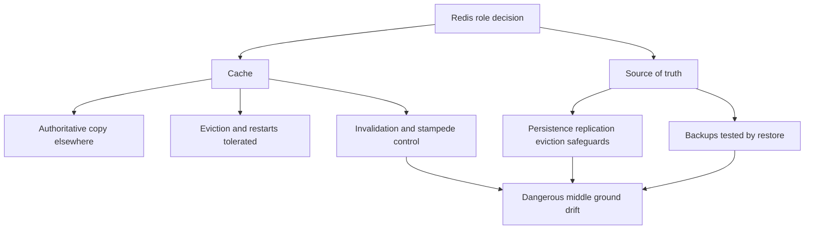

# Redis as a Cache Versus a Source of Truth: The Consequences of Choosing

## English

The single most consequential design decision with Redis is whether it is allowed to lose data. Calling it a cache means the authoritative copy lives elsewhere — a relational database, an object store — and Redis holds a disposable, faster mirror. Calling it a source of truth means Redis holds the only copy, and every durability and availability property of your system now depends on it. The same server binary serves both roles, which is exactly why teams drift from one to the other without noticing.

In the cache role, the rules are liberating: eviction under memory pressure is fine, a cold restart that empties the dataset is an inconvenience rather than a disaster, and you can run without persistence entirely. The hard part moves to cache invalidation and stampede control — keeping the mirror consistent enough with the origin, and surviving the moment when a popular key vanishes and a thousand requests hit the database at once. Reads typically follow a pattern of checking Redis, falling back to the origin on a miss, and writing the result back with a TTL.

In the source-of-truth role, everything tightens. Persistence becomes mandatory and must be tuned: append-only logging with an appropriate fsync policy trades write latency for how much you can lose on a crash, and snapshots alone leave a window of loss. Replication becomes a requirement for availability, not just read scaling. Eviction policies that discard keys become dangerous — an eviction in a source-of-truth deployment is silent data loss, so you must configure a policy that refuses writes instead, and monitor memory headroom as a first-class alert. Backups must be tested by actually restoring them, because a backup that has never been restored is a hypothesis, not a backup.

The dangerous middle ground is the accidental source of truth: a team builds a cache, then starts storing session state, job queues, rate-limit counters, and feature flags in it, and one day discovers that a flush has logged everyone out, dropped pending jobs, and reset quotas. The tell is asking, for each key family, what happens if this key disappears right now. If the answer is a user-visible incident, it is not a cache, whatever the deployment is called.

A useful practice is to classify key families explicitly in documentation: authoritative, derived-and-rebuildable, or ephemeral. Authoritative families get persistence, replication, and no eviction. Derived families get TTLs and a documented rebuild path. Ephemeral families get eviction and nothing else. This single classification prevents most of the arguments that later become outages.

## 中文

使用 Redis 時最具影響力的單一設計決定，就是它是否被允許遺失資料。把它當快取，意味著權威副本存在別處——關聯式資料庫、物件儲存——而 Redis 持有的是一份可丟棄、更快的鏡像。把它當真實來源，意味著 Redis 持有唯一副本，而你系統的每一項持久性與可用性屬性從此都依賴它。同一個伺服器二進位檔同時扮演這兩種角色，這正是為什麼團隊會在不知不覺中從一種漂移到另一種。

在快取角色裡，規則令人解放：記憶體壓力下被驅逐沒關係，一次清空資料集的冷啟動只是不便而非災難，你甚至可以完全不用持久化。難的部分轉移到快取失效與踩踏控制——讓鏡像與來源夠一致，以及在熱門鍵消失、上千個請求同時打到資料庫的那一刻活下來。讀取通常遵循一個模式：先查 Redis，未命中就回退到來源，再把結果連同 TTL 寫回去。

在真實來源角色裡，一切都收緊了。持久化變成強制，而且必須調校：僅追加日誌配上合適的 fsync 策略，是用寫入延遲換取當機時最多能遺失多少；只靠快照則留下一個遺失窗口。複寫變成可用性的必要條件，而不只是讀取擴展。會丟棄鍵的驅逐策略變得危險——真實來源部署中的一次驅逐就是無聲的資料遺失，所以你必須設定成拒絕寫入的策略，並把記憶體餘裕當成第一級告警來監控。備份必須透過真正還原來驗證，因為從未還原過的備份只是假設，不是備份。

危險的中間地帶是「意外的真實來源」：團隊建了一個快取，然後開始把工作階段狀態、任務佇列、限流計數器、功能開關放進去，某天才發現一次清空讓所有人被登出、待處理任務掉光、配額被重置。判斷的方法是，對每一個鍵族問：如果這個鍵現在消失會怎樣？如果答案是使用者可見的事故，那它就不是快取，不管部署被叫什麼名字。

一個實用的做法是在文件中明確分類鍵族：權威的、可重建的衍生物、短暫的。權威鍵族要有持久化、複寫，且不可驅逐。衍生物鍵族要有 TTL 與成文的重建路徑。短暫鍵族只要驅逐，其他都不要。這一個分類就能避免掉大多數日後演變成事故的爭論。

## Key Takeaway

Decide per key family whether Redis is a disposable cache or the authoritative copy, because that choice dictates persistence, eviction, replication, and backup requirements.

## Related Concepts
- Choosing an eviction policy
- Persistence: RDB snapshots versus AOF

## Diagram

