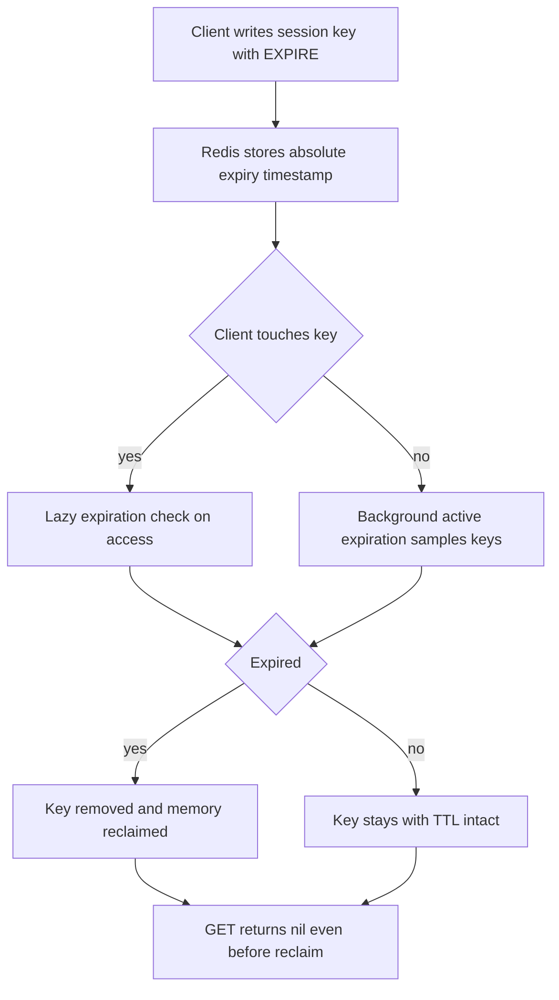

# Expiring Sessions and TTL Semantics: What a Timeout Actually Guarantees

## English

A TTL (time to live) in Redis is not a promise that the key disappears at that instant. When you run EXPIRE or SET with the EX option, Redis records an absolute expiry timestamp in milliseconds. Deletion happens through two paths: lazy expiration, where a key is checked and removed when a client touches it, and active expiration, where a background cycle samples keys with TTLs and removes the expired ones. The practical consequence is that a key can be logically expired yet still occupy memory for a short while, and a GET on an expired key returns nil even before the memory is reclaimed. If you need a value gone at a precise moment, Redis cannot guarantee it — it guarantees only that reads will not return expired data.

The most common real-world use is session storage. A login handler writes a session hash under a key like session:<token>, sets a TTL of, say, 1800 seconds, and every authenticated request does GET or HGETALL on it. If you want sliding sessions (each request extends the lifetime), you call EXPIRE session:<token> 1800 again on each hit. That is a write on every read path, which costs bandwidth and can be avoided by only refreshing when the remaining TTL drops below a threshold, checked with TTL. A fixed-TTL session is cheaper but logs users out mid-work; a sliding session costs a write per request but feels natural. Neither is free, so choose deliberately.

A subtle trap is that many commands clear the TTL. Running SET on an existing key without the KEEPTTL option wipes the expiry, turning a session key into a permanent one that slowly fills memory. Commands that replace the whole value, such as SET or GETSET, behave this way; commands that mutate in place, like HSET or INCR, leave the TTL intact. RENAME is a special case worth calling out: it does not clear the expiry, it transfers it — the destination key inherits the source key's TTL, and if the source had no TTL the destination ends up with no TTL either, even if the old destination key had one. Before you deploy, audit every code path that writes to a key that is supposed to expire, and prefer SET key value EX 1800 in a single atomic call rather than a SET followed by a separate EXPIRE, which leaves a window where the key has no expiry if the client crashes between the two commands.

TTLs also interact with persistence and replication. An expired key is not written to RDB snapshots, and when a primary expires a key it sends an explicit DEL to replicas rather than relying on them to expire it themselves. This keeps replicas consistent with the primary, but it means a replica that is disconnected can briefly serve data the primary has already deleted. For session data that is a minor risk; for anything security-sensitive, treat the TTL as a cleanup mechanism, not an authorization boundary.

Finally, remember that a TTL is per key, not per field. If a session hash stores a login time, a last-seen time, and a cart, all three share one clock. If different parts of the session need different lifetimes, split them into separate keys with their own TTLs, or accept the coarsest lifetime that is safe for all of them. Designing the key layout around the lifetime you need is easier than fighting the semantics later.

## 中文

Redis 的 TTL（time to live，存活時間）並不是承諾鍵會在某個瞬間消失。當你執行 EXPIRE，或用帶 EX 選項的 SET 時，Redis 會以毫秒記錄一個絕對的到期時間戳。刪除會經由兩條路徑發生：惰性過期（lazy expiration），即客戶端接觸該鍵時才檢查並移除；以及主動過期（active expiration），即背景週期抽樣帶 TTL 的鍵並清除已過期者。實際後果是：一個鍵可以在邏輯上已過期，卻仍短暫佔用記憶體；而在記憶體被回收之前，對已過期鍵做 GET 就已經回傳 nil。若你需要某個值在精確時刻消失，Redis 無法保證——它只保證讀取不會回傳已過期的資料。

最常見的實際用途是會話儲存（session storage）。登入處理器把會話雜湊寫在 session:<token> 這類鍵下，設定 TTL 例如 1800 秒，之後每個已驗證請求都對它做 GET 或 HGETALL。若你想要滑動式會話（每次請求延長壽命），就在每次命中時再呼叫 EXPIRE session:<token> 1800。這等於在每條讀取路徑上都做一次寫入，耗費頻寬；可以改用 TTL 檢查剩餘時間，只在低於門檻時才刷新，以避免此開銷。固定 TTL 的會話較便宜，但會讓使用者在工作中被登出；滑動式會話每請求一次寫入，卻較自然。兩者都有代價，所以要刻意選擇。

一個微妙的陷阱是：許多指令會清除 TTL。對已存在的鍵執行不帶 KEEPTTL 選項的 SET，會抹掉到期時間，把會話鍵變成永久鍵，慢慢填滿記憶體。會替換整個值的指令（例如 SET、GETSET）就是這種行為；而就地變更的指令（例如 HSET 或 INCR）則保留 TTL。RENAME 是個特別值得留意嘅例外：佢唔係清除到期時間，而係轉移——目標鍵會繼承來源鍵的 TTL，如果來源鍵冇 TTL，目標鍵最終亦都冇 TTL，即使原本嗰個目標鍵有。部署前，請稽核每一條會寫入「本應過期之鍵」的程式路徑，並優先採用單一原子呼叫 SET key value EX 1800，而不是先 SET 再另外 EXPIRE——因為若客戶端在兩個指令之間崩潰，就會留下一個沒有到期時間的鍵。

TTL 也與持久化和複寫互動。已過期的鍵不會寫入 RDB 快照；而當主節點（primary）讓某鍵過期時，它會向複本（replica）送出明確的 DEL，而不是依賴複本自行過期。這讓複本與主節點保持一致，但也意味著一個斷線的複本可能短暫提供主節點已刪除的資料。對會話資料而言風險不大；但對任何安全敏感的資料，請把 TTL 當成清理機制，而非授權邊界。

最後，請記住 TTL 是針對「鍵」而非「欄位」。若一個會話雜湊存了登入時間、最後活動時間與購物車，三者共用同一個時鐘。若會話的不同部分需要不同壽命，就把它們拆成各自帶 TTL 的獨立鍵，或接受對所有部分都安全的最粗略壽命。依你需要的壽命來設計鍵的佈局，會比事後與語意搏鬥容易得多。

## Key Takeaway

A Redis TTL guarantees only that expired data will not be returned by reads, not that memory is freed at that exact instant, so design key layouts and refresh strategies around that distinction.

## Related Concepts
- Lazy vs Active Expiration
- Session Management

## Diagram

