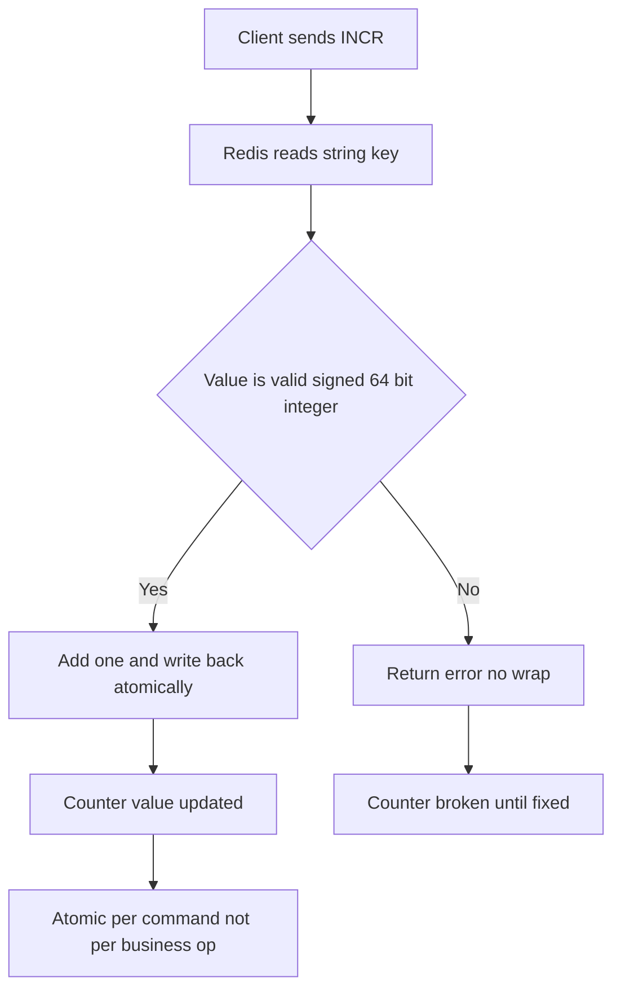

# Counting Visitors Without Counting Wrong: INCR, Overflow, and the Limits of Atomicity

## English

INCR is the command most people learn first after GET and SET, and it is genuinely useful: it reads a string key, parses it as a 64-bit signed integer, adds one, and writes it back, all atomically with respect to other clients. That atomicity is the reason people reach for Redis instead of a relational UPDATE counter. But atomic does not mean correct in every sense. The value is a signed 64-bit integer, so it ranges from about negative 9.2 quintillion to positive 9.2 quintillion. If a key somehow holds a string that is not an integer, or a number outside that range, INCR fails with an error rather than silently wrapping. That is a safety net, but it also means a stray SET on a counter key can break every subsequent increment until someone notices.

A more common correctness problem is that INCR is atomic per command, not per business operation. If a request handler does INCR pageviews then INCR unique_visitors, a crash between the two leaves the counters inconsistent. Wrapping them in MULTI/EXEC or a Lua script makes the pair atomic, but neither makes the pair durable against a Redis crash unless persistence is configured to fsync on every write, which most deployments do not do. A counter that loses a few increments during a failover is usually acceptable for analytics; a counter that drives billing or quota enforcement is not. Decide which kind you are building before you pick the tool.

Counters also expose the difference between approximate and exact counting. If you want to know how many distinct users visited today, INCR on a single key cannot tell you — it counts events, not people, and the same user refreshing ten times adds ten. Redis offers a few answers: a set of user IDs is exact but grows with the number of users; a HyperLogLog is fixed-size (around 12 KB regardless of cardinality) but approximate, with a typical error well under one percent; a bitmap indexed by user ID is exact and compact if IDs are dense small integers, but wasteful if they are sparse 64-bit hashes. Choosing among them is a cardinality-versus-precision trade, and it is worth thinking about before the data arrives.

There is a further subtlety with counters that expire. If you use a key like counter:2024-06-01 and set a TTL so old days are cleaned up, remember that INCR on a missing key creates it with value 1 and no TTL — the TTL you set yesterday is gone if the key was deleted and recreated. A safer pattern is to INCR first and then call EXPIRE only when the counter is new, which you can detect by checking whether INCR returned 1, or to use a Lua script that does both atomically. Otherwise a busy counter can silently become permanent.

Finally, counters are a shared mutable resource, and shared mutable resources invite contention. A single hot counter incremented by every request on every server becomes a serialization point, because Redis executes commands one at a time. At very high rates this is fine — Redis can do hundreds of thousands of INCRs per second — but it is not free, and sharding the counter across N keys and summing on read spreads the load at the cost of read complexity. The right design depends on whether you need the exact total at every instant or only a good-enough number refreshed periodically.

## 中文

INCR 是大多數人在學完 GET 與 SET 之後最先接觸的指令，而且它確實有用：它讀取一個字串鍵，解析成 64 位元有號整數，加一，再寫回，整個過程相對於其他客戶端是原子的。這份原子性正是人們選用 Redis 而非關聯式 UPDATE 計數器的原因。但「原子」並不代表在所有意義上都「正確」。該值是 64 位元有號整數，範圍大約從負 9.2 百京到正 9.2 百京。若某個鍵存了不是整數的字串，或超出此範圍的數字，INCR 會回傳錯誤，而不是默默溢位。這是一層安全網，但也意味著對計數器鍵的一次誤寫 SET，會讓之後每一次遞增都失敗，直到有人發現為止。

更常見的正確性問題是：INCR 是「每個指令」原子，而非「每個業務操作」原子。若一個請求處理器先 INCR pageviews 再 INCR unique_visitors，兩者之間若崩潰，計數器就會不一致。用 MULTI/EXEC 或 Lua 指令碼包住可讓這一對原子化，但除非持久化設定成每次寫入都 fsync（大多數部署並不會），否則兩者都無法讓這一對在 Redis 崩潰時保持耐久。在故障轉移時丟失幾次遞增，對分析用途通常可接受；但對驅動帳單或配額強制的計數器則不可接受。在選工具之前，先決定你在建哪一種。

計數器也暴露了「近似計數」與「精確計數」的差別。若你想知道今天有多少「不同」使用者來訪，單一鍵上的 INCR 無法告訴你——它計的是事件，不是人，同一個使用者重新整理十次就加十。Redis 提供幾種答案：存使用者 ID 的集合精確，但隨使用者數成長；HyperLogLog 大小固定（無論基數多大約 12 KB）但為近似，典型誤差遠低於百分之一；以使用者 ID 為索引的點陣圖（bitmap）在 ID 是稠密小整數時既精確又緊湊，但若 ID 是稀疏的 64 位元雜湊就很浪費。在這些之間取捨，是基數與精確度之間的權衡，值得在資料進來之前就想清楚。

計數器與到期時間還有一層微妙互動。若你使用像 counter:2024-06-01 這樣的鍵並設 TTL 以清理舊日期，請記得：對不存在的鍵做 INCR 會以值 1 建立它，且沒有 TTL——若該鍵曾被刪除又重建，你昨天設的 TTL 就沒了。較安全的模式是先 INCR，然後只在計數器是新建時才呼叫 EXPIRE（可藉由檢查 INCR 是否回傳 1 來判斷），或用 Lua 指令碼把兩者原子地一起做。否則一個繁忙的計數器可能悄悄變成永久鍵。

最後，計數器是共享的可變資源，而共享可變資源會招來競爭。一個被每臺伺服器上每個請求遞增的熱門計數器，會成為序列化點，因為 Redis 一次只執行一個指令。在極高頻率下這通常沒問題——Redis 每秒可做數十萬次 INCR——但並非免費；把計數器分片到 N 個鍵、讀取時再相加，可分散負載，代價是讀取變複雜。正確設計取決於你需要「每個瞬間的精確總數」，還是「定期重新整理、夠用就好」的數字。

## Key Takeaway

INCR is atomic per command but not per business operation, so pair related counters in a transaction or script, and choose exact versus approximate counting structures deliberately.

## Related Concepts
- Atomic Operations
- HyperLogLog

## Diagram

