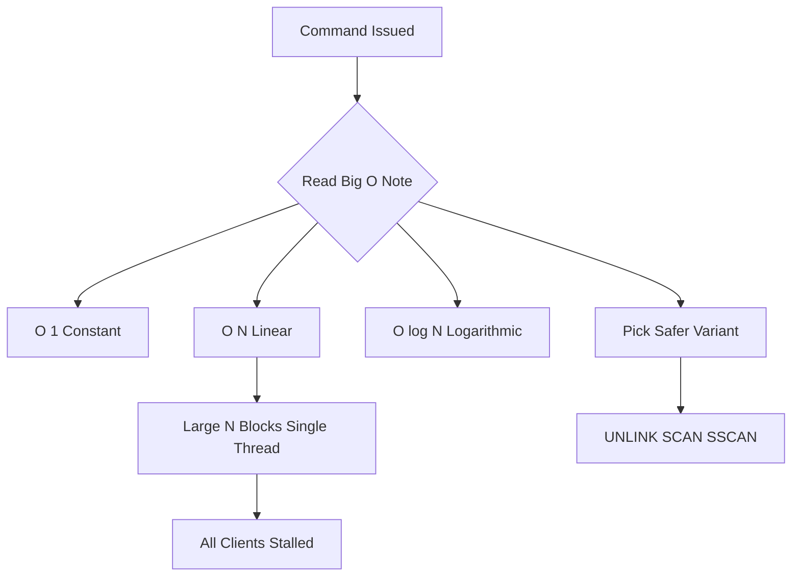

# Reading a Redis Command's Cost Before It Hurts: Big-O, Key Size, and the Shape of Your Data

## English

Every Redis command page lists a time complexity, usually in Big-O notation — the way computer scientists describe how running time grows as input size grows. O(1) means constant time regardless of size; O(N) means time proportional to the number of elements; O(log N) means it grows slowly, like a binary search. Because Redis executes commands on a single thread, a command that is O(N) with a large N does not just slow itself down — it blocks every other client for the duration. Learning to read these notes is the single highest-leverage skill for keeping a Redis deployment healthy, and it costs nothing but attention.

Consider DEL versus UNLINK. Both remove a key, but DEL frees the value synchronously, so deleting a list with a million elements takes time proportional to a million and stalls the server. UNLINK removes the key from the keyspace immediately and hands the actual memory reclamation to a background thread, so the client gets an answer quickly. Similarly, KEYS pattern walks the entire keyspace and is O(N) in the number of keys — on a database with ten million keys it can freeze Redis for seconds. SCAN, by contrast, returns a small batch and a cursor, so the work is spread across many calls and no single call blocks for long. The data you delete or enumerate is the same; the cost profile is completely different.

Collection commands have their own traps. LRANGE key 0 -1 on a list with a million items returns a million items in one reply, which is O(N) in time and also O(N) in network bytes — the client may time out, and the server buffers the whole reply in memory while sending it. LLEN is O(1). SMEMBERS on a large set is O(N); SSCAN lets you iterate. ZRANGE with a small index range is O(log N + M) where M is the number of returned elements, so asking for the top ten of a million-element sorted set is cheap, while asking for all of them is expensive. The lesson is not to avoid big collections but to query them in bounded slices.

The shape of a key matters as much as the command. A hash with a handful of fields is stored compactly; a hash with a million fields is not, and commands like HGETALL become O(N). A sorted set with a few thousand members uses a compact encoding; beyond a threshold it switches to a skiplist plus hash table, using more memory per element. These thresholds are configurable, and knowing they exist explains why a dataset that fits comfortably in development can balloon in production. The same logical data can cost ten times more memory depending on how many elements you pack into one key versus spreading them across many keys.

A practical habit: before adding a new command to a hot path, look up its complexity, estimate the worst-case size of the key it touches, and ask whether that product is acceptable. If a command is O(N) and N can grow without bound, either bound N by design (cap list length with LTRIM, cap set size, expire old data) or switch to an incremental alternative like SCAN, UNLINK, or a range query with explicit limits. Redis will happily run whatever you send; the discipline of keeping commands small is yours to supply.

## 中文

每個 Redis 指令頁面都會列出時間複雜度，通常以 Big-O 記法表示——也就是電腦科學家用來描述「執行時間如何隨輸入規模成長」的方式。O(1) 表示無論大小都是常數時間；O(N) 表示時間與元素數量成正比；O(log N) 表示成長緩慢，像二分搜尋。因為 Redis 在單一執行緒上執行指令，一個 O(N) 且 N 很大的指令不只拖慢自己——它會在整段期間阻塞所有其他客戶端。學會讀這些註記，是維持 Redis 部署健康、槓桿最高的單一技能，而且只需付出注意力。

比較 DEL 與 UNLINK。兩者都移除鍵，但 DEL 同步釋放值，所以刪除一個百萬元素的清單會花與百萬成正比的時間，並卡住伺服器。UNLINK 立即從鍵空間移除該鍵，把實際的記憶體回收交給背景執行緒，因此客戶端很快得到回應。同樣地，KEYS pattern 會走訪整個鍵空間，對鍵的數量是 O(N)——在有一千萬個鍵的資料庫上，它可能讓 Redis 凍結數秒。相對地，SCAN 回傳一小批結果與一個遊標，把工作分散到多次呼叫，因此沒有單次呼叫會長時間阻塞。你刪除或列舉的資料相同，成本輪廓卻完全不同。

集合類指令有其自身陷阱。對一個百萬項的清單執行 LRANGE key 0 -1，會在單一回覆中回傳一百萬項，時間上是 O(N)，網路位元組上也是 O(N)——客戶端可能逾時，而伺服器在傳送期間會把整個回覆緩衝在記憶體中。LLEN 是 O(1)。對大型集合執行 SMEMBERS 是 O(N)；SSCAN 讓你逐步迭代。帶小索引範圍的 ZRANGE 是 O(log N + M)，其中 M 是回傳元素數，所以從百萬元素的排序集合取前十名很便宜，取全部則很貴。教訓不是避開大型集合，而是以有界的切片查詢它們。

鍵的形狀與指令同樣重要。只有少量欄位的雜湊會緊湊儲存；有百萬欄位的雜湊則不然，而 HGETALL 這類指令會變成 O(N)。只有幾千成員的排序集合使用緊湊編碼；超過門檻就切換成跳錶加雜湊表，每個元素耗用更多記憶體。這些門檻是可設定的，知道它們存在，就能解釋為何在開發環境輕鬆放得下的資料集，在生產環境會膨脹。同樣的邏輯資料，視你把多少元素塞進一個鍵、或分散到許多鍵，記憶體成本可相差十倍。

一個實用習慣：在把新指令加入熱路徑之前，先查它的複雜度，估計它觸及的鍵的最壞情況大小，並問這個乘積是否可接受。若某指令是 O(N) 且 N 可無界成長，就用設計把 N 綁住（用 LTRIM 限制清單長度、限制集合大小、讓舊資料過期），或改用增量式替代方案，如 SCAN、UNLINK，或帶明確上限的範圍查詢。Redis 會樂意執行你送出的任何東西；把指令保持小規模的紀律，得由你提供。

## Key Takeaway

Because Redis runs commands one at a time, reading each command's Big-O complexity and bounding the size of the keys it touches is the cheapest way to prevent one slow call from stalling the whole server.

## Related Concepts
- Command Complexity
- Single-Threaded Execution

## Diagram

