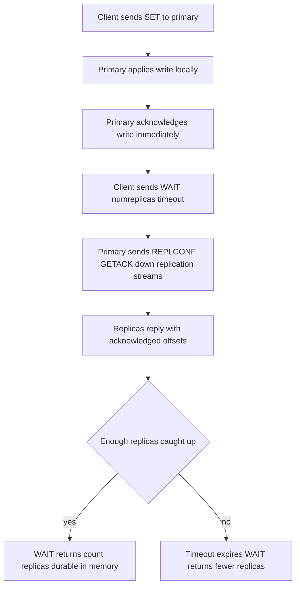

# WAIT and the Replication Handshake: How a Client Learns That a Write Is Durable Elsewhere

## English

When you write to a primary and a replica is configured, the primary acknowledges the write the moment it is applied locally — not when the replica has it. That gap is the source of a whole class of bugs: a client writes a value, immediately reads from a replica, and gets the old value back. Redis offers a small, easily overlooked command to close the gap for a single client: WAIT numreplicas timeout. It blocks the calling client until either the given number of replicas have acknowledged all writes issued earlier on that same connection, or the timeout in milliseconds elapses; it returns the number of replicas that actually acknowledged. The key subtlety is 'on that same connection': WAIT is not a global barrier. It asks the primary to send a REPLCONF GETACK request down each replication stream and waits for the replies, and it only counts offsets the client's own connection has already produced. If another client wrote something after your last command, WAIT may well return before that other write reaches any replica.

A concrete example: you have one primary and two replicas, and you want a write to survive the loss of the primary. You send SET order:42 confirmed, then WAIT 1 100. If one replica has caught up within 100 ms, WAIT returns 1 and you can tell the user the order is recorded in at least two places. If it returns 0, the timeout expired — you know the write is only on the primary, and you can decide whether to fail the request, retry, or proceed with a warning. Notice that WAIT does not make the write durable on disk: replicas may have it only in memory, and a replica that later crashes without persistence loses it. Durability has two independent axes — copies in memory elsewhere, and bytes on disk — and WAIT only addresses the first.

Why is WAIT not the default? Because blocking costs latency. A synchronous replication scheme would make every write pay the slowest replica's round trip, which is exactly the cost Redis is designed to avoid. WAIT gives you a per-call, opt-in trade: pay one round trip only where correctness demands it. A useful pattern is to call WAIT only for writes that matter (payments, state transitions) and skip it for cache fills and counters where a lost update is tolerable.

A few practical cautions. In Redis Cluster, WAIT only talks to replicas of the shard that owns the key you last wrote — it is not a cluster-wide quorum, and there is no cross-shard coordination. WAIT does not block when it is sent inside a MULTI/EXEC block: rather than waiting, it returns immediately with the number of replicas that had already acknowledged the preceding writes. The same applies to any other non-blocking context, such as inside a Lua script, since Redis 7.0. And if you use WAIT with a timeout of 0, it blocks forever, which is a fine way to turn a replica outage into a client outage. Treat the timeout as a deadline you can defend, and treat a short return value as a signal to your application, not an error to swallow.

The mental model that makes all of this stick: replication in Redis is asynchronous by design, and WAIT is a per-client probe you insert at the points where asynchronous is not good enough. It does not change the system's nature; it just lets one caller ask, 'has my work reached N other machines yet?' and get an honest answer.

## 中文

當你向 primary 寫入資料，而系統設有 replica 時，primary 在你本地套用寫入的那一刻就回覆成功——而不是等到 replica 也收到。這個時間差正是整類錯誤的根源：客戶端寫入一個值，隨即從 replica 讀取，卻拿到舊值。Redis 提供了一個細小、容易被忽略的命令來為單一客戶端收窄這個差距：WAIT numreplicas timeout。它會阻塞發出呼叫的客戶端，直到指定數量的 replica 確認了「同一條連線上較早前發出的所有寫入」，或者直到以毫秒計的 timeout 屆滿；它回傳真正確認了的 replica 數目。關鍵微妙之處在於「同一條連線」：WAIT 不是全域屏障。它要求 primary 沿每條複製串流送出 REPLCONF GETACK 請求並等待回覆，而且只計算該客戶端連線本身已產生的偏移量。若另一個客戶端在你最後一個命令之後寫入了東西，WAIT 很可能在該另一筆寫入到達任何 replica 之前就回傳了。

具體例子：你有一個 primary 和兩個 replica，想讓一筆寫入能承受 primary 失效。你送出 SET order:42 confirmed，然後 WAIT 1 100。若有一個 replica 在 100 毫秒內追上，WAIT 回傳 1，你就可以告訴用戶訂單已記錄在至少兩個地方。若回傳 0，代表逾時——你知道這筆寫入只在 primary 上，可以決定要讓請求失敗、重試，還是帶著警告繼續。注意 WAIT 並不使寫入在磁碟上持久：replica 可能只在記憶體中有它，而之後在沒有持久化的情況下崩潰的 replica 會失去它。持久性有兩條獨立的軸——記憶體中另有副本，以及磁碟上的位元組——而 WAIT 只處理第一條。

為何 WAIT 不是預設？因為阻塞有延遲成本。同步複製方案會令每筆寫入都要付最慢 replica 的來回時間，而這正是 Redis 刻意避免的成本。WAIT 給你的是每次呼叫、可選的取捨：只在正確性有要求的地方付一次來回。一個實用模式是只對重要的寫入（付款、狀態轉換）呼叫 WAIT，而對快取填充和計數器（丟失一次更新可接受）則略過。

幾點實務警告。在 Redis Cluster 中，WAIT 只與擁有你最後寫入的那個鍵所屬分片的 replica 通訊——它不是叢集範圍的 quorum，也沒有跨分片協調。當 WAIT 在 MULTI/EXEC 區塊中送出時，它不會阻塞：它會立即回傳當時已確認前面寫入的 replica 數量。相同的情況也適用於其他不允許阻塞的上下文（例如在 Lua 腳本之內），自 Redis 7.0 起。而若你用 timeout 為 0 的 WAIT，它會永遠阻塞，這正好是把 replica 故障變成客戶端故障的好方法。把 timeout 當成你能夠辯護的截止時間，並把偏短的回傳值當成給應用程式的訊號，而不是可以吞掉的錯誤。

讓這一切牢牢記住的心智模型是：Redis 的複製本質上是異步的，而 WAIT 是你在「異步不夠好」的位置插入的每客戶端探針。它不改變系統的本質；它只是讓某個呼叫者問一句「我的工作到達另外 N 部機器了嗎？」，並得到誠實的答案。

## Key Takeaway

WAIT is a per-connection, opt-in probe that tells you how many replicas have acknowledged your own writes — it narrows the async replication gap for one caller but does not make Redis synchronously replicated or disk-durable.

## Related Concepts
- Replication Mechanics
- Read-Your-Writes Consistency

## Diagram

