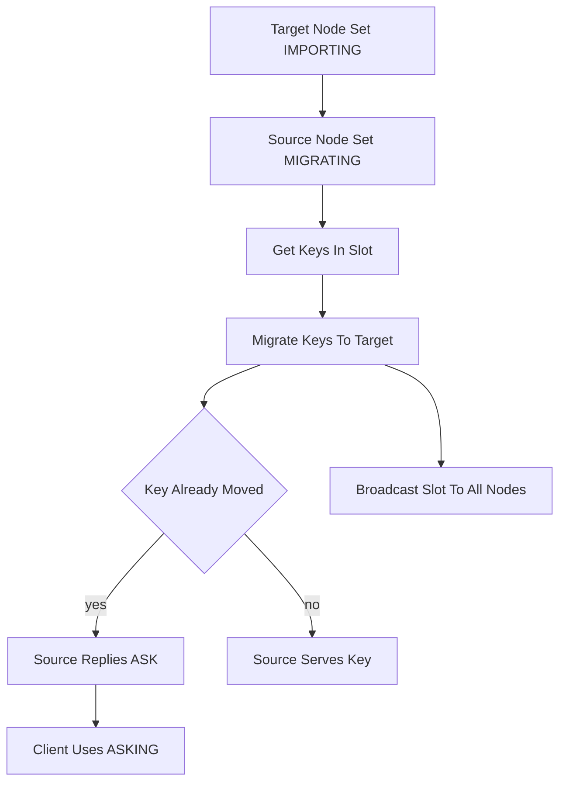

# Cluster Resharding: Moving Hash Slots Without Dropping Requests

## English

A Redis Cluster splits the 16384 hash slots across primaries, and the mapping from key to slot is fixed: CRC16 of the key modulo 16384. What changes over time is which node owns which slot. Resharding is the process of reassigning slots from one primary to another — usually to rebalance after adding a node, to drain a node before decommissioning it, or to fix a lopsided distribution. The command-line tool redis-cli --cluster reshard drives this, and underneath it is a careful, multi-step dance designed so that no client request is silently lost.

Here is the sequence for moving a single slot, and it is worth understanding because every symptom of a botched migration traces back to one of these steps. First, the target node is told to import the slot (CLUSTER SETSLOT slot IMPORTING source-id). Second, the source node is told to migrate it (CLUSTER SETSLOT slot MIGRATING target-id). Third, the tool asks the source for the keys in the slot (CLUSTER GETKEYSINSLOT) and copies them one batch at a time with MIGRATE, which is an atomic move of a key from one node to another. Fourth — and this is the elegant part — during migration the source still owns the slot but only serves keys that still exist there; for a key that has already moved, the source replies with an ASK redirection pointing at the target, and the client is expected to send ASKING to the target first, followed by that one command. Fifth, once all keys are moved, the new owner is broadcast to every node (CLUSTER SETSLOT slot NODE target-id), and the slot's ownership is consistent everywhere.

The distinction between MOVED and ASK is the crux. MOVED means 'this slot permanently lives elsewhere now; update your slot map and stop asking me.' ASK means 'for this one command only, go ask that node, then come back to your normal routing.' A cluster-aware client must handle both; a client that only handles MOVED will fail during the window when keys are mid-flight. This is why resharding is safe for well-behaved clients and dangerous for naive ones — the protocol is designed around the assumption that the client can be redirected.

What can go wrong? If a client sends a multi-key command whose keys span the migrating slot and another slot, Redis returns a CROSSSLOT error regardless of migration — this is why hash tags (curly braces around a common substring, like user:{42}:name and user:{42}:email) exist: they force related keys into the same slot. If the migration tool dies halfway, the slot may be left in MIGRATING or IMPORTING state on some nodes, and you must finish or roll it back manually. If you reshard during heavy write load, the MIGRATE calls compete with normal traffic for the single thread and can spike latency. And if a node is added but never receives slots, it sits idle while the others stay hot.

Practical advice: reshard in small batches during low traffic, watch latency and the cluster's slot coverage (CLUSTER INFO reports cluster_state and slots_assigned), and make sure every client library in your fleet understands ASK. The deeper lesson is that Redis Cluster's consistency comes from a fixed slot function plus a deliberately awkward, redirect-heavy migration protocol. The awkwardness is the safety: at no point does a key exist in two places with ambiguous ownership, and at no point does a client get a silently wrong answer instead of a redirect.

## 中文

Redis Cluster 把 16384 個雜湊槽分配到各個 primary，而鍵到槽的對映是固定的：鍵的 CRC16 對 16384 取模。隨時間改變的是哪個節點擁有哪個槽。重新分片（resharding）就是把槽從一個 primary 重新指派到另一個的過程——通常是為了在新增節點後重新平衡、在退役節點前排空它，或修正傾斜的分佈。命令列工具 redis-cli --cluster reshard 負責驅動這件事，而在它底下是一場小心、多步的舞蹈，設計目標是不讓任何客戶端請求被悄悄丟失。

以下是移動單一槽的步驟，值得理解，因為一次搞砸的遷移的每個症狀都可追溯到其中一步。第一，目標節點被指示匯入該槽（CLUSTER SETSLOT slot IMPORTING source-id）。第二，來源節點被指示遷出它（CLUSTER SETSLOT slot MIGRATING target-id）。第三，工具向來源查詢該槽中的鍵（CLUSTER GETKEYSINSLOT），並用 MIGRATE 一次一批地複製它們，MIGRATE 是把一個鍵從一個節點原子地搬到另一個。第四——這是最優雅的部分——遷移期間來源仍擁有該槽，但只服務仍然存在於那裡的鍵；對於已經搬走的鍵，來源回覆一個指向目標的 ASK 重定向，客戶端應先把 ASKING 送到目標，再送出該單一命令。第五，所有鍵搬完後，新的擁有者被廣播到每個節點（CLUSTER SETSLOT slot NODE target-id），槽的擁有權在各處一致。

MOVED 與 ASK 的區別是關鍵。MOVED 意思是「這個槽現在永久住在別處；更新你的槽對映，別再問我。」ASK 意思是「就這一條命令，去問那個節點，然後回到你正常的路由。」叢集感知的客戶端必須處理兩者；只處理 MOVED 的客戶端會在鍵仍在遷移途中的視窗期失敗。這就是為何重新分片對行為良好的客戶端是安全的，對天真的客戶端則危險——協議是圍繞「客戶端可以被重定向」這個假設設計的。

什麼會出錯？若客戶端送出一個多鍵命令，而其鍵橫跨正在遷移的槽和另一個槽，無論是否遷移，Redis 都會回傳 CROSSSLOT 錯誤——這就是雜湊標籤（用大括號包住共同子字串，例如 user:{42}:name 和 user:{42}:email）存在的原因：它們強制相關的鍵落入同一槽。若遷移工具中途死掉，某些節點上的槽可能停留在 MIGRATING 或 IMPORTING 狀態，你必須手動完成或回滾。若你在高寫入負載下重新分片，MIGRATE 呼叫會與正常流量爭奪單一執行緒，可能令延遲飆升。而若新增了節點卻從未收到槽，它會閒著，其他節點則繼續過熱。

實務建議：在低流量時小批次重新分片，留意延遲和叢集的槽覆蓋情況（CLUSTER INFO 會報告 cluster_state 和 slots_assigned），並確保你整個機群中每個客戶端程式庫都懂 ASK。更深的教訓是：Redis Cluster 的一致性來自一個固定的槽函式，加上一個刻意笨拙、重定向頻繁的遷移協議。笨拙本身就是安全：任何時刻都不會有鍵同時存在於兩處而擁有權含糊，任何時刻客戶端都不會得到悄悄錯誤的答案而不是重定向。

## Key Takeaway

Resharding works because slot ownership is a fixed function plus a redirect protocol — MOVED for permanent moves and ASK for in-flight keys — so a cluster-aware client is never silently wrong, only redirected.

## Related Concepts
- Hash Tags and CROSSSLOT Errors
- Cluster-Aware Clients

## Diagram

