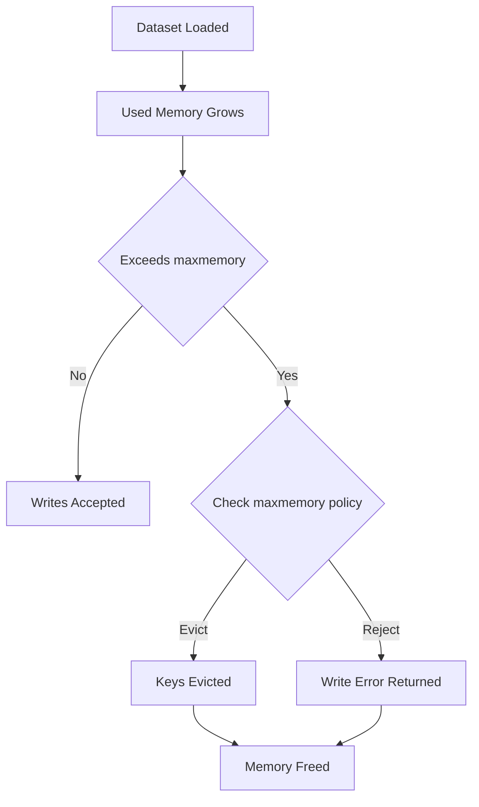

# The Memory Budget: maxmemory, Used Memory, and the Numbers That Actually Matter

## English

Everyone knows Redis keeps data in RAM, but the operational question is sharper: how much RAM will this dataset need, and what happens when it runs out? The first number to understand is maxmemory — the cap Redis enforces. When used memory exceeds it, Redis consults maxmemory-policy and either evicts keys or rejects writes with an error. The second number is what 'used memory' even means. INFO memory reports used_memory (what Redis's allocator believes is allocated for the dataset and overheads), used_memory_rss (the resident set size the operating system sees), and used_memory_peak. These diverge for real reasons: the allocator (jemalloc by default) rounds allocations into size classes, so a 100-byte string may occupy more; freed memory may not be returned to the OS, so RSS stays high after a bulk delete; and fragmentation ratio (rss divided by used) above roughly 1.5 suggests the allocator is holding onto memory it cannot reuse.

The budget is bigger than the data. Every key carries overhead: the key string itself, the value, a redisObject header, and dictionary entries in the main keyspace hash table. Small collections are stored in compact encodings (listpacks and intsets; ziplists were the pre-7.0 name for listpacks) until they cross configurable thresholds, then convert to full structures and can multiply in size. Replication adds output buffers per replica — a slow replica can make the primary buffer a large backlog. Clients add input and output buffers. The dataset you measured on a laptop with a few thousand keys can be several times larger at production scale, and the safest approach is to measure a representative sample with MEMORY USAGE key or MEMORY STATS rather than extrapolate from a naive per-key guess.

When memory runs out, the policy decides the outcome, and the policies are not interchangeable. noeviction returns errors on writes — correct when Redis is a source of truth. allkeys-lru and allkeys-lfu evict any key to make room — correct for a pure cache. volatile-lru and volatile-lfu only evict keys that have a TTL set, which is a trap if most of your keys have no TTL: eviction finds nothing to remove and writes start failing anyway. allkeys-random is rarely what you want. Note that LRU in Redis is approximate: it samples a handful of keys (maxmemory-samples) rather than maintaining a perfect order, which is fine in practice but means 'least recently used' is a statistical claim, not a guarantee.

A subtle and important interaction: eviction removes keys, and that removal fires keyspace notifications and DEL events. If you have subscribers reacting to expirations or deletions, a memory-pressure event can look like a mass deletion. Also, a replica does not evict on its own — it waits for the primary to send DELs — so a replica's maxmemory should generally be set higher than the primary's, or it will hit the cap and start refusing writes that the primary would have accepted.

The practical discipline: set maxmemory below the machine's physical RAM (leave headroom for copy-on-write during RDB saves, which can double the footprint of pages being written), pick a policy that matches whether Redis is a cache or a source of truth, monitor used_memory versus used_memory_rss and the fragmentation ratio, and alert on evictions before users notice missing data. Memory is the resource that fails silently and then all at once.

## 中文

人人都知道 Redis 把資料放在 RAM，但運維上的問題更尖銳：這個資料集需要多少 RAM，用完時會怎樣？第一個要理解的數字是 maxmemory——Redis 強制執行的上限。當已用記憶體超過它，Redis 會查閱 maxmemory-policy，要麼淘汰鍵，要麼以錯誤拒絕寫入。第二個數字是「已用記憶體」到底指什麼。INFO memory 報告 used_memory（Redis 的配置器認為已為資料集和各種開銷配置的記憶體）、used_memory_rss（作業系統看到的常駐集大小）和 used_memory_peak。這些數字會分歧，原因很實在：配置器（預設是 jemalloc）把配置向上取整到大小類別，所以一個 100 位元組的字串可能佔用更多；已釋放的記憶體未必會還給作業系統，所以大量刪除後 RSS 仍然高企；而碎片比率（rss 除以 used）高於約 1.5 就表示配置器正握著無法重用的記憶體。

預算比資料本身大。每個鍵都有開銷：鍵字串本身、值、一個 redisObject 標頭，以及主鍵空間雜湊表中的字典條目。小型集合以緊湊編碼（listpack、intset；ziplist 是 7.0 之前 listpack 的舊稱）儲存，直到跨過可配置的門檻，然後轉為完整結構，大小可以倍增。複製會為每個 replica 增加輸出緩衝——慢的 replica 可令 primary 緩衝大量積壓。客戶端會增加輸入和輸出緩衝。你在筆記型電腦上以幾千個鍵量度到的資料集，在生產規模下可以大好幾倍，最安全的做法是用 MEMORY USAGE key 或 MEMORY STATS 量度具代表性的樣本，而不是從天真的每鍵猜測外推。

記憶體用完時，策略決定結果，而各策略不可互換。noeviction 在寫入時回傳錯誤——當 Redis 是真相來源時這是正確的。allkeys-lru 和 allkeys-lfu 淘汰任何鍵來騰出空間——對純快取是正確的。volatile-lru 和 volatile-lfu 只淘汰設有 TTL 的鍵，若你大部分鍵都沒有 TTL，這就是陷阱：淘汰找不到東西可移除，寫入照樣開始失敗。allkeys-random 很少是你想要的。注意 Redis 的 LRU 是近似的：它抽樣少數鍵（maxmemory-samples）而不是維持完美次序，實務上沒問題，但意味著「最近最少使用」是統計上的主張，不是保證。

一個微妙而重要的互動：淘汰會移除鍵，而移除會觸發鍵空間通知和 DEL 事件。若你有訂閱者對過期或刪除作出反應，一次記憶體壓力事件看起來就像大規模刪除。另外，replica 不會自行淘汰——它等待 primary 送出 DEL——所以 replica 的 maxmemory 一般應設得比 primary 高，否則它會撞到上限並開始拒絕 primary 本來會接受的寫入。

實務紀律：把 maxmemory 設在機器實體 RAM 以下（為 RDB 儲存期間的寫時複製留餘裕，它可令正在寫入的頁面佔用翻倍），選一個符合 Redis 是快取還是真相來源的策略，監控 used_memory 對比 used_memory_rss 和碎片比率，並在用戶發現資料不見之前對淘汰發出警報。記憶體是那種先悄悄失敗、然後一次過全面失敗的資源。

## Key Takeaway

Budget for overhead and fragmentation, not just payload: set maxmemory with headroom for copy-on-write, choose an eviction policy that matches whether Redis is a cache or a source of truth, and watch used_memory versus RSS and eviction counts before users notice missing data.

## Related Concepts
- Eviction Policies
- Memory Fragmentation and jemalloc

## Diagram

